# APMon — ArduPilot Telemetry Monitor for EdgeTX radios

[English](README.md) | **Deutsch**

[](LICENSE)

**Telemetrie für ArduPilot auf RadioMaster-Fernsteuerungen mit EdgeTX.**
APMon ist für **ExpressLRS im MAVLink-Modus** ausgelegt. Es zeigt Akkudaten,
Fluglage, GPS-Status und Meldungen des Flugcontrollers an. Dazu liest es die
EdgeTX-Sensoren und ausgewählte ArduPilot-Passthrough-Daten, nicht den
vollständigen MAVLink-Datenstrom. Die Anwendung besteht aus Lua-Skripten auf der
SD-Karte und benötigt zur Laufzeit weder einen Laptop noch ein zusätzliches
Skript im Flugcontroller.

Der aktuelle Projektstand ist **Version 1.0.0**, siehe [VERSION](VERSION).
Siehe [Release-Notizen zu v1.0.0](releases/v1.0.0.md).

Die GUI unterstützt **Englisch und Deutsch**. Englisch ist die Standardsprache.

**Entwicklung mit KI-Unterstützung:** OpenAI Codex CLI half bei der Erstellung
und Überarbeitung von Quellcode, Tests und Dokumentation. Das ersetzt keine
Hardwaretests. Der aktuelle Prüfstand steht im Abschnitt zur Kompatibilität.

## Inhalt

- [Passende Displayvariante wählen](#passende-displayvariante-wählen)
- [Screenshots](#screenshots)
- [Funktionen](#funktionen)
- [Kompatibilität und Voraussetzungen](#kompatibilität-und-voraussetzungen)
- [Installation](#installation)
- [Bedienung](#bedienung)
- [Sensoren konfigurieren](#sensoren-konfigurieren)
- [Bedeutung und Gültigkeit der Daten](#bedeutung-und-gültigkeit-der-daten)
- [Fehlersuche](#fehlersuche)
- [Entwicklung und Tests](#entwicklung-und-tests)
- [Mitwirken](#mitwirken)
- [Lizenz](#lizenz)

## Passende Displayvariante wählen

| Paket | Display / Oberfläche | Referenzsender |
| --- | --- | --- |
| [APMon-SW.zip](APMon-SW.zip) | Telemetrieskript mit Übersicht, Flugwerten und HUD für Schwarzweißdisplays (128 × 64 Pixel) | RadioMaster GX12 und Boxer |
| [APMon-COLOR.zip](APMon-COLOR.zip) | Dashboard-Widget für Farbdisplays (Widget-Zone mindestens 440 × 252 Pixel) | RadioMaster GX15 und TX15 (480 × 320), TX16S MK3 (800 × 480) |

**SW** steht für *Schwarzweiß*. Paket und Deployment-Option richten sich nach
dem **Displaytyp**, nicht nach dem Sendernamen: `--display sw` installiert das
Telemetrieskript, `--display color` das Farbwidget. Andere RadioMaster-Sender
können funktionieren, wenn sie die unten genannten Voraussetzungen erfüllen.
Ein passendes Display allein bedeutet nicht, dass der Sender getestet wurde.

## Screenshots

Echte Aufnahmen von GX12, GX15 und TX16S MK3.
Die Werte zeigen den Aufnahmezustand und sind keine Aussage zur Flugbereitschaft.

**Schwarzweiß — GX12 (128 × 64, APMon v1.0.0)**

Die Bilder sind zur besseren Lesbarkeit vergrößert. In beiden Aufnahmen ist
die Senderuhr eingeblendet.

| Übersicht (1/3) | Flugwerte (2/3) |
| --- | --- |
| 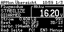 | 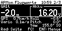 |

**Kompaktes Projektmenü:**

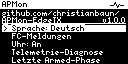

Weitere GX12-Aufnahmen: [HUD](#hud), [FC-Meldungsfilter](#senderuhr-und-fc-meldungsverlauf),
[GPS-Details](#gps-details),
[Telemetrie-Diagnose](#telemetrie-diagnose),
[Einrichtungscheck](#einrichtungscheck-für-telemetriequellen),
[Diagnosebericht](#diagnosebericht) und
[Zusammenfassung nach dem Entarmen](#zusammenfassung-nach-dem-entarmen).

**Farbdisplay — GX15 (480 × 320, APMon v1.0.0)**

| Übersicht (1/2) mit Senderuhr | Projektmenü |
| --- | --- |
| 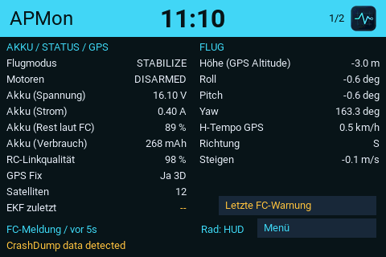 | 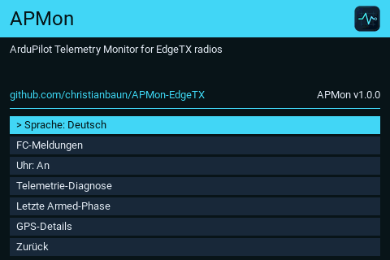 |

Weitere GX15-Aufnahmen: [HUD](#hud), [FC-Meldungsfilter](#senderuhr-und-fc-meldungsverlauf),
[GPS-Details](#gps-details),
[Telemetrie-Diagnose](#telemetrie-diagnose),
[Einrichtungscheck](#einrichtungscheck-für-telemetriequellen),
[Diagnosebericht](#diagnosebericht) und
[Zusammenfassung nach dem Entarmen](#zusammenfassung-nach-dem-entarmen).

**Farbdisplay — TX16S MK3 (800 × 480, APMon v1.0.0)**

| Übersicht (1/2) mit Senderuhr | Projektmenü |
| --- | --- |
| 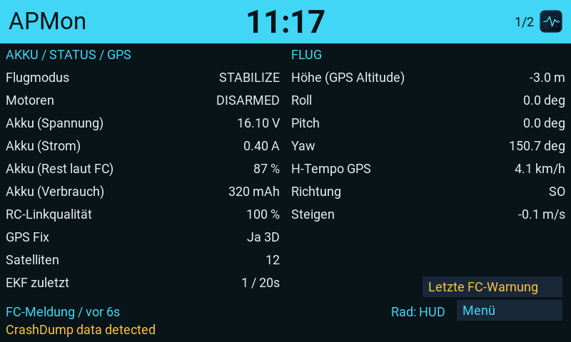 | 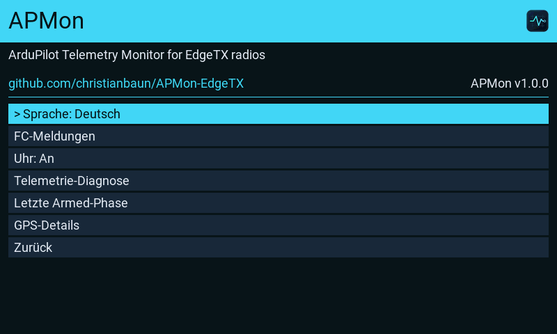 |

Weitere TX16S-MK3-Aufnahmen: [HUD](#hud), [Armed-Bilanz](#zusammenfassung-nach-dem-entarmen),
[GPS-Details](#gps-details), [FC-Meldungen](#senderuhr-und-fc-meldungsverlauf),
[Telemetrie-Diagnose](#telemetrie-diagnose),
[Einrichtungscheck](#einrichtungscheck-für-telemetriequellen) und [Diagnosebericht](#diagnosebericht).

**Sprache wechseln:** Auf SW-Displays **ENTER** drücken und **Sprache /
Language** auswählen. Auf COLOR-Displays APMon im Vollbild öffnen und
**Menü → Sprache** wählen. Dauerhaft gilt dort **Widget-Einstellungen → Language**.

## Funktionen

- **Akku:** Spannung, Strom, vom FC gemeldete Restladung und verbrauchte mAh.
- **Flug:** ausgeschriebener Flugmodus, Armed/Disarmed, Höhe, Roll, Pitch, Yaw,
  horizontales GPS-Tempo, Steigen und Himmelsrichtung aus Yaw.
- **[GPS-Details](#gps-details):** Koordinaten, bestätigter Fixtyp, Satellitenzahl
  und GPS-Kurs. Nach einem Ausfall bleibt die letzte bestätigte Position sichtbar.
- **FC-Status:** letzte Textmeldung und zuletzt gemeldeter EKF-Quellensatz,
  jeweils mit Alter der Meldung.
- **RC-Linkqualität:** Anteil empfangener Steuerpakete in Prozent.
- **Telemetrie-Diagnose:** Zustand von RC-Link, EdgeTX-Sensoren und FC-Status
  getrennt prüfen, den [Einrichtungscheck](#einrichtungscheck-für-telemetriequellen)
  öffnen oder einen [Diagnosebericht speichern](#diagnosebericht).
- **Letzte Armed-Phase:** Dauer und gemessene Extremwerte nach dem Entarmen
  im Projektmenü nachsehen.
- **Sprachwahl:** direkt am Sender. Weitere Sprachen können zentral ergänzt werden.

APMon sendet **keine Flugbefehle, Parameteränderungen oder Telemetrieanfragen**.
Es verändert keine Modell- oder FC-Einstellungen. SW speichert Sprache und
Uhreinstellung auf der SD-Karte. Beide Varianten schreiben einen Bericht nur
auf ausdrücklichen Wunsch.

**Grenzen:** LiDAR-Bodenabstand, Optical-Flow-Rohdaten, VTX-Frequenz, Band/Kanal
und PIT werden derzeit nicht angezeigt. Die vorhandenen Konfigurationseinträge
allein schaffen dafür keinen Transport vom FC zur Fernsteuerung.
APMon ist eine Telemetrieanzeige, keine Flugfreigabe und kein Ersatz für die
PreArm-Prüfungen des Flugcontrollers.

## Alternativen und Abgrenzung

APMon ist ein **rein lesender Monitor direkt am Sender**, keine
Bodenstation (Ground Control Station, GCS). Es nutzt EdgeTX-Sensoren und
ausgewählte ArduPilot-Passthrough-Daten aus dem ExpressLRS-MAVLink-Modus,
nicht den vollständigen MAVLink-Datenstrom. APMon plant oder überträgt keine
Missionen, konfiguriert keinen Flugcontroller, flasht keine Firmware und
wertet keine Fluglogs aus. Für diese Aufgaben ergänzt eine GCS APMon.

| Lösung | Plattform und typischer Einsatz | Schwerpunkt |
| --- | --- | --- |
| **APMon** | EdgeTX 2.x mit Lua-LCD-API auf Schwarzweiß- und Farbsendern, ArduPilot mit ExpressLRS im MAVLink-Modus | Telemetrie direkt am Sender, FC-Meldungen, Armed-Bilanz und lokaler Diagnosebericht |
| [FM2M ToolBox](https://fm2m.online/) | EdgeTX- oder ETHOS-Farbsender, vor allem Betaflight und INAV mit kompatibler CRSF- oder FrSky-S.Port-Telemetrie | Status, Telemetrie und Diagnose am Sender, je nach Edition und Aufbau auch Geräte- und VTX-Konfiguration |
| [Yaapu Telemetry Script](https://github.com/yaapu/frskytelemetryscript) | OpenTX, EdgeTX oder ETHOS, ArduPilot-Passthrough je nach Aufbau über FrSky S.Port, TBS Crossfire oder ExpressLRS | ArduPilot-Telemetrie als Skript oder Widget für mehr Sender und Telemetrieverbindungen |
| [INAV Lua Telemetry](https://github.com/iNavFlight/OpenTX-Telemetry-Widget) | OpenTX oder EdgeTX mit INAV und kompatibler Telemetrie | Status, Akku, GPS und Flugdaten direkt am Sender für INAV statt ArduPilot |
| [ArduDeck](https://ardudeck.com/) | Plattformübergreifende GCS für ArduPilot und PX4 mit optionalem EdgeTX-HUD | Kartenbasierte Überwachung, Missions- und Vermessungsplanung, Parameterverwaltung und Log-Auswertung |
| [Mission Planner](https://ardupilot.org/planner/docs/mission-planner-overview.html) von Michael Oborne | Windows-GCS für ArduPilot | Einrichtung und Abstimmung, Firmware-Installation, Missionsplanung und Log-Auswertung |
| [MicoPilot](https://micoair.com/en/tools/micopilot) von MicoAir | GCS für ArduPilot und PX4, Android-Beta und weitere Plattformen im Test | Live-Telemetrie, FC-Konfiguration, Sensorkalibrierung und Missionsplanung |
| [QGroundControl](https://qgroundcontrol.com/) | MAVLink-GCS für PX4 und ArduPilot auf Desktop- und Mobilgeräten | Einrichtung, kartenbasierte Flugüberwachung und -steuerung sowie Missionsplanung |
| [MAVProxy](https://ardupilot.org/mavproxy/) | MAVLink-Bodenstation für die Kommandozeile | Skriptgestützter Zugriff auf das Modell und Weiterleitung von Telemetrie an andere Bodenstationen |
| [UgCS](https://ugcs.com/supported_drones_autopilots) | Kommerzieller Desktop-Missionsplaner für unterstützte Fluggeräte, darunter kompatible ArduPilot- und PX4-Aufbauten | Planung von Vermessungsrouten für Photogrammetrie, LiDAR und Korridorkartierung |
| [ArduPilot UAV Log Viewer](https://plot.ardupilot.org/) | Browserwerkzeug für vorhandene ArduPilot-DataFlash- (`.bin`) und MAVLink-Logs (`.tlog`) | Diagramme, Karten und Flugwiedergabe im Nachhinein statt Live-Anzeige am Sender |
| [AirData UAV](https://airdata.com/supported-apps) | Cloud-Dienst mit Import für unterstützte ArduPilot-Fluglogs (`.bin` und `.tlog`) | Flugauswertung, Akkuzustand, Wartung und Flottenverwaltung |
| [DroneLogbook](https://www.dronelogbook.com/hp/1/features.html) | Cloud-Dienst für Flugbücher mit Import unterstützter Logformate | Flugbuch, Ausrüstung, Inspektionen, Wartung und Nachweisdokumentation |

Ob Sender, Firmware und Telemetrieverbindung zusammenpassen, steht in der
Dokumentation des jeweiligen Projekts. Nicht jede Alternative funktioniert
ohne Änderungen mit demselben Aufbau wie APMon.

Cloud-Dienste verarbeiten Daten außerhalb des Senders. Ihr Fluglog-Import
ist vom lokalen APMon-Diagnosebericht getrennt. APMon lädt keine Daten zu
diesen Diensten hoch und exportiert keine Fluglogs.

## Kompatibilität und Voraussetzungen

Zielplattform ist **EdgeTX 2.x mit Lua-LCD-API**. Eine Oberfläche für
EdgeTX 3.x/LVGL ist nicht enthalten. SW ist für 128 × 64 Pixel ausgelegt.
COLOR benötigt eine Widget-Zone von mindestens 440 × 252 Pixeln. Andere
Auflösungen, Tastenbelegungen, Speicherbudgets und Firmwarestände müssen
separat geprüft werden.

| Sender | Versionen |
| --- | --- |
| GX15 | EdgeTX 2.12.5, ExpressLRS 4.1.0, APMon 1.0.0 |
| TX15 | EdgeTX 2.12.5, ExpressLRS 4.1.0, APMon 0.4.0 |
| TX16S MK3 | EdgeTX 2.12.5, ExpressLRS 4.1.0, APMon 1.0.0 |
| GX12 | EdgeTX 2.12.5, ExpressLRS 4.1.0, APMon 1.0.0 |
| Boxer | Hardwaretest noch offen |
| Andere Sender | Hardwaretest noch offen |

Für den vollständigen Funktionsumfang werden benötigt:

1. ArduPilot mit funktionierender ExpressLRS-Verbindung im **MAVLink-Modus**.
2. Im EdgeTX-Modell entdeckte Telemetriesensoren mit passenden Namen und Einheiten.
3. Die Lua-API `getSourceValue()` mit dem Gültigkeitsflag `isCurrent`.
4. Für GPS-Fix, Armed und FC-Meldungen: die von **ELRS 4.1.0** erzeugten
   ArduPilot-Passthrough-Pakete und `crossfireTelemetryPop()`.

Fehlt Passthrough, bleiben die normalen EdgeTX-Sensoranzeigen nutzbar.
Die zusätzlichen Statusanzeigen können dann unbekannt bleiben.

### Datenweg

```text
ArduPilot FC → ELRS-Empfänger → Funk → ELRS-Sendemodul
                                      ├─ CRSF-Sensoren → EdgeTX → APMon
                                      ├─ ArduPilot-Passthrough → APMon
                                      └─ MAVLink → Backpack → GCS/Laptop (separat)
```

Der vollständige MAVLink-Datenstrom am Backpack steht einem EdgeTX-Lua-Skript
nicht automatisch zur Verfügung. APMon wertet die EdgeTX-Sensoren und eine
begrenzte Auswahl der Passthrough-Pakete aus.

## Installation

### Paket auf die SD-Karte kopieren

1. Das zum Display passende Paket aus der Tabelle oben herunterladen.
2. Den Sender per USB im **SD-Karten-/Speichermodus** verbinden oder die
   SD-Karte in einen Kartenleser einsetzen.
3. Das ZIP **direkt im Stammverzeichnis der SD-Karte** entpacken. Bestehende
   Ordner zusammenführen und APMon-Dateien bei einem Update ersetzen.
4. Bei einem manuellen Update alte `.luac`-Dateien der aktualisierten
   APMon-Module entfernen. Das Deployment-Skript übernimmt diesen Schritt.
5. SD-Karte sauber auswerfen, USB trennen und den Sender neu starten.

Die Struktur auf der SD-Karte muss so aussehen:

```text
SCRIPTS/
├── APMON/
│   ├── armed_summary.lua
│   ├── config.lua
│   ├── core.lua
│   ├── diagnostics.lua
│   ├── i18n.lua
│   ├── mono_tools.lua      # nur im SW-Paket
│   ├── pass.lua
│   ├── project.lua
│   ├── VERSION
│   └── LICENSE.txt
└── TELEMETRY/             # nur im SW-Paket
    ├── APMon.lua
    └── APDiag.lua
WIDGETS/                   # nur im COLOR-Paket
└── APMon/
    ├── main.lua
    └── logo.png
```

**Keinen zusätzlichen Paketordner anlegen:**
`/SCRIPTS/TELEMETRY/APMon.lua` ist richtig,
`/APMon-SW/SCRIPTS/TELEMETRY/APMon.lua` ist falsch.

### Farbdisplay (COLOR): Widget hinzufügen

1. In der Hauptansicht das EdgeTX-Menü öffnen und **Screen settings /
   Bildschirmeinstellungen** auswählen.
2. Ein Layout mit einer großen Zone wählen. APMon benötigt mindestens
   **440 × 252 Pixel**.
3. **Setup widgets / Widgets einrichten** öffnen, die Zone auswählen und
   **APMon** hinzufügen.
4. Mit RTN zur Hauptansicht zurückkehren.

### Schwarzweißdisplay (SW): Telemetrieskript auswählen

1. Das gewünschte Modell öffnen.
2. Unter **Modell → Anzeige/Display** einen Telemetriebildschirm auf
   **Script → APMon** einstellen.
3. Die Telemetrieansicht öffnen.

### APMon über SYS → Tools starten

Beide Pakete, SW und COLOR, ergänzen **APMon** im EdgeTX-Menü **SYS → Tools**.
Zuerst das gewünschte Modell öffnen, dann unter **Tools** den Eintrag
**APMon** wählen. Dafür muss weder eine Telemetrieseite noch ein Widget
eingerichtet sein. **RTN** geht zurück und schließt das Tool auf der
Übersicht. Auf COLOR nutzt das Tool direkt die gesamte Anzeige, ohne in den
Vollbildmodus eines Widgets zu wechseln.

Diesen Einstieg für Tests am Boden verwenden, nicht im Flug. EdgeTX setzt
währenddessen andere Lua-Skripte aus, darunter auch Lua-Mischerskripte.
Das Tool startet mit eigenem Meldungsverlauf und eigener Armed-Bilanz. Für
die Erfassung im Hintergrund die Telemetrieseite des Modells auf SW oder
das Widget auf COLOR verwenden. Auf SW lädt EdgeTX die Lua-Skripte des
Modells nach dem Schließen neu. Der bisherige Meldungsverlauf und die
Armed-Bilanz der Telemetrieseite gehen dabei verloren. Änderungen an Sprache
und Uhr gelten im COLOR-Tool nur bis zum Schließen und ändern keine
Widget-Einstellungen.

### Automatisches Deployment unter Linux

Python **3.9 oder neuer** sowie eine Lua-5.3-/5.4-Systembibliothek werden für
die lokalen Hilfsprogramme benötigt. Python läuft nur auf dem Computer.

Im Projektverzeichnis zuerst eine Vorschau anzeigen:

```bash
python3 deploy.py --display color
```

Anschließend genau den zum Display passenden Befehl ausführen:

```bash
python3 deploy.py --display color --apply
# oder
python3 deploy.py --display sw --apply
```

`--display` ist erforderlich. Die frühere `--radio`-Option von `deploy.py`
entfällt. Eine automatische Modellfreigabe findet nicht statt.
Das Skript erkennt eine eingebundene EdgeTX-SD-Karte anhand der Verzeichnisse
`MODELS`, `RADIO` und `SCRIPTS`. Bei mehreren Karten das Ziel angeben:

```bash
python3 deploy.py --display color --sd /run/media/USER/KARTE --apply
```

Mit `--apply` führt es die Tests aus, erzeugt beide ZIP-Pakete, kopiert die zum
Display passenden Lua-Dateien, prüft deren Inhalt und entfernt zugehörige alte
`.luac`-Dateien. **Es erstellt kein Backup.** Andere Anwendungen und
Modelldateien werden nicht verändert.

`config.lua` wird ebenfalls durch die Projektversion ersetzt. Eigene
Sensorzuordnungen deshalb vor einem Update in
[SD/SCRIPTS/APMON/config.lua](SD/SCRIPTS/APMON/config.lua) übernehmen.
Die gespeicherten SW-Einstellungen für Sprache und Uhr in `mono.cfg` bleiben erhalten.
Die Lizenz liegt in beiden ZIP-Paketen. Das direkte Deployment kopiert sie nicht.

### Screenshots importieren

Auf dem Sender mit der EdgeTX-Spezialfunktion **Screenshot** eine Aufnahme
machen und den Sender dann im USB-Speichermodus anschließen.
`import_screenshots.py` erkennt die SD-Karte wie `deploy.py`. Bei mehreren
Karten hilft `--sd PFAD`. Für Vorschau und Import wird Pillow ab 9.1
benötigt (`python3-pil` unter Debian), für die Dateiliste nicht.

```bash
python3 import_screenshots.py --list
python3 import_screenshots.py --display sw --radio gx12 --view overview --lang de --scale 4
python3 import_screenshots.py --display sw --radio gx12 --view overview --lang de --scale 4 --apply
```

Ohne Dateiauswahl übernimmt das Skript **alle neuen Aufnahmen** aus
`SCREENSHOTS`. Bereits importierte Aufnahmen erkennt es an Aufnahmezeit
und Bildinhalt, auch bei anderen Metadaten oder anderer Vergrößerung.
Die angegebene Ansicht und Sprache gelten für den ganzen Import. Bei
gemischten Aufnahmen die Dateien mit `--file NAME` auswählen. Die Option
kann für mehrere Aufnahmen mit gleichen Metadaten wiederholt werden.
Für das englische GX15-Menü beispielsweise
`--display color --radio gx15 --view menu --lang en` angeben. Falls auf dem
Sender eine andere Version als in [VERSION](VERSION) läuft, `--version` setzen.
Weitere Ansichten heißen `flight`, `language`, `messages` und `diagnostics`.

BMP- und PNG-Aufnahmen landen zum Beispiel als
`images/screenshots/apmon-sw-gx12-overview-de-v0.2.1-2026-11-20-090305-4x.png`
im Repository. Datum und Uhrzeit stammen aus dem EdgeTX-Dateinamen oder,
bei umbenannten Aufnahmen, aus der lokalen Dateiänderungszeit. Ohne
`--scale` bleiben die Originalmaße erhalten. Identische Importe werden
übersprungen, Namenskollisionen nummeriert. Die SD-Karte und vorhandene
README-Bilder bleiben unverändert.

## Bedienung

### Farbdisplay / COLOR

Eine Gesamtansicht zeigt links Flugmodus, Motoren, Akku, RC-Linkqualität,
GPS-Fix, Satelliten und die letzte EKF-Umschaltmeldung. Rechts stehen Höhe,
Fluglage, horizontales GPS-Tempo, Richtung und Steigen. Die letzte FC-Meldung
erscheint unten mit Altersangabe. Langer Text wird auf die verfügbare Breite
gekürzt.

- **Vollbild öffnen:** In EdgeTX 2.12.5 für den Bildschirm das Layout
  **App mode** wählen und APMon als einziges Widget zuweisen. Auf diesem
  Bildschirm führt ein langer Druck auf **ENTER** direkt ins Vollbild.
  In einem normalen Layout führt das Widget-Kontextmenü über **Vollbild**
  dorthin. EdgeTX steuert den Modus und erlaubt einem Lua-Widget keinen
  automatischen Vollbildstart. Im Vollbild auf **Menü** tippen oder
  **ENTER** drücken, um das Projektmenü zu öffnen.
- Unter **APMon** steht **ArduPilot Telemetry Monitor for EdgeTX radios**.
  Darunter stehen die GitHub-Adresse und die installierte APMon-Version.
  **Sprache** und **FC-Meldungen** lassen sich per Touch oder mit Drehgeber
  und **ENTER** öffnen. **RTN** geht eine Ebene zurück. **RTN** lang gedrückt
  verlässt das Vollbild.
- Die Sprachwahl im APMon-Menü gilt für dieses Widget in der aktuellen
  Sitzung. Für die dauerhafte Einstellung in den EdgeTX-Bildschirmeinstellungen
  unter **Widgets einrichten** die **Widget-Einstellungen → Language** öffnen.
- **Menü → Uhr** schaltet die größere Senderuhr mittig in der Kopfzeile des
  Dashboards für die aktuelle Sitzung ein oder aus. Den dauerhaften Standard
  pro Widget legt **Widget-Einstellungen → Clock** fest.

### Schwarzweißdisplay / SW

| Ansicht | Inhalt |
| --- | --- |
| Übersicht | Flugmodus und Armed links, darunter Akkustrom, Restladung, Verbrauch, RC-Linkqualität, GPS-Fix mit Satellitenzahl und letzte EKF-Umschaltmeldung |
| Flugwerte | Höhe groß links, darunter horizontales GPS-Tempo, Steigen, Roll, Pitch und Yaw mit Himmelsrichtung |
| [HUD](#hud) | Künstlicher Horizont mit Roll- und Nickwinkel auf Seite 3 |

Die **Akkuspannung in Volt steht in der Übersicht und bei den Flugwerten oben rechts**.
Ohne gültigen Wert zeigt das Feld `--`.

- **Drehgeber, Plus/Minus oder NEXT/PREV:** Seite manuell wechseln.
- **ENTER / Drehgeber drücken:** Menü mit Projekttitel, GitHub-Adresse und
  installierter APMon-Version öffnen.
- Unter **Sprache** zwischen **Deutsch** und **English** wählen. **FC-Meldungen**
  öffnet den Verlauf. Mit **Uhr: Aus/An** direkt darunter und **ENTER** lässt
  sich die Uhr umschalten. Sie steht auf allen drei Telemetrieseiten
  links neben der Seitennummer. **RTN** geht eine Ebene zurück.

Sprache und Uhr werden in `/SCRIPTS/APMON/mono.cfg` gespeichert und gelten
für alle Modelle dieser SD-Karte. Bei einem Schreibfehler erscheint ein Hinweis.
Die Änderung bleibt für die aktuelle Sitzung aktiv.

Für das kleine Display werden kurze Labels verwendet:

| Label | Bedeutung |
| --- | --- |
| Akku / Strom | Akkuspannung (V) / Akkustrom (A) |
| Rest / Left | Restladung laut FC |
| Verbr. / Used | verbrauchte mAh |
| LQ | RC-Linkqualität |
| GAlt | Höhe aus dem gleichnamigen Sensor |
| GPS | Fix und Satellitenzahl auf der Übersicht (z. B. `3D/12`), horizontales GPS-Tempo auf der Flugseite |
| Vario / Climb | Steigen |
| Dir | Himmelsrichtung aus Yaw, falls sie nicht neben dem Winkel Platz findet |
| EKF | letzte EKF-Umschaltmeldung, z. B. `2/30s` = Set 2 vor 30 Sekunden gemeldet |

### HUD

Auf SW den Drehgeber von der **Übersicht** über **Flugwerte** bis zum **HUD**
nach rechts drehen. Auf COLOR das Widget im Vollbild öffnen und von der
Hauptansicht (**1/2**) nach rechts zum HUD (**2/2**) drehen. Nach links gelangt
man zurück. **ENTER**
öffnet auf beiden Displays weiterhin das Projektmenü.

Das HUD zeigt ein festes Flugzeugsymbol, einen beweglichen Horizont und
Nickmarken. Daneben stehen Akkuspannung, Strom, RC-Linkqualität, der letzte
EKF-Quellensatz, GPS-Fixtyp und Satellitenzahl. Die Kopfzeile zeigt die Uhr
nur, wenn sie auf der Hauptseite eingeschaltet ist.
Das HUD nutzt Roll- und Nickdaten der konfigurierten EdgeTX-Sensoren
(standardmäßig `Roll` und `Ptch`). Die Werte müssen nicht gleichzeitig
eintreffen. Das HUD überbrückt pro Achse Lücken von bis zu einer Sekunde,
solange EdgeTX die Quelle noch als aktuell meldet. Bei einem längeren
Ausfall oder einem ungültigen Wert bleibt die letzte vollständige Lage
mit dem Hinweis **HOLD** stehen. Wurde noch keine vollständige Lage
empfangen, erscheint kein Horizont. Die übrigen Sensorwerte werden weiter
aktualisiert und stehen auf SW in zwei Zeilen unter dem Horizont. Auf COLOR
werden die Werte neben dem Horizont größer dargestellt, wenn der Platz
ausreicht. Das HUD ist kein primäres Fluginstrument.

| GX12 mit v1.0.0: Live-HUD | Eingefrorener Horizont mit HOLD |
| --- | --- |
| 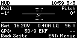 | 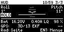 |

[HOLD bei fast waagerechter Lage](images/screenshots/apmon-sw-gx12-hud-hold-de-v1.0.0-2026-11-23-105929.png).

| GX15 mit v1.0.0: HUD in Schräglage | HUD bei annähernd waagerechter Lage |
| --- | --- |
| 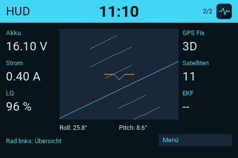 | 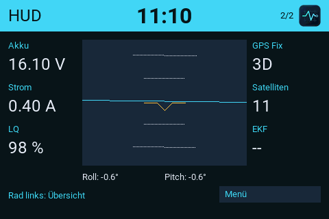 |

| TX16S MK3 mit v1.0.0: Live-HUD | Eingefrorener Horizont mit HOLD |
| --- | --- |
| 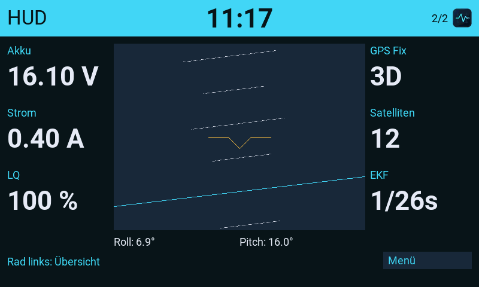 | 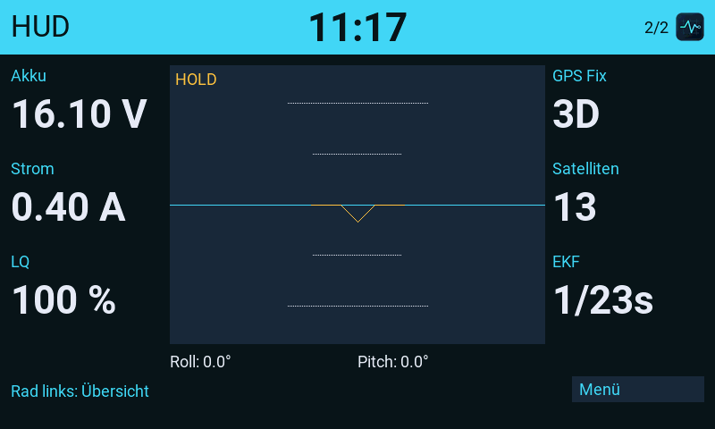 |

### Senderuhr und FC-Meldungsverlauf

Die Uhr ist standardmäßig aus. Sie zeigt die EdgeTX-Senderzeit im 24-Stunden-Format
`HH:MM` auch ohne Verbindung zum Modell und unabhängig vom Kalenderdatum.
Wenn EdgeTX keine gültige Stunde oder Minute liefert, erscheint `--:--`.

**FC-Meldungen** zeigt eine Liste mit den neuesten Einträgen zuerst. Mit dem
Drehgeber oder **NEXT/PREV** blättern, auf COLOR auch mit **Ältere/Neuere**.
**ENTER** oder ein Tipp auf die Zeile (COLOR) öffnet den vollständigen Text
mit Schweregrad, Alter seit dem letzten Empfang und ggf. Wiederholungszähler
(`x3`). **RTN** führt zurück zur Liste. `S4` bedeutet MAVLink-Schweregrad 4.

Auf COLOR öffnet **Letzte FC-Warnung** unten rechts in der Vollbildübersicht
die jüngste noch im Verlauf gespeicherte Warnung oder Fehlermeldung (S0–S4).
Die Schaltfläche erscheint nur, wenn eine solche Meldung vorhanden ist.
**Zurück** oder **RTN** führt direkt zur Übersicht, ohne den Meldungsfilter
zu ändern.

| Letzte FC-Warnung auf der GX15 | Letzte FC-Warnung auf der TX16S MK3 |
| --- | --- |
| 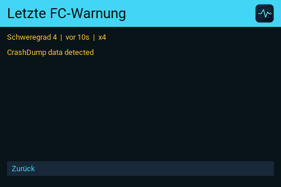 | 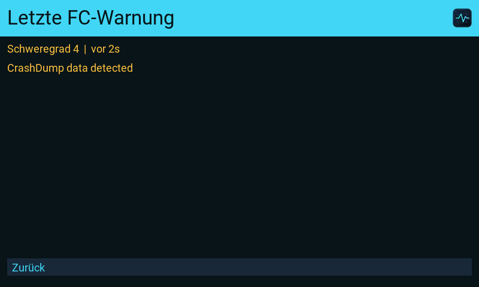 |

[Dieselbe Warnung in der Telemetrie-Diagnose](images/screenshots/apmon-color-gx15-diagnostics-de-v0.9.0-2026-11-23-091232.png).

Über **Filter: Alle** zwischen allen Meldungen und **Warnungen & Fehler**
wechseln. Mit dem Drehgeber oder **PREV** von der neuesten Zeile zum Filter
navigieren und **ENTER** drücken. Auf COLOR lässt sich der Filter direkt
antippen. Der Filter zeigt Schweregrade **S0 bis S4** und blendet andere
Meldungen nur aus.

| GX12 mit v0.6.0: Alle Meldungen | GX12 mit v0.6.0: Warnungen |
| --- | --- |
| 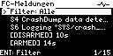 | 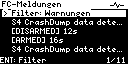 |

| GX15 mit v0.6.0: Alle Meldungen | GX15 mit v0.6.0: Warnungen & Fehler |
| --- | --- |
| 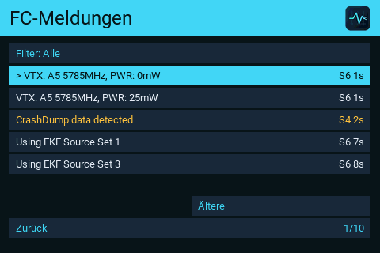 | 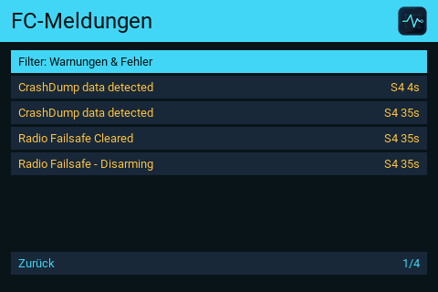 |

Bestätigte Wechsel im FC-Status erscheinen als **`[ARMED]`** und
**`[DISARMED]`**. Die Markierungen bleiben auch im Warnungsfilter sichtbar.
Der erste empfangene Zustand, auch nach einer Lücke im FC-Status, erzeugt
keine Markierung. Die Übergänge werden nicht aus Schalterstellungen abgeleitet.
Der Verlauf hält **12 Meldungen und 4 Markierungen auf SW** bzw.
**32 Meldungen und 8 Markierungen auf COLOR** im Arbeitsspeicher. Markierungen
verdrängen keine Meldungen. Beim Neuladen wird der Verlauf geleert.

| TX16S MK3 mit v0.6.0: Alle Meldungen | TX16S MK3 mit v0.6.0: Warnungen & Fehler |
| --- | --- |
| 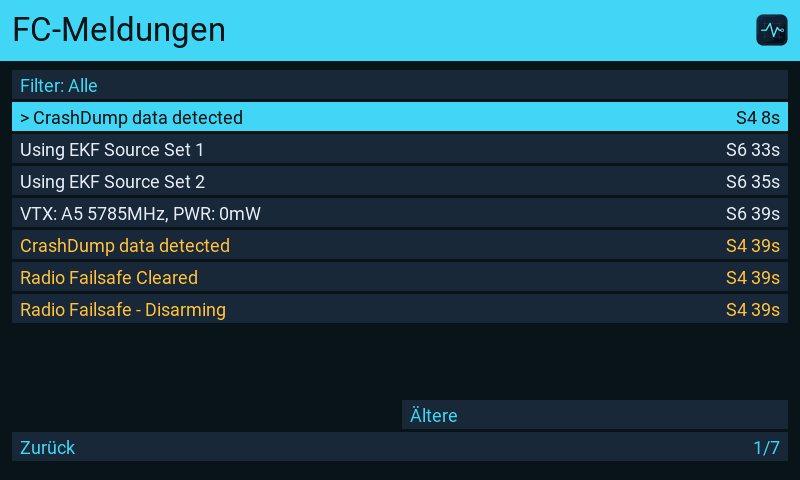 | 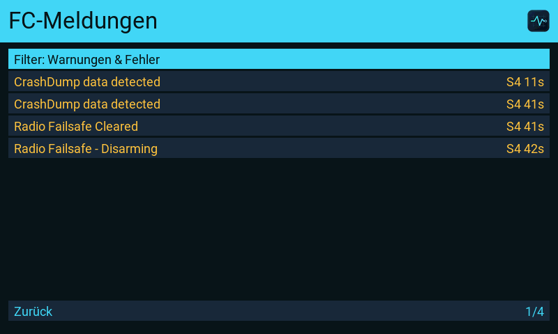 |

[Armed-Markierungen bei aktivem Warnungsfilter (v0.5.0)](images/screenshots/apmon-color-tx16s-mk3-messages-de-v0.5.0-2026-11-22-113025.png)

### GPS-Details

Im Projektmenü **GPS-Details** öffnen. Auf SW passen fünf Einträge gleichzeitig
auf den Bildschirm. Für **GPS-Details** hinter **Letzte Armed-Phase**
weiterdrehen und **ENTER** drücken. Auf COLOR lässt sich der Eintrag auch
antippen, sobald er sichtbar ist.

| GX12 (SW) | GX15 (COLOR) |
| --- | --- |
| 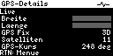 | 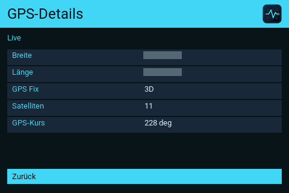 |

**TX16S MK3 (COLOR, 800 × 480):**

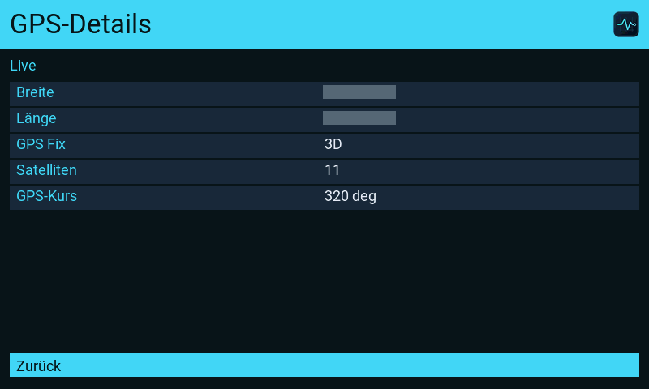

*Alle drei Sender verwenden APMon 0.6.0. Die Koordinaten sind in den Screenshots abgedeckt.*

Die Koordinaten erscheinen in Dezimalgrad. Für **Live** braucht APMon einen
frischen, gültigen `GPS`-Wert und einen bestätigten Positionsfix. Damit die
Anzeige zwischen Updates nicht flackert, bleibt **Live** bis zu 1,5 Sekunden
nach dem letzten frischen Wert stehen, solange der GPS-Wert gültig und der
Fix bestätigt bleibt. ArduPilot-Passthrough meldet den Fixtyp (2D, 3D, DGPS,
RTK float oder RTK fix). Ein konfigurierter, überprüfter `gpsfix`-Sensor kann
einen Fix ohne Typangabe bestätigen. APMon leitet keinen Fix aus den
Koordinaten oder der Satellitenzahl ab. Bei einer Live-Position bleibt der
letzte frische Wert von `Sats` und `Hdg` jeweils bis zu 1,5 Sekunden sichtbar.
Ungültige, fehlende oder zu alte Werte erscheinen als `--`. `Hdg` bezeichnet
den GPS-Kurs über Grund, nicht die Ausrichtung des Modells (Yaw).

Wenn Positionsdaten oder Fixbestätigung ausfallen, kennzeichnet **Nicht live**
die letzten bestätigten Koordinaten und zeigt, wie lange sie nicht mehr live
gesehen wurden. Bis zur ersten bestätigten Position steht dort `--`.
Die Position bleibt nur im Arbeitsspeicher und verschwindet beim Neuladen
von APMon. Sie wird nicht auf die SD-Karte geschrieben. Einen Home-Pfeil
gibt es nicht.

### Telemetrie-Diagnose

Im Projektmenü **Telemetrie-Diagnose** öffnen. Auf SW ist der Eintrag unter
**Uhr** sichtbar. Auf COLOR lässt er sich auch
antippen. Die Übersicht trennt RC-Linkqualität, EdgeTX-Sensoren, FC-Statuspakete
und FC-Textmeldungen. Nur ein ArduPilot-Statuspaket aktualisiert das Alter des
FC-Status. Neue GPS-Daten oder Textmeldungen ersetzen kein Statuspaket.

Unter **Sensoren** stehen Name, Zustand und der zuletzt von APMon akzeptierte
Wert des jeweiligen Sensors. **NEXT/PREV** oder der Drehgeber blättern. Auf
COLOR geht das auch per Touch. Ein alter Wert bleibt nach einem Ausfall nur
als letzter Wert sichtbar und wird nicht als Live-Wert übernommen. Nicht
konfigurierte Sensoren zählen nicht mit. Die Werte sind keine Flugfreigabe.

| GX15 mit v0.9.0: Telemetrie-Diagnose | Sensorliste |
| --- | --- |
| 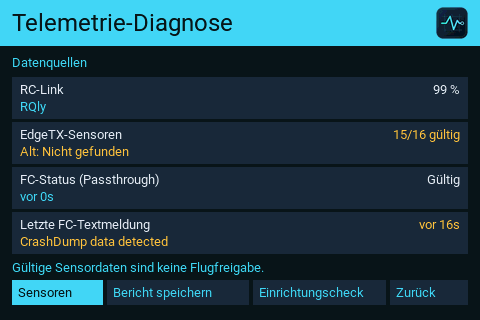 | 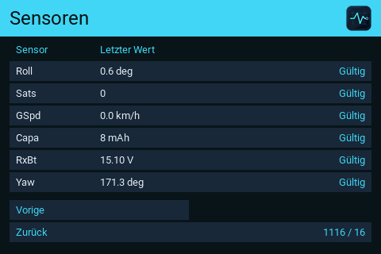 |

| GX12 mit v0.9.0: Telemetrie-Diagnose | Sensordetails |
| --- | --- |
| 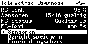 | 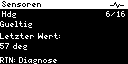 |

| TX16S MK3 mit v0.9.0: Telemetrie-Diagnose | Sensorliste |
| --- | --- |
| 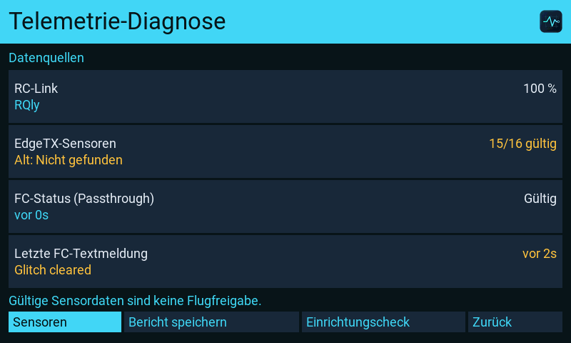 | 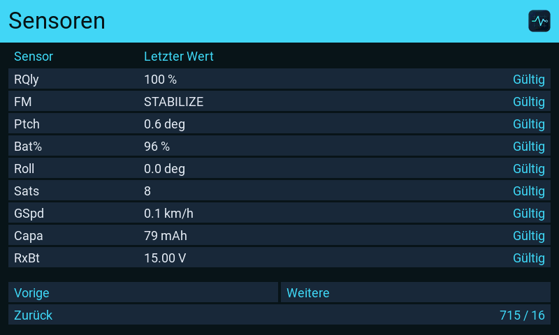 |

[Telemetrie-Diagnose auf der TX16S MK3 mit gültigem FC-Status und separater FC-Warnung](images/screenshots/apmon-color-tx16s-mk3-diagnostics-de-v0.9.0-2026-11-23-092353.png).

### Einrichtungscheck für Telemetriequellen

**Projektmenü → Telemetrie-Diagnose → Einrichtungscheck** öffnen. Auf SW
mit dem Drehgeber oder **NEXT/PREV** blättern, auf COLOR auch per
**Vorige/Weitere**. Der Check prüft RC-Linkqualität, FC-Status,
GPS-Koordinaten, GPS-Fixtyp, Akkuspannung, Strom und mAh-Zähler. Er zeigt
Quelle und Status sowie bei Bedarf einen Hinweis zum nächsten Schritt.
So können GPS-Koordinaten gültig sein, obwohl noch kein Fixtyp empfangen
wurde. Der Fixtyp-Check wertet ArduPilot-Passthrough aus und leitet keinen
Fix aus Koordinaten oder Satellitenzahl ab. Der Check ändert keine
Sender- oder FC-Einstellungen und ist keine Flugfreigabe.

Ab v1.0.0 zeigt der Check zusätzlich die Namen aus
`config.lua` in Suchreihenfolge und unterscheidet erkannte von tatsächlich
verwendeten Quellen. Auf SW können lange Aliaslisten gekürzt sein.
**Relative Höhe** prüft die ausdrückliche Zuordnung für die Armed-Bilanz.
`relativeAltitudeSensor` erst setzen, wenn die Quelle nachweislich die Höhe
über Home liefert. APMon übernimmt dafür nicht automatisch die GPS-Höhe.

| GX12: 3D-Fix | GX15: Warten auf GPS-Fix |
| --- | --- |
| 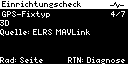 | 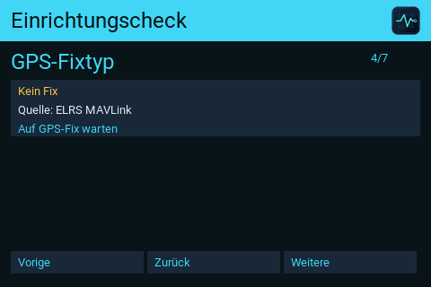 |

[RC-Link-Check auf der GX12 mit gültiger Quelle RQly](images/screenshots/apmon-sw-gx12-setup-check-rc-link-de-v0.9.0-2026-11-23-091815.png).
Auf der TX16S MK3: [RC-Link über RQly](images/screenshots/apmon-color-tx16s-mk3-setup-check-rc-link-de-v0.9.0-2026-11-23-092348.png)
und [gültiger FC-Status über ELRS MAVLink](images/screenshots/apmon-color-tx16s-mk3-setup-check-fc-status-de-v0.9.0-2026-11-23-092350.png).

### Diagnosebericht

**Projektmenü → Telemetrie-Diagnose → Bericht speichern** öffnen. Auf SW
mit dem Drehgeber und **ENTER** bedienen, auf COLOR auch per Touch. Mit
**Ohne FC-Klartext** bestätigen, um `/APMon-report.txt` auf die SD-Karte zu
schreiben. Der neue Bericht ersetzt den alten. APMon zeigt den Dateipfad
oder einen Schreibfehler an.

| GX15 mit v0.9.0: Speichern bestätigen | Bericht gespeichert |
| --- | --- |
| 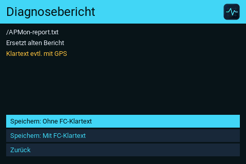 | 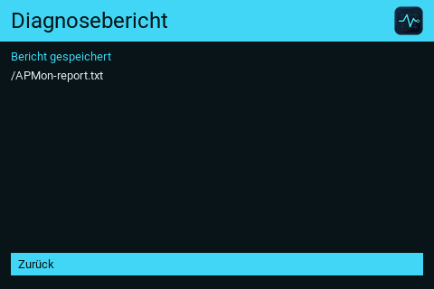 |

| GX12 mit v0.9.0: Speichern bestätigen | Bericht gespeichert |
| --- | --- |
| 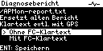 | 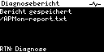 |

Auf der TX16S MK3: [Menüpunkt Bericht speichern](images/screenshots/apmon-color-tx16s-mk3-diagnostics-de-v0.9.0-2026-11-23-092345.png),
[Bestätigung ohne FC-Klartext](images/screenshots/apmon-color-tx16s-mk3-report-confirm-de-v0.9.0-2026-11-23-092341.png)
und [erfolgreicher Export](images/screenshots/apmon-color-tx16s-mk3-report-saved-de-v0.9.0-2026-11-23-092343.png).

Der Bericht enthält APMon- und EdgeTX-Version, konfigurierte und erkannte
Sensorquellen samt Gültigkeitsstatus, den FC-Status mit Alter sowie
Schweregrad, Alter und Wiederholungszahl von bis zu acht letzten
FC-Meldungen. **Senderzeit** ist das lokale Datum und die Uhrzeit beim
Bestätigen (`JJJJ-MM-TT HH:MM:SS`). Liefert der Sender kein gültiges Datum
mit Uhrzeit im Bereich 2020–2099, steht dort **Nicht verfügbar**. Ein
plausibler Zeitstempel garantiert keine korrekt gestellte Senderuhr.
Sensorwerte und GPS-Koordinaten aus Sensoren fehlen bewusst.
**Mit FC-Klartext** muss bei jedem Export ausdrücklich gewählt werden.
Meldungstexte können selbst Standortdaten enthalten. Den Bericht vor dem
Teilen prüfen. Es gibt keine Hintergrundaufzeichnung und keinen
automatischen Upload.

[Bestätigungsdialog auf der GX12 mit ausgewählter Option Mit FC-Klartext](images/screenshots/apmon-sw-gx12-report-confirm-fc-text-de-v0.9.0-2026-11-23-091807.png).

### Zusammenfassung nach dem Entarmen

Unter **Projektmenü → Letzte Armed-Phase** steht die letzte abgeschlossene
Bilanz. Auf SW über **Telemetrie-Diagnose** hinaus weiterblättern, auf COLOR
den Eintrag auswählen oder antippen. Die Ansicht öffnet sich beim Entarmen
nicht automatisch. Die Bilanz bleibt bis zum Neuladen von APMon im Speicher.

- **Armed-Zeit:** Dauer zwischen bestätigtem Armen und Entarmen, auch am
  Boden. Wurde der Start nicht beobachtet oder gab es eine Lücke im FC-Status,
  steht `--` statt einer Schätzung.
- **RC-LQ min.:** niedrigster frischer, gültiger `RQly`-Wert bei bestätigtem
  Armed-Status. Ohne gültigen Messwert erscheint `--`. Ein tatsächlich
  gemeldetes `0 %` bleibt `0 %`. Das Minimum wird getrennt von den
  FC-Datenlücken gezeigt und belegt keinen RC-Verbindungsabbruch.
- **Messwerte:** Niedrigste Akkuspannung und Spitzenstrom aus frischen
  Messungen während der Phase. Der Verbrauch ist die Differenz des
  mAh-Zählers aus Messungen nahe dem Start und Ende (jeweils höchstens drei
  Sekunden entfernt). Fehlen diese Werte, wechselt die Quelle oder sinkt
  der Zähler, bleibt der Verbrauch unbekannt.
- **Maximale relative Höhe:** Standardmäßig `--`. In
  [`config.lua`](SD/SCRIPTS/APMON/config.lua) `relativeAltitudeSensor` erst
  dann auf den exakten Sensornamen (z. B. `GAlt`) setzen, wenn der Bezug
  **relativ zu Home** für dieses Setup geprüft ist. Die Bilanz verwendet
  keine andere Höhenquelle als Ersatz und schätzt keinen Bodenabstand.

Bei **Unvollständig** zeigt **Details**, warum Werte fehlen. Beispielsweise
bedeutet **FC-Status fehlt 2x**, dass der FC-Status zweimal unterbrochen war.
**Stromsensor fehlt 1x** kennzeichnet einen Zeitraum, in dem der Stromsensor
nicht verfügbar war. Aufeinanderfolgende Ausfälle derselben Quelle zählen
als eine Lücke. APMon zählt die Lücken im FC-Status, bei Spannung, Strom,
mAh-Zähler und relativer Höhe getrennt. Die relative Höhe wird nur geprüft,
wenn sie konfiguriert ist. Ohne bestätigten Armed-Status ordnet APMon
einen Ausfall nicht einzelnen Sensoren zu. Auf SW bei angezeigter zweiter
Detailseite mit dem Drehgeber oder **NEXT/PREV** weiterblättern.

Bereits erfasste Messwerte bleiben sichtbar. Eine Datenlücke ist **kein Beleg
für einen RC-Verbindungsabbruch**. Ein Telemetrieausfall zählt nie als Entarmen.

| GX12 mit v0.7.0: Vollständige Bilanz | Details derselben Phase |
| --- | --- |
| 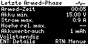 | 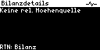 |

| GX15 mit v0.7.0: Vollständige Bilanz | Details derselben Phase |
| --- | --- |
| 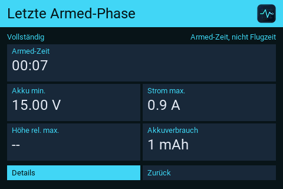 | 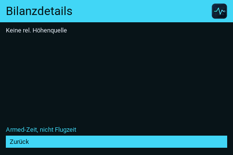 |

| TX16S MK3 mit v0.7.0: Vollständige Bilanz | Details derselben Phase |
| --- | --- |
| 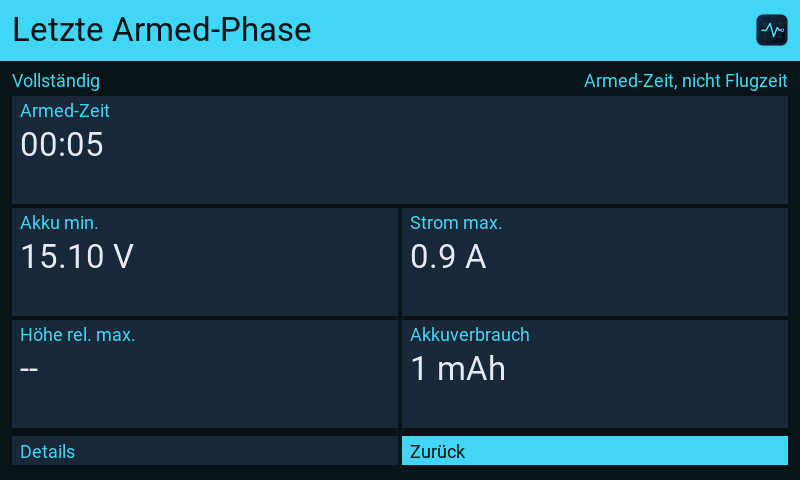 | 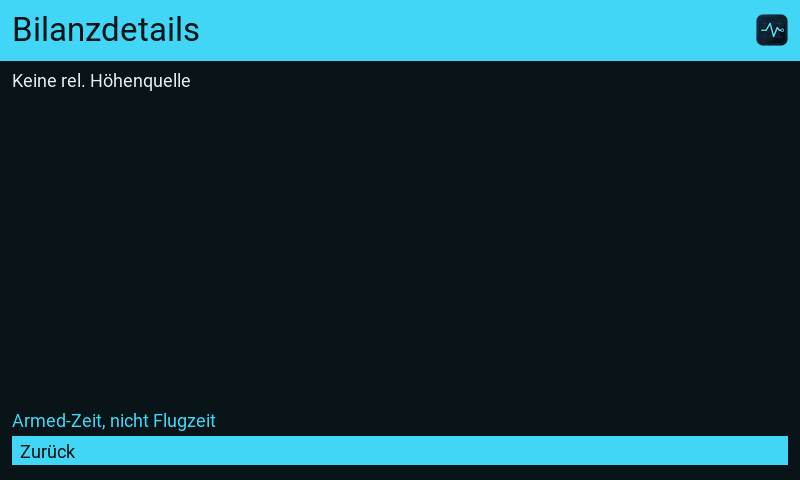 |

## Sensoren konfigurieren

Die Zuordnung liegt in [config.lua](SD/SCRIPTS/APMON/config.lua).
Sie gilt gemeinsam für alle Modelle derselben SD-Karte. Vor Benutzung die
Werte und Einheiten mit der FC-Anzeige vergleichen.

| Anzeige | Standardquelle | Erwartete Einheit / Bedeutung |
| --- | --- | --- |
| Akku (Spannung) | `RxBt` | Spannung in V. Prüfen, dass der Sensor den Flugakku und nicht das BEC oder den Empfänger misst. |
| Akku (Strom) | `Curr` | A |
| Akku (Rest laut FC) | `Bat%` | Prozent laut FC, keine Schätzung aus der Spannung |
| Akku (Verbrauch) | `Capa` | verbrauchte mAh |
| Höhe | `Alt`, ersatzweise `GAlt` | Meter. Höhenbezug der Quelle beachten. |
| Steigen | `VSpd` | m/s |
| Horizontales GPS-Tempo | `GSpd` | km/h |
| Roll / Pitch / Yaw | `Roll` / `Ptch` / `Yaw` | CRSF-Standard: Radiant, von APMon in Grad umgerechnet |
| Satelliten | `Sats` | Anzahl, kein alleiniger Fixnachweis |
| GPS-Kurs | `Hdg` | Bewegungsrichtung in Grad, nicht zwingend Ausrichtung der Fahrzeugnase |
| Flugmodus | `FM` | FC-Modustext |
| RC-Linkqualität | `RQly` | Prozent empfangener Steuerpakete |
| GPS-Position | `GPS` | Tabelle mit `lat` und `lon` |

Die GPS-Position und der GPS-Kurs werden im Adapter ausgewertet, sind aber in
den aktuellen kompakten Hauptansichten nicht als eigene Felder enthalten.

Beispiel für eine umbenannte Spannungsquelle:

```lua
voltage = { names = { 'Flugakku' }, unit = 'V', decimals = 2, min = 0.1 },
```

`names` kann mehrere, der Reihe nach geprüfte Aliasnamen enthalten. Bei anderen
Einheiten `scale` anpassen: z. B. `3.6` für m/s → km/h oder `1`, wenn ein
Winkelsensor bereits Grad liefert. Die unveränderten CRSF-Winkelsensoren
verwenden `180 / math.pi` zur Umrechnung in Grad.

Nur echte Rückmeldesensoren zuordnen. Kanal- oder Schalterstellungen bestätigen
weder Armed noch einen aktiven EKF-Quellensatz oder eine VTX-Einstellung.

## Bedeutung und Gültigkeit der Daten

### Fehlende und veraltete Werte

`--` bedeutet: nicht empfangen, nicht zugeordnet, ungültiger Datentyp oder
veraltete Daten. Gültige Nullwerte bleiben erhalten.

| Datenquelle | Gültigkeit |
| --- | --- |
| EdgeTX-Sensoren | `isCurrent` von EdgeTX. In der Zielversion können letzte Werte bei Ausfall noch ungefähr 20 Sekunden sichtbar bleiben. |
| Passthrough: GPS-Fix und Armed | etwa 3 Sekunden nach dem letzten entsprechenden Paket |
| FC-Text und letzte EKF-Umschaltmeldung | Historische Meldung mit angezeigtem Alter, keine kontinuierliche Zustandsbestätigung |

`isFresh` wird nicht als Anzeigevoraussetzung verwendet: Sein kurzes Zeitfenster
würde langsam eintreffende, noch aktuelle Sensoren ausblenden. APMon bietet
keine unabhängige MAVLink-Heartbeat-Überwachung. Eine gute RC-Linkqualität
bestätigt weder vollständige FC-Telemetrie noch Flugbereitschaft.

### GPS, Höhe und Richtung

- GPS-Fix wird aus Passthrough gelesen, nicht aus Satellitenzahl oder Koordinaten geschätzt.
- „Ja“ bedeutet mindestens 2D-Fix. DGPS ist ein eigener unterstützter Fix-Typ.
- **GAlt** steht für *GPS Altitude*. Im normalen ELRS-4.1.0-MAVLink-Build wird
  dieser Sensor jedoch mit `GLOBAL_POSITION_INT.relative_alt` befüllt, also
  Höhe relativ Home. Ein Build mit `USE_MAVLINK_GPS_ALTITUDE` verwendet
  stattdessen die GPS-Höhe über Meeresspiegel. Die GUI benennt die Sensorquelle.
  Daraus darf kein Bodenabstand abgeleitet werden.
- Die Himmelsrichtung stammt aus Yaw. GPS-Kurs und Fahrzeugausrichtung sind
  unterschiedliche Größen, besonders im Stillstand.

### Flugmodus und EKF

`STAB`, `LOIT` und `GUID` werden als `STABILIZE`, `LOITER` und `GUIDED`
ausgeschrieben. Ein abschließendes Sternchen wird aus dem Modustext entfernt.
Armed/Disarmed wird separat aus der Rückmeldung gelesen.

„EKF zuletzt“ wertet ausschließlich die FC-Textmeldung
`Using EKF Source Set 1/2/3` aus. Eine alte Meldung beweist nicht, dass der
Quellensatz noch aktiv ist, insbesondere nach einem FC-Neustart.

## Fehlersuche

| Problem | Prüfung |
| --- | --- |
| APMon fehlt in der Auswahl | Paketstruktur prüfen und Sender neu starten. Tools: `/SCRIPTS/TOOLS/APMon.lua`. SW-Telemetrieseite: `/SCRIPTS/TELEMETRY/APMon.lua`. COLOR-Widget: `/WIDGETS/APMon/main.lua`. |
| Fehler beim Laden eines Moduls | Gesamtes passendes Paket installieren, nicht nur die Hauptdatei. Alte APMon-`.luac`-Dateien entfernen. |
| SW meldet `not enough memory` | Aktuelles SW-Paket vollständig installieren, alte APMon-`.luac`-Dateien entfernen und den Sender neu starten. Tritt die Meldung weiter auf, andere Lua-Skripte im Modell vorübergehend deaktivieren und erneut testen. |
| Nur Modus und RC-Linkqualität kommen an | Zuerst Werte in EdgeTX → Telemetrie prüfen. Fehlen sie dort ebenfalls, liegt das Problem vor APMon. |
| GPS-Fix / Armed bleiben unbekannt | ELRS-Version, MAVLink-Modus und Passthrough-Empfang prüfen. |
| Spracheinstellung fehlt im COLOR-Widget | Nach dem Update neu starten. Nötigenfalls das Widget entfernen und erneut hinzufügen. |
| SW meldet „Language not saved“ | Schreibzugriff und freien Platz auf der SD-Karte prüfen. |
| Meldung „waiting for home“ oder GPS-/AHRS-Abweichung | Bei einem FC- oder EKF-Problem die vollständige PreArm-Meldung mit einer GCS prüfen. APMon zeigt die Meldung nur an. |

### Telemetrie fehlt nach FC-Neustart

APMon fordert keine Nachrichtenraten an. Eine zuvor verbundene GCS kann
Nachrichtenintervalle für eine Sitzung angefragt haben. Nach einem Neustart
muss der FC die benötigten Daten selbstständig senden.

Für den zugehörigen MAVLink-Kanal empfiehlt die
[ExpressLRS-Anleitung](https://www.expresslrs.org/software/mavlink/#flight-controller-setup)
SR-/MAV-Nachrichtengruppen mit 1 Hz, ausgenommen `ADSB`, `PARAMS` und
`RAW_CTRL` mit 0. Die Zuordnung des SR-Index zum Empfängeranschluss prüfen.
Der SR-Index entspricht nicht zwingend der SERIAL-Nummer.
Nach der Konfiguration ohne angeschlossene GCS neu starten und prüfen.

### Andere Lua-Telemetrieprogramme

APMon liest über `crossfireTelemetryPop()` die CRSF-Lua-Warteschlange.
Andere Rohdatenleser, beispielsweise Yaapu oder das ELRS-Konfigurationstool,
können mit dieser Nutzung konkurrieren. Während der Nutzung und Fehlersuche
keine anderen Rohdatenleser parallel betreiben.

### APDiag

Das SW-Paket enthält das unabhängige Diagnoseskript **APDiag**. Es kann auf
einem freien Telemetriebildschirm ausgewählt werden und zeigt für ausgewählte
Sensoren den Rückgabewert von `getSourceValue()`, dessen Gültigkeitsflags sowie
`getValue()`. Plus/Minus bzw. NEXT/PREV wechseln den Sensor. APDiag sendet
keine Anfragen und ersetzt keine MAVLink-Diagnose.

## Entwicklung und Tests

### Projektstruktur

```text
SD/SCRIPTS/APMON/        Gemeinsamer Adapter, Passthrough, Konfiguration, Sprachen
SD/SCRIPTS/TELEMETRY/    Schwarzweiß-Anwendung und APDiag
SD/SCRIPTS/TOOLS/        Einstieg über SYS → Tools für beide Displaytypen
SD/WIDGETS/APMon/        Farbwidget
tests/                  Simulierte EdgeTX-APIs und Lua-Testläufe
deploy.py               Vorschau und Deployment auf eine eingebundene SD-Karte
package_sd.py           Erzeugung und Prüfung beider Installationspakete
LICENSE                 Apache License 2.0
```

### Quellcode-Header und Versionierung

Alle Lua- und Python-Dateien enthalten einen einheitlichen Kommentarheader mit
Dateipfad, Zweck, Projektversion, Aktualisierungsdatum, Autorenangabe,
Codex-CLI-Unterstützung und SPDX-Lizenzkennung `Apache-2.0`. Unter `Authors`
steht Christian Baun. Codex CLI wird separat als Entwicklungsunterstützung
aufgeführt. Das Datum beschreibt den dokumentierten Änderungsstand, nicht ein
nachträglich angenommenes Erstellungsdatum.

[VERSION](VERSION) ist die zentrale Projektversionsnummer. Beide SD-Pakete und
`deploy.py` übernehmen sie als `SCRIPTS/APMON/VERSION` für die Menüanzeige.
Bei einer neuen Projektversion die Versionsangaben in den Quellcode-Headern
und in beiden READMEs gemeinsam aktualisieren. Bei Dateiänderungen das jeweilige Headerdatum
anpassen. Vor der Veröffentlichung beide Pakete mit `python3 package_sd.py`
neu bauen, damit sie die aktuellen Header enthalten.

### Tests ausführen

Vom Projektverzeichnis aus:

```bash
python3 tests/run.py
python3 -m unittest discover -s tests -p 'test_*.py'
```

Der Runner nutzt eine installierte Lua-5.3-/5.4-Systembibliothek über `ctypes`.
Alternativ mit einem Lua-Interpreter:

```bash
lua tests/check.lua
```

Geprüft werden unter anderem fehlende Sensoren, gültige Nullwerte,
veraltete Daten, Anzeigegrenzen, beide Skript-Lebenszyklen, Navigation,
Sprachwahl, SW-Speicherung, Passthrough-Paketformate, GPS-Fix einschließlich
DGPS, Armed, FC-/EKF-Meldungen und deren Zeitablauf. Die Tests berücksichtigen
auch eine eingeschränkte Lua-Umgebung ohne String-Methoden und ohne
`table`-Bibliothek für die SW-Anwendung.

Die Python-Tests prüfen die Dateiauswahl nach Displaytyp, die Vorschau und den
Erhalt fremder Dateien sowie der gespeicherten Sprache beim Deployment.

Das sind **Simulationstests**, keine vollständige Hardwarequalifikation.
Schriften, Tastenereignisse, Speicher- und Laufzeitbudget sowie Funkintegration
müssen auf dem jeweiligen Sender geprüft werden.

### APMon-Host-Simulator und GIF-Demos

Der Simulator in [`simulate.py`](simulate.py) führt den echten APMon-Lua-Code
mit synthetischen Sensoren, Passthrough-Paketen und geskripteten Drehgeber-,
Tasten- und Touch-Eingaben aus. Er prüft Meldungsfilter, GPS-Position nach
einem Ausfall, Armed-Bilanz und Diagnosebericht ohne Koordinaten oder
FC-Klartext. Die simulierte SD-Karte bleibt im Arbeitsspeicher.

```bash
python3 simulate.py --check
python3 simulate.py
python3 simulate.py --profile sw-128x64 --profile color-480x320 --lang de
```

Standardmäßig prüft das Skript beide Sprachen auf SW mit 128 × 64 und
experimentell 212 × 64 sowie COLOR mit 440 × 252, 480 × 320 und 800 × 480.
Der erste Befehl prüft nur. Für GIFs sind zusätzlich Pillow und eine
Unicode-TrueType-Schrift wie DejaVu Sans nötig. Mit `--font` lässt sich eine
Schriftdatei angeben. Die GIFs landen standardmäßig im von Git ignorierten
Ordner `simulator-output/`. Mit `--output-dir` lässt sich ein anderer Ordner
wählen. Beschriftungen und Touch-Markierungen erklären die Bedienung.

Das ist eine Nachbildung der Lua-LCD-API, nicht der offizielle
EdgeTX-Simulator. Die GIFs sind keine echten Senderaufnahmen und kein
Nachweis für die Unterstützung neuer Sender oder Auflösungen.

### Pakete bauen

```bash
python3 package_sd.py
```

Nach erfolgreichen Tests werden ausschließlich `APMon-SW.zip` und
`APMon-COLOR.zip` erzeugt. Beide enthalten den vollständigen Lizenztext.
Ein Gesamtpaket wird nicht mehr gebaut.

### Weitere Sprachen ergänzen

Das Register `languages` in [i18n.lua](SD/SCRIPTS/APMON/i18n.lua) enthält
Sprachcode, Anzeigename, Übersetzungen und Himmelsrichtungen. Einen Eintrag
am Ende ergänzen, beispielsweise:

```lua
{ code = 'fr', name = 'Français',
  texts = {
    ['Flugmodus'] = 'Mode de vol',
    ['Satelliten'] = 'Satellites',
    ['FC-Meldung / vor %ds'] = 'Message FC / il y a %ds',
    -- Weitere Schlüssel aus dem Übersetzungskatalog übersetzen.
  },
  directions = { 'N', 'NE', 'E', 'SE', 'S', 'SO', 'O', 'NO' },
},
```

Die Auswahlmenüs entstehen automatisch aus dem Register. Fehlende Texte und
Himmelsrichtungen verwenden Englisch. Platzhalter wie `%ds` erhalten und
lange Texte auf beiden Displaytypen prüfen. Bestehende Einträge nicht
umsortieren: EdgeTX speichert die COLOR-Auswahl als Index und SW speichert den
Sprachcode. Empfangene FC-Meldungen bleiben in ihrer Originalsprache.

## Mitwirken

Fehlerberichte sollten Sender, EdgeTX-/ELRS-/ArduPilot-Version, Paketvariante,
Sensornamen und Einheiten sowie die genaue Meldung oder einen Screenshot
enthalten. Bei fehlenden Werten bitte angeben, ob sie bereits unter
EdgeTX → Telemetrie fehlen.

Beiträge als Pull Request einreichen und die Tests vorab ausführen.
Neue Telemetriequellen müssen Einheit, Bedeutung und Datenalter nachvollziehbar
behandeln. Ein fehlender Wert darf nicht durch einen erfundenen Zustand ersetzt
werden. Beiträge werden unter der Projektlizenz Apache-2.0 bereitgestellt.

### Referenzen

- [EdgeTX Lua-Dokumentation](https://luadoc.edgetx.org/)
- [EdgeTX 2.12.5: Lua-API](https://github.com/EdgeTX/edgetx/blob/v2.12.5/radio/src/lua/api_general.cpp)
- [EdgeTX 2.12.5: CRSF-Sensoren](https://github.com/EdgeTX/edgetx/blob/v2.12.5/radio/src/telemetry/crossfire.cpp)
- [ExpressLRS: MAVLink](https://www.expresslrs.org/software/mavlink/)
- [ELRS 4.1.0: MAVLink-Konverter](https://github.com/ExpressLRS/ExpressLRS/blob/4.1.0/src/lib/MAVLink/MAVLink.cpp)
- [ELRS 4.1.0: Passthrough-Feldkodierung](https://github.com/ExpressLRS/ExpressLRS/blob/4.1.0/src/lib/MAVLink/ardupilot_custom_telemetry.cpp)
- [MAVLink-Nachrichten und GPS-Fix-Typen](https://mavlink.io/en/messages/common.html)

## Lizenz

APMon wird unter der **Apache License, Version 2.0** veröffentlicht.
Der vollständige Lizenztext steht in [LICENSE](LICENSE).

EdgeTX, ExpressLRS und ArduPilot sind eigenständige Projekte mit eigenen
Lizenzen. Verlinkte Dokumentation und Protokollreferenzen werden dadurch
nicht unter die APMon-Lizenz gestellt.
