# APMon — EdgeTX Monitor for ArduPilot

[English](README.md) | **Deutsch**

[](LICENSE)

**Telemetrie für ArduPilot auf RadioMaster-Fernsteuerungen mit EdgeTX.**
APMon zeigt Akkudaten, Fluglage, GPS-Status und Meldungen des Flugcontrollers
auf der Fernsteuerung an. Die Anwendung besteht aus Lua-Skripten auf der
SD-Karte und benötigt zur Laufzeit weder einen Laptop noch ein zusätzliches
Skript im Flugcontroller.

Der aktuelle Projektstand ist **Version 0.4.0**; die Versionsnummer steht in
[VERSION](VERSION). Siehe [Release-Notizen zu v0.4.0](releases/v0.4.0.md).

Die GUI unterstützt **Englisch und Deutsch**. Englisch ist die Standardsprache.

**Entwicklung mit KI-Unterstützung:** OpenAI Codex CLI half bei der Erstellung
und Überarbeitung von Quellcode, Tests und Dokumentation. Das ersetzt keine
Hardwaretests; der aktuelle Prüfstand steht im Abschnitt zur Kompatibilität.

## Inhalt

- [Passende Displayvariante wählen](#passende-displayvariante-wählen)
- [Screenshots](#screenshots)
- [Funktionen](#funktionen)
- [Kompatibilität und Voraussetzungen](#kompatibilität-und-voraussetzungen)
- [Installation](#installation)
- [Bedienung](#bedienung)
- [Sensoren konfigurieren](#sensoren-konfigurieren)
- [Bedeutung und Gültigkeit der Daten](#bedeutung-und-gültigkeit-der-daten)
- [Fehlersuche](#fehlersuche)
- [Entwicklung und Tests](#entwicklung-und-tests)
- [Mitwirken](#mitwirken)
- [Lizenz](#lizenz)

## Passende Displayvariante wählen

| Paket | Display / Oberfläche | Referenzsender |
| --- | --- | --- |
| [APMon-SW.zip](APMon-SW.zip) | Schwarzweiß, 128 × 64 Pixel; Telemetrieskript mit zwei Datenseiten | RadioMaster GX12 und Boxer |
| [APMon-COLOR.zip](APMon-COLOR.zip) | Farbdisplay; Dashboard-Widget, Mindestgröße der Widget-Zone: 440 × 252 Pixel | RadioMaster GX15 und TX15 (480 × 320), TX16S MK3 (800 × 480) |

**SW** steht für *Schwarzweiß*. Paket und Deployment-Option richten sich nach
dem **Displaytyp**, nicht nach dem Sendernamen: `--display sw` installiert das
Telemetrieskript, `--display color` das Farbwidget. Andere RadioMaster-Sender
können funktionieren, wenn sie die unten genannten Voraussetzungen erfüllen.
Ein passendes Display allein bedeutet nicht, dass der Sender getestet wurde.

## Screenshots

Echte Aufnahmen von GX12, GX15 und TX16S MK3.
Die Werte zeigen den Aufnahmezustand und sind keine Aussage zur Flugbereitschaft.

**Schwarzweiß — GX12 (128 × 64, APMon v0.4.0)**

Die Bilder sind vierfach vergrößert. Die Senderuhr ist auf beiden
Telemetrieseiten eingeschaltet.

| Übersicht | Flugwerte |
| --- | --- |
| 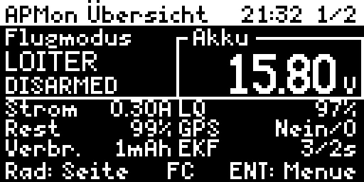 | 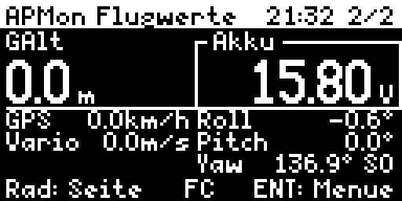 |

| Projektmenü | FC-Meldungsliste |
| --- | --- |
| 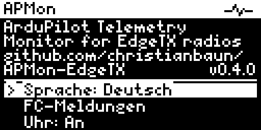 | 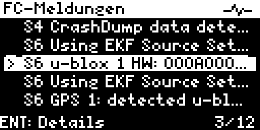 |

Weitere GX12-Aufnahmen: [Projektmenü mit den neuen Einträgen (Englisch)](images/screenshots/apmon-sw-gx12-menu-en-v0.4.0-2026-11-21-213258-4x.png),
[Telemetrie-Diagnose](#telemetrie-diagnose) und
[Zusammenfassung nach dem Entarmen](#zusammenfassung-nach-dem-entarmen).

**Farbdisplay — GX15 (480 × 320, APMon v0.4.0)**

| Übersicht mit Senderuhr | Projektmenü |
| --- | --- |
| 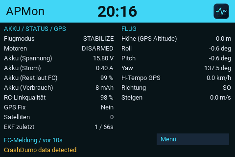 | 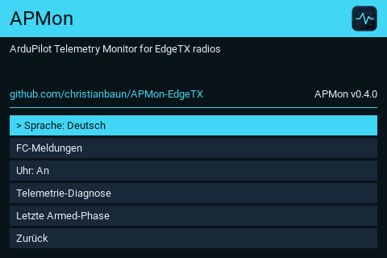 |

**FC-Meldungsliste — GX15 (Englisch)**

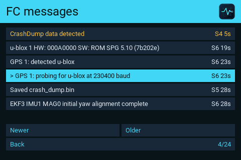

Weitere GX15-Aufnahmen: [Telemetrie-Diagnose](#telemetrie-diagnose) und
[Zusammenfassung nach dem Entarmen](#zusammenfassung-nach-dem-entarmen).

**Farbdisplay — TX16S MK3 (800 × 480, APMon v0.4.0)**

| Übersicht im Vollbild | Projektmenü |
| --- | --- |
| 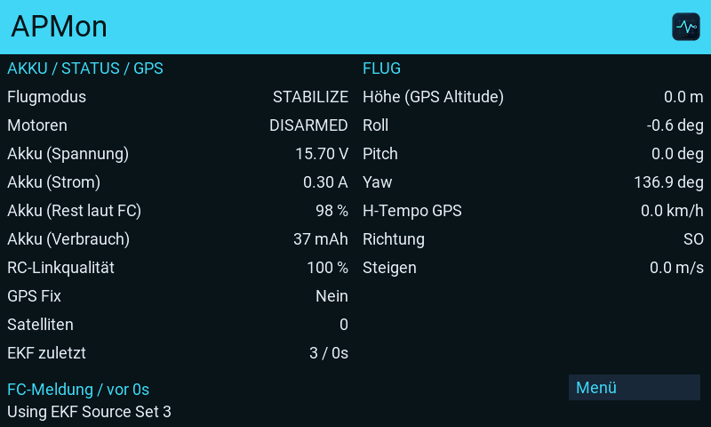 | 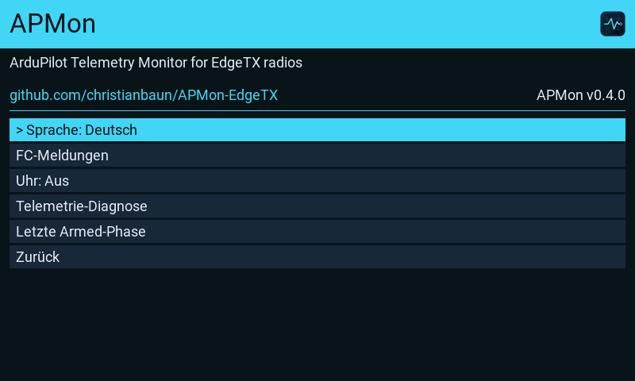 |

**FC-Meldungsliste — TX16S MK3**

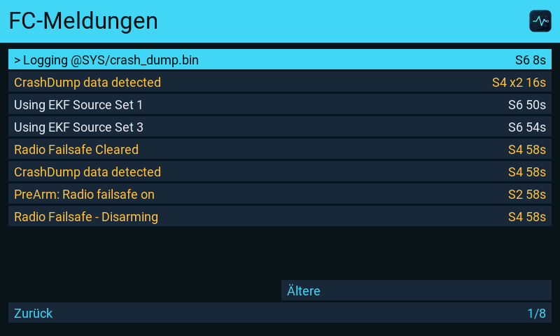

**Sprache wechseln:** Auf SW-Displays **ENTER** drücken und **Sprache /
Language** auswählen. Auf COLOR-Displays APMon im Vollbild öffnen und
**Menü → Sprache** wählen. Dauerhaft gilt dort **Widget-Einstellungen → Language**.

## Funktionen

- **Akku:** Spannung, Strom, vom FC gemeldete Restladung und verbrauchte mAh.
- **Flug:** ausgeschriebener Flugmodus, Armed/Disarmed, Höhe, Roll, Pitch, Yaw,
  horizontales GPS-Tempo, Steigen und Himmelsrichtung aus Yaw.
- **GPS:** Satellitenanzahl und echter Fixstatus einschließlich 2D, 3D, DGPS,
  RTK Float und RTK Fixed aus ELRS-Passthrough.
- **FC-Status:** letzte Textmeldung und zuletzt gemeldeter EKF-Quellensatz,
  jeweils mit Alter der Meldung.
- **RC-Linkqualität:** Anteil empfangener Steuerpakete in Prozent.
- **Telemetrie-Diagnose:** Zustand von RC-Link, EdgeTX-Sensoren und FC-Status
  getrennt prüfen.
- **Letzte Armed-Phase:** Dauer und gemessene Extremwerte nach dem Entarmen
  im Projektmenü nachsehen.
- **Sprachwahl:** direkt am Sender; weitere Sprachen können zentral ergänzt werden.

APMon sendet **keine Flugbefehle, Parameteränderungen oder Telemetrieanfragen**.
Es verändert keine Modell- oder FC-Einstellungen. Die SW-Version speichert
lediglich ihre Sprachwahl in einer eigenen Datei auf der SD-Karte.

**Grenzen:** LiDAR-Bodenabstand, Optical-Flow-Rohdaten, VTX-Frequenz, Band/Kanal
und PIT werden derzeit nicht angezeigt. Die vorhandenen Konfigurationseinträge
allein schaffen dafür keinen Transport vom FC zur Fernsteuerung.
APMon ist eine Telemetrieanzeige, keine Flugfreigabe und kein Ersatz für die
PreArm-Prüfungen des Flugcontrollers.

## Kompatibilität und Voraussetzungen

Zielplattform ist die **klassische EdgeTX-2.x-LCD-API**. Eine Oberfläche für
EdgeTX 3.x/LVGL ist nicht enthalten. SW ist für 128 × 64 Pixel ausgelegt;
COLOR benötigt eine Widget-Zone von mindestens 440 × 252 Pixeln. Andere
Auflösungen, Tastenbelegungen, Speicherbudgets und Firmwarestände müssen
separat geprüft werden.

| Sender | Versionen |
| --- | --- |
| GX15 | EdgeTX 2.12.5, ExpressLRS 4.1.0, APMon 0.4.0 |
| TX15 | EdgeTX 2.12.5, ExpressLRS 4.1.0, APMon 0.4.0 |
| TX16S MK3 | EdgeTX 2.12.5, ExpressLRS 4.1.0, APMon 0.4.0 |
| GX12 | EdgeTX 2.12.5, ExpressLRS 4.1.0, APMon 0.4.0 |
| Boxer | Hardwaretest noch offen |
| Andere Sender | Hardwaretest noch offen |

Für den vollständigen Funktionsumfang werden benötigt:

1. ArduPilot mit funktionierender ExpressLRS-Verbindung im **MAVLink-Modus**.
2. Im EdgeTX-Modell entdeckte Telemetriesensoren mit passenden Namen und Einheiten.
3. Die Lua-API `getSourceValue()` mit dem Gültigkeitsflag `isCurrent`.
4. Für GPS-Fix, Armed und FC-Meldungen: die von **ELRS 4.1.0** erzeugten
   ArduPilot-Passthrough-Pakete und `crossfireTelemetryPop()`.

Fehlt Passthrough, bleiben die normalen EdgeTX-Sensoranzeigen nutzbar.
Die zusätzlichen Statusanzeigen können dann unbekannt bleiben.

### Datenweg

```text
ArduPilot FC → ELRS-Empfänger → Funk → ELRS-Sendemodul
                                      ├─ CRSF-Sensoren → EdgeTX → APMon
                                      ├─ ArduPilot-Passthrough → APMon
                                      └─ MAVLink → Backpack → GCS/Laptop (separat)
```

Der vollständige MAVLink-Datenstrom am Backpack steht einem EdgeTX-Lua-Skript
nicht automatisch zur Verfügung. APMon wertet die EdgeTX-Sensoren und eine
begrenzte Auswahl der Passthrough-Pakete aus.

## Installation

### Paket auf die SD-Karte kopieren

1. Das zum Display passende Paket aus der Tabelle oben herunterladen.
2. Den Sender per USB im **SD-Karten-/Speichermodus** verbinden oder die
   SD-Karte in einen Kartenleser einsetzen.
3. Das ZIP **direkt im Stammverzeichnis der SD-Karte** entpacken. Bestehende
   Ordner zusammenführen und APMon-Dateien bei einem Update ersetzen.
4. Bei einem manuellen Update alte `.luac`-Dateien der aktualisierten
   APMon-Module entfernen. Das Deployment-Skript übernimmt diesen Schritt.
5. SD-Karte sauber auswerfen, USB trennen und den Sender neu starten.

Die Struktur auf der SD-Karte muss so aussehen:

```text
SCRIPTS/
├── APMON/
│   ├── armed_summary.lua
│   ├── config.lua
│   ├── core.lua
│   ├── diagnostics.lua
│   ├── i18n.lua
│   ├── mono_tools.lua      # nur im SW-Paket
│   ├── pass.lua
│   ├── project.lua
│   ├── VERSION
│   └── LICENSE.txt
└── TELEMETRY/             # nur im SW-Paket
    ├── APMon.lua
    └── APDiag.lua
WIDGETS/                   # nur im COLOR-Paket
└── APMon/
    ├── main.lua
    └── logo.png
```

**Keinen zusätzlichen Paketordner anlegen:**
`/SCRIPTS/TELEMETRY/APMon.lua` ist richtig,
`/APMon-SW/SCRIPTS/TELEMETRY/APMon.lua` ist falsch.

### Farbdisplay (COLOR): Widget hinzufügen

1. In der Hauptansicht das EdgeTX-Menü öffnen und **Screen settings /
   Bildschirmeinstellungen** auswählen.
2. Ein Layout mit einer großen Zone wählen; APMon benötigt mindestens
   **440 × 252 Pixel**.
3. **Setup widgets / Widgets einrichten** öffnen, die Zone auswählen und
   **APMon** hinzufügen.
4. Mit RTN zur Hauptansicht zurückkehren.

### Schwarzweißdisplay (SW): Telemetrieskript auswählen

1. Das gewünschte Modell öffnen.
2. Unter **Modell → Anzeige/Display** einen Telemetriebildschirm auf
   **Script → APMon** einstellen.
3. Die Telemetrieansicht öffnen.

APMon wird als Telemetrieskript verwendet, nicht als einmaliges Werkzeug
über den SD-Karten-Browser gestartet.

### Automatisches Deployment unter Linux

Python **3.9 oder neuer** sowie eine Lua-5.3-/5.4-Systembibliothek werden für
die lokalen Hilfsprogramme benötigt. Python läuft nur auf dem Computer.

Im Projektverzeichnis zuerst eine Vorschau anzeigen:

```bash
python3 deploy.py --display color
```

Anschließend genau den zum Display passenden Befehl ausführen:

```bash
python3 deploy.py --display color --apply
# oder
python3 deploy.py --display sw --apply
```

`--display` ist erforderlich. Die frühere `--radio`-Option von `deploy.py`
entfällt; eine automatische Modellfreigabe findet nicht statt.
Das Skript erkennt eine eingebundene EdgeTX-SD-Karte anhand der Verzeichnisse
`MODELS`, `RADIO` und `SCRIPTS`. Bei mehreren Karten das Ziel angeben:

```bash
python3 deploy.py --display color --sd /run/media/USER/KARTE --apply
```

Mit `--apply` führt es die Tests aus, erzeugt beide ZIP-Pakete, kopiert die zum
Display passenden Lua-Dateien, prüft deren Inhalt und entfernt zugehörige alte
`.luac`-Dateien. **Es erstellt kein Backup.** Andere Anwendungen und
Modelldateien werden nicht verändert.

`config.lua` wird ebenfalls durch die Projektversion ersetzt. Eigene
Sensorzuordnungen deshalb vor einem Update in
[SD/SCRIPTS/APMON/config.lua](SD/SCRIPTS/APMON/config.lua) übernehmen.
Die gespeicherten SW-Einstellungen für Sprache und Uhr in `mono.cfg` bleiben erhalten.
Die Lizenz liegt in beiden ZIP-Paketen; das direkte Deployment kopiert sie nicht.

### Screenshots importieren

Auf dem Sender mit der EdgeTX-Spezialfunktion **Screenshot** eine Aufnahme
machen und den Sender dann im USB-Speichermodus anschließen.
`import_screenshots.py` erkennt die SD-Karte wie `deploy.py`; bei mehreren
Karten hilft `--sd PFAD`. Für Vorschau und Import wird Pillow ab 9.1
benötigt (`python3-pil` unter Debian), für die Dateiliste nicht.

```bash
python3 import_screenshots.py --list
python3 import_screenshots.py --display sw --radio gx12 --view overview --lang de --scale 4
python3 import_screenshots.py --display sw --radio gx12 --view overview --lang de --scale 4 --apply
```

Ohne Dateiauswahl übernimmt das Skript **alle neuen Aufnahmen** aus
`SCREENSHOTS`. Bereits importierte Aufnahmen erkennt es an Aufnahmezeit
und Bildinhalt, auch bei anderen Metadaten oder anderer Vergrößerung.
Die angegebene Ansicht und Sprache gelten für den ganzen Import. Bei
gemischten Aufnahmen die Dateien mit `--file NAME` auswählen; die Option
kann für mehrere Aufnahmen mit gleichen Metadaten wiederholt werden.
Für das englische GX15-Menü beispielsweise
`--display color --radio gx15 --view menu --lang en` angeben. Falls auf dem
Sender eine andere Version als in [VERSION](VERSION) läuft, `--version` setzen.
Weitere Ansichten heißen `flight`, `language`, `messages` und `diagnostics`.

BMP- und PNG-Aufnahmen landen zum Beispiel als
`images/screenshots/apmon-sw-gx12-overview-de-v0.2.1-2026-11-20-090305-4x.png`
im Repository. Datum und Uhrzeit stammen aus dem EdgeTX-Dateinamen oder,
bei umbenannten Aufnahmen, aus der lokalen Dateiänderungszeit. Ohne
`--scale` bleiben die Originalmaße erhalten. Identische Importe werden
übersprungen, Namenskollisionen nummeriert. Die SD-Karte und vorhandene
README-Bilder bleiben unverändert.

## Bedienung

### Farbdisplay / COLOR

Eine Gesamtansicht zeigt links Flugmodus, Motoren, Akku, RC-Linkqualität,
GPS-Fix, Satelliten und die letzte EKF-Umschaltmeldung. Rechts stehen Höhe,
Fluglage, horizontales GPS-Tempo, Richtung und Steigen. Die letzte FC-Meldung
erscheint unten mit Altersangabe; langer Text wird auf die verfügbare Breite
gekürzt.

- **Projektmenü öffnen:** APMon doppelt antippen oder im Kontextmenü
  **Vollbild** wählen. Im Vollbild auf **Menü** tippen oder **ENTER** drücken.
- Unter **APMon** steht **ArduPilot Telemetry Monitor for EdgeTX radios**.
  Darunter stehen die GitHub-Adresse und die installierte APMon-Version.
  **Sprache** und **FC-Meldungen** lassen sich per Touch oder mit Drehgeber
  und **ENTER** öffnen. **RTN** geht eine Ebene zurück; **RTN** lang gedrückt
  verlässt das Vollbild.
- Die Sprachwahl im APMon-Menü gilt für dieses Widget in der aktuellen
  Sitzung. Dauerhaft speichert EdgeTX sie im Modell: APMon in der Hauptansicht
  lange antippen → **Widget-Einstellungen → Language → English oder Deutsch**.
- **Menü → Uhr** schaltet die größere Senderuhr mittig in der Kopfzeile des
  Dashboards für die aktuelle Sitzung ein oder aus. Den dauerhaften Standard
  pro Widget legt **Widget-Einstellungen → Clock** fest.

### Schwarzweißdisplay / SW

| Ansicht | Inhalt |
| --- | --- |
| Übersicht | Flugmodus und Armed links, darunter Akkustrom, Restladung, Verbrauch, RC-Linkqualität, GPS-Fix mit Satellitenzahl und letzte EKF-Umschaltmeldung |
| Flugwerte | Höhe groß links, darunter horizontales GPS-Tempo, Steigen, Roll, Pitch und Yaw mit Himmelsrichtung |

Die **Akkuspannung in Volt steht auf beiden Seiten oben rechts**.
Ohne gültigen Wert zeigt das Feld `--`.

- **Drehgeber, Plus/Minus oder NEXT/PREV:** Seite wechseln; kein automatisches Blättern.
- **ENTER / Drehgeber drücken:** Menü mit Projekttitel, GitHub-Adresse und
  installierter APMon-Version öffnen.
- Unter **Sprache** zwischen **Deutsch** und **English** wählen. **FC-Meldungen**
  öffnet den Verlauf. Mit **Uhr: Aus/An** direkt darunter und **ENTER** lässt
  sich die Uhr umschalten. Sie steht auf beiden Telemetrieseiten
  links neben der Seitennummer. **RTN** geht eine Ebene zurück.

Sprache und Uhr werden in `/SCRIPTS/APMON/mono.cfg` gespeichert und gelten
für alle Modelle dieser SD-Karte. Bei einem Schreibfehler erscheint ein Hinweis;
die Änderung bleibt für die aktuelle Sitzung aktiv.

Für das kleine Display werden kurze Labels verwendet:

| Label | Bedeutung |
| --- | --- |
| Akku / Strom | Akkuspannung (V) / Akkustrom (A) |
| Rest / Left | Restladung laut FC |
| Verbr. / Used | verbrauchte mAh |
| LQ | RC-Linkqualität |
| GAlt | Höhe aus dem gleichnamigen Sensor |
| GPS | Auf der Übersicht Fix/Satellitenzahl (z. B. `3D/12`); auf der Flugseite horizontales GPS-Tempo |
| Vario / Climb | Steigen |
| Dir | Himmelsrichtung aus Yaw, falls sie nicht neben dem Winkel Platz findet |
| EKF | letzte EKF-Umschaltmeldung, z. B. `2/30s` = Set 2 vor 30 Sekunden gemeldet |

### Senderuhr und FC-Meldungsverlauf

Die Uhr ist standardmäßig aus. Sie zeigt die EdgeTX-Senderzeit im 24-Stunden-Format
`HH:MM` auch ohne Verbindung zum Modell und unabhängig vom Kalenderdatum.
Wenn EdgeTX keine gültige Stunde oder Minute liefert, erscheint `--:--`.

**FC-Meldungen** zeigt eine Liste mit den neuesten Einträgen zuerst. Mit dem
Drehgeber oder **NEXT/PREV** blättern, auf COLOR auch mit **Ältere/Neuere**.
**ENTER** oder ein Tipp auf die Zeile (COLOR) öffnet den vollständigen Text
mit Schweregrad, Alter seit dem letzten Empfang und ggf. Wiederholungszähler
(`x3`). **RTN** führt zurück zur Liste. `S4` bedeutet MAVLink-Schweregrad 4.
Der Verlauf hält **12 Einträge auf SW** und **32 auf COLOR** im Arbeitsspeicher
und wird beim Neuladen von APMon geleert.

### Telemetrie-Diagnose

Im Projektmenü **Telemetrie-Diagnose** öffnen. Auf SW steht der Eintrag unter
**Uhr** und wird beim Weiterdrehen sichtbar. Auf COLOR lässt er sich auch
antippen. Die Übersicht trennt RC-Linkqualität, EdgeTX-Sensoren, FC-Statuspakete
und FC-Textmeldungen. Nur ein ArduPilot-Statuspaket aktualisiert das Alter des
FC-Status; neue GPS-Daten oder Textmeldungen ersetzen kein Statuspaket.

Unter **Sensoren** stehen Name, Zustand und der zuletzt von APMon akzeptierte
Wert des jeweiligen Sensors. **NEXT/PREV** oder der Drehgeber blättern; auf
COLOR geht das auch per Touch. Ein alter Wert bleibt nach einem Ausfall nur
als letzter Wert sichtbar und wird nicht als Live-Wert übernommen. Nicht
konfigurierte Sensoren zählen nicht mit. Die Werte sind keine Flugfreigabe.

| Telemetrie-Diagnose auf der GX15 | Sensorliste auf der GX15 |
| --- | --- |
| 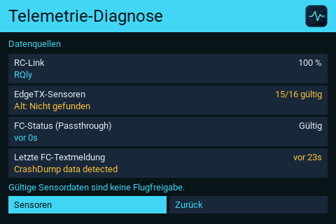 | 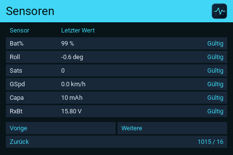 |

**Telemetrie-Diagnose auf der GX12 (Englisch):**

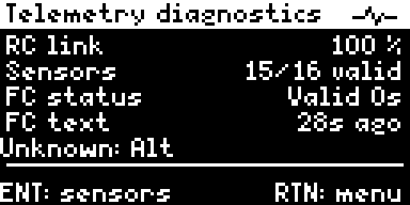

Auf der TX16S MK3: [Diagnose-Übersicht](images/screenshots/apmon-color-tx16s-mk3-diagnostics-de-v0.4.0-2026-11-21-213731.png)
und [Sensorliste](images/screenshots/apmon-color-tx16s-mk3-sensors-de-v0.4.0-2026-11-21-213741.png) bei 800 × 480 Pixeln.

### Zusammenfassung nach dem Entarmen

Unter **Projektmenü → Letzte Armed-Phase** steht die letzte abgeschlossene
Bilanz. Auf SW über **Telemetrie-Diagnose** hinaus weiterblättern, auf COLOR
den Eintrag auswählen oder antippen. Die Ansicht öffnet sich beim Entarmen
nicht automatisch. Die Bilanz bleibt bis zum Neuladen von APMon im Speicher.

- **Armed-Zeit:** Dauer zwischen bestätigtem Armen und Entarmen, auch am
  Boden. Wurde der Start nicht beobachtet oder gab es eine Lücke im FC-Status,
  steht `--` statt einer Schätzung.
- **Messwerte:** Niedrigste Akkuspannung und Spitzenstrom aus frischen
  Messungen während der Phase. Der Verbrauch ist die Differenz des
  mAh-Zählers aus Messungen nahe dem Start und Ende (jeweils höchstens drei
  Sekunden entfernt). Fehlen diese Werte, wechselt die Quelle oder sinkt
  der Zähler, bleibt der Verbrauch unbekannt.
- **Maximale relative Höhe:** Standardmäßig `--`. In
  [`config.lua`](SD/SCRIPTS/APMON/config.lua) `relativeAltitudeSensor` erst
  dann auf den exakten Sensornamen (z. B. `GAlt`) setzen, wenn der Bezug
  **relativ zu Home** für dieses Setup geprüft ist. Die Bilanz verwendet
  keine andere Höhenquelle als Ersatz und schätzt keinen Bodenabstand.

Bei **Unvollständig** zeigt **Details**, warum Werte fehlen. Bereits erfasste
Messwerte bleiben sichtbar; ein Telemetrieausfall zählt nie als Entarmen.

| GX12 (Englisch) | GX15 |
| --- | --- |
| 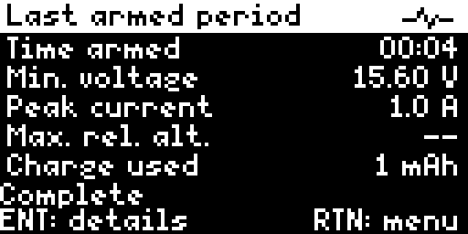 | 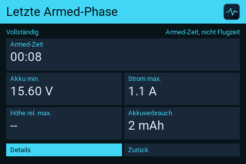 |

[Letzte Armed-Phase auf der TX16S MK3 (800 × 480)](images/screenshots/apmon-color-tx16s-mk3-summary-de-v0.4.0-2026-11-21-213734.png)

## Sensoren konfigurieren

Die Zuordnung liegt in [config.lua](SD/SCRIPTS/APMON/config.lua).
Sie gilt gemeinsam für alle Modelle derselben SD-Karte. Vor Benutzung die
Werte und Einheiten mit der FC-Anzeige vergleichen.

| Anzeige | Standardquelle | Erwartete Einheit / Bedeutung |
| --- | --- | --- |
| Akku (Spannung) | `RxBt` | V; muss die Flugakkuspannung sein, nicht BEC-/Empfängerspannung |
| Akku (Strom) | `Curr` | A |
| Akku (Rest laut FC) | `Bat%` | Prozent; keine eigene Spannungsschätzung |
| Akku (Verbrauch) | `Capa` | verbrauchte mAh |
| Höhe | `Alt`, ersatzweise `GAlt` | m; Höhenbezug der Quelle beachten |
| Steigen | `VSpd` | m/s |
| Horizontales GPS-Tempo | `GSpd` | km/h |
| Roll / Pitch / Yaw | `Roll` / `Ptch` / `Yaw` | CRSF-Standard: Radiant, von APMon in Grad umgerechnet |
| Satelliten | `Sats` | Anzahl; kein alleiniger Fixnachweis |
| GPS-Kurs | `Hdg` | Grad; Bewegungsrichtung, nicht zwingend Ausrichtung der Fahrzeugnase |
| Flugmodus | `FM` | FC-Modustext |
| RC-Linkqualität | `RQly` | Prozent empfangener Steuerpakete |
| GPS-Position | `GPS` | Tabelle mit `lat` und `lon` |

Die GPS-Position und der GPS-Kurs werden im Adapter ausgewertet, sind aber in
den aktuellen kompakten Hauptansichten nicht als eigene Felder enthalten.

Beispiel für eine umbenannte Spannungsquelle:

```lua
voltage = { names = { 'Flugakku' }, unit = 'V', decimals = 2, min = 0.1 },
```

`names` kann mehrere, der Reihe nach geprüfte Aliasnamen enthalten. Bei anderen
Einheiten `scale` anpassen: z. B. `3.6` für m/s → km/h oder `1`, wenn ein
Winkelsensor bereits Grad liefert. Die unveränderten CRSF-Winkelsensoren
verwenden `180 / math.pi` zur Umrechnung in Grad.

Nur echte Rückmeldesensoren zuordnen. Kanal- oder Schalterstellungen bestätigen
weder Armed noch einen aktiven EKF-Quellensatz oder eine VTX-Einstellung.

## Bedeutung und Gültigkeit der Daten

### Fehlende und veraltete Werte

`--` bedeutet: nicht empfangen, nicht zugeordnet, ungültiger Datentyp oder
veraltete Daten. Gültige Nullwerte bleiben erhalten.

| Datenquelle | Gültigkeit |
| --- | --- |
| EdgeTX-Sensoren | `isCurrent` von EdgeTX; in der Zielversion können letzte Werte bei Ausfall noch ungefähr 20 Sekunden sichtbar bleiben |
| Passthrough: GPS-Fix und Armed | etwa 3 Sekunden nach dem letzten entsprechenden Paket |
| FC-Text und letzte EKF-Umschaltmeldung | historische Meldung mit angezeigtem Alter; keine kontinuierliche Zustandsbestätigung |

`isFresh` wird nicht als Anzeigevoraussetzung verwendet: Sein kurzes Zeitfenster
würde langsam eintreffende, noch aktuelle Sensoren ausblenden. APMon bietet
keine unabhängige MAVLink-Heartbeat-Überwachung. Eine gute RC-Linkqualität
bestätigt weder vollständige FC-Telemetrie noch Flugbereitschaft.

### GPS, Höhe und Richtung

- GPS-Fix wird aus Passthrough gelesen, nicht aus Satellitenzahl oder Koordinaten geschätzt.
- „Ja“ bedeutet mindestens 2D-Fix; DGPS ist ein eigener unterstützter Fix-Typ.
- **GAlt** steht für *GPS Altitude*. Im normalen ELRS-4.1.0-MAVLink-Build wird
  dieser Sensor jedoch mit `GLOBAL_POSITION_INT.relative_alt` befüllt, also
  Höhe relativ Home. Ein Build mit `USE_MAVLINK_GPS_ALTITUDE` verwendet
  stattdessen die GPS-Höhe über Meeresspiegel. Die GUI benennt die Sensorquelle;
  daraus darf kein Bodenabstand abgeleitet werden.
- Die Himmelsrichtung stammt aus Yaw. GPS-Kurs und Fahrzeugausrichtung sind
  unterschiedliche Größen, besonders im Stillstand.

### Flugmodus und EKF

`STAB`, `LOIT` und `GUID` werden als `STABILIZE`, `LOITER` und `GUIDED`
ausgeschrieben. Ein abschließendes Sternchen wird aus dem Modustext entfernt;
Armed/Disarmed wird separat aus der Rückmeldung gelesen.

„EKF zuletzt“ wertet ausschließlich die FC-Textmeldung
`Using EKF Source Set 1/2/3` aus. Eine alte Meldung beweist nicht, dass der
Quellensatz noch aktiv ist, insbesondere nach einem FC-Neustart.

## Fehlersuche

| Problem | Prüfung |
| --- | --- |
| APMon fehlt in der Auswahl | Paketstruktur prüfen und Sender neu starten. SW: `/SCRIPTS/TELEMETRY/APMon.lua`; COLOR: `/WIDGETS/APMon/main.lua`. |
| Fehler beim Laden eines Moduls | Gesamtes passendes Paket installieren, nicht nur die Hauptdatei. Alte APMon-`.luac`-Dateien entfernen. |
| SW meldet `not enough memory` | Aktuelles SW-Paket vollständig installieren, alte APMon-`.luac`-Dateien entfernen und den Sender neu starten. Tritt die Meldung weiter auf, andere Lua-Skripte im Modell vorübergehend deaktivieren und erneut testen. |
| Nur Modus und RC-Linkqualität kommen an | Zuerst Werte in EdgeTX → Telemetrie prüfen. Fehlen sie dort ebenfalls, liegt das Problem vor APMon. |
| GPS-Fix / Armed bleiben unbekannt | ELRS-Version, MAVLink-Modus und Passthrough-Empfang prüfen. |
| Spracheinstellung fehlt im COLOR-Widget | Nach Update neu starten; nötigenfalls Widget entfernen und erneut hinzufügen. |
| SW meldet „Language not saved“ | Schreibzugriff und freien Platz auf der SD-Karte prüfen. |
| Meldung „waiting for home“ oder GPS-/AHRS-Abweichung | FC-/EKF-Problem; vollständige PreArm-Meldung mit einer GCS prüfen. APMon zeigt die Meldung nur an. |

### Telemetrie fehlt nach FC-Neustart

APMon fordert keine Nachrichtenraten an. Eine zuvor verbundene GCS kann
Nachrichtenintervalle für eine Sitzung angefragt haben; nach einem Neustart
muss der FC die benötigten Daten selbstständig senden.

Für den zugehörigen MAVLink-Kanal empfiehlt die
[ExpressLRS-Anleitung](https://www.expresslrs.org/software/mavlink/#flight-controller-setup)
SR-/MAV-Nachrichtengruppen mit 1 Hz, ausgenommen `ADSB`, `PARAMS` und
`RAW_CTRL` mit 0. Die Zuordnung des SR-Index zum Empfängeranschluss prüfen;
sie darf nicht pauschal mit der SERIAL-Nummer gleichgesetzt werden.
Nach der Konfiguration ohne angeschlossene GCS neu starten und prüfen.

### Andere Lua-Telemetrieprogramme

APMon liest über `crossfireTelemetryPop()` die CRSF-Lua-Warteschlange.
Andere Rohdatenleser, beispielsweise Yaapu oder das ELRS-Konfigurationstool,
können mit dieser Nutzung konkurrieren. Während der Nutzung und Fehlersuche
keine anderen Rohdatenleser parallel betreiben.

### APDiag

Das SW-Paket enthält das unabhängige Diagnoseskript **APDiag**. Es kann auf
einem freien Telemetriebildschirm ausgewählt werden und zeigt für ausgewählte
Sensoren den Rückgabewert von `getSourceValue()`, dessen Gültigkeitsflags sowie
`getValue()`. Plus/Minus bzw. NEXT/PREV wechseln den Sensor. APDiag sendet
keine Anfragen und ersetzt keine MAVLink-Diagnose.

## Entwicklung und Tests

### Projektstruktur

```text
SD/SCRIPTS/APMON/        Gemeinsamer Adapter, Passthrough, Konfiguration, Sprachen
SD/SCRIPTS/TELEMETRY/    Schwarzweiß-Anwendung und APDiag
SD/WIDGETS/APMon/        Farbwidget
tests/                  Simulierte EdgeTX-APIs und Lua-Testläufe
deploy.py               Vorschau und Deployment auf eine eingebundene SD-Karte
package_sd.py           Erzeugung und Prüfung beider Installationspakete
LICENSE                 Apache License 2.0
```

### Quellcode-Header und Versionierung

Alle Lua- und Python-Dateien enthalten einen einheitlichen Kommentarheader mit
Dateipfad, Zweck, Projektversion, Aktualisierungsdatum, Autorenangabe,
Codex-CLI-Unterstützung und SPDX-Lizenzkennung `Apache-2.0`. Unter `Authors`
steht Christian Baun; Codex CLI wird separat als Entwicklungsunterstützung
aufgeführt. Das Datum beschreibt den dokumentierten Änderungsstand, nicht ein
nachträglich angenommenes Erstellungsdatum.

[VERSION](VERSION) ist die zentrale Projektversionsnummer. Beide SD-Pakete und
`deploy.py` übernehmen sie als `SCRIPTS/APMON/VERSION` für die Menüanzeige.
Bei einer neuen Projektversion die Versionsangaben in den Quellcode-Headern
und in beiden READMEs gemeinsam aktualisieren. Bei Dateiänderungen das jeweilige Headerdatum
anpassen. Vor der Veröffentlichung beide Pakete mit `python3 package_sd.py`
neu bauen, damit sie die aktuellen Header enthalten.

### Tests ausführen

Vom Projektverzeichnis aus:

```bash
python3 tests/run.py
python3 -m unittest discover -s tests -p 'test_*.py'
```

Der Runner nutzt eine installierte Lua-5.3-/5.4-Systembibliothek über `ctypes`.
Alternativ mit einem Lua-Interpreter:

```bash
lua tests/check.lua
```

Geprüft werden unter anderem fehlende Sensoren, gültige Nullwerte,
veraltete Daten, Anzeigegrenzen, beide Skript-Lebenszyklen, Navigation,
Sprachwahl, SW-Speicherung, Passthrough-Paketformate, GPS-Fix einschließlich
DGPS, Armed, FC-/EKF-Meldungen und deren Zeitablauf. Die Tests berücksichtigen
auch eine eingeschränkte Lua-Umgebung ohne String-Methoden und ohne
`table`-Bibliothek für die SW-Anwendung.

Die Python-Tests prüfen die Dateiauswahl nach Displaytyp, die Vorschau und den
Erhalt fremder Dateien sowie der gespeicherten Sprache beim Deployment.

Das sind **Simulationstests**, keine vollständige Hardwarequalifikation.
Schriften, Tastenereignisse, Speicher- und Laufzeitbudget sowie Funkintegration
müssen auf dem jeweiligen Sender geprüft werden.

### Pakete bauen

```bash
python3 package_sd.py
```

Nach erfolgreichen Tests werden ausschließlich `APMon-SW.zip` und
`APMon-COLOR.zip` erzeugt. Beide enthalten den vollständigen Lizenztext.
Ein Gesamtpaket wird nicht mehr gebaut.

### Weitere Sprachen ergänzen

Das Register `languages` in [i18n.lua](SD/SCRIPTS/APMON/i18n.lua) enthält
Sprachcode, Anzeigename, Übersetzungen und Himmelsrichtungen. Einen Eintrag
am Ende ergänzen, beispielsweise:

```lua
{ code = 'fr', name = 'Français',
  texts = {
    ['Flugmodus'] = 'Mode de vol',
    ['Satelliten'] = 'Satellites',
    ['FC-Meldung / vor %ds'] = 'Message FC / il y a %ds',
    -- Weitere Schlüssel aus dem Übersetzungskatalog übersetzen.
  },
  directions = { 'N', 'NE', 'E', 'SE', 'S', 'SO', 'O', 'NO' },
},
```

Die Auswahlmenüs entstehen automatisch aus dem Register. Fehlende Texte und
Himmelsrichtungen verwenden Englisch. Platzhalter wie `%ds` erhalten und
lange Texte auf beiden Displaytypen prüfen. Bestehende Einträge nicht
umsortieren: EdgeTX speichert die COLOR-Auswahl als Index; SW speichert den
Sprachcode. Empfangene FC-Meldungen bleiben in ihrer Originalsprache.

## Mitwirken

Fehlerberichte sollten Sender, EdgeTX-/ELRS-/ArduPilot-Version, Paketvariante,
Sensornamen und Einheiten sowie die genaue Meldung oder einen Screenshot
enthalten. Bei fehlenden Werten bitte angeben, ob sie bereits unter
EdgeTX → Telemetrie fehlen.

Beiträge als Pull Request einreichen und die Tests vorab ausführen.
Neue Telemetriequellen müssen Einheit, Bedeutung und Datenalter nachvollziehbar
behandeln. Ein fehlender Wert darf nicht durch einen erfundenen Zustand ersetzt
werden. Beiträge werden unter der Projektlizenz Apache-2.0 bereitgestellt.

### Referenzen

- [EdgeTX Lua-Dokumentation](https://luadoc.edgetx.org/)
- [EdgeTX 2.12.5: Lua-API](https://github.com/EdgeTX/edgetx/blob/v2.12.5/radio/src/lua/api_general.cpp)
- [EdgeTX 2.12.5: CRSF-Sensoren](https://github.com/EdgeTX/edgetx/blob/v2.12.5/radio/src/telemetry/crossfire.cpp)
- [ExpressLRS: MAVLink](https://www.expresslrs.org/software/mavlink/)
- [ELRS 4.1.0: MAVLink-Konverter](https://github.com/ExpressLRS/ExpressLRS/blob/4.1.0/src/lib/MAVLink/MAVLink.cpp)
- [ELRS 4.1.0: Passthrough-Feldkodierung](https://github.com/ExpressLRS/ExpressLRS/blob/4.1.0/src/lib/MAVLink/ardupilot_custom_telemetry.cpp)
- [MAVLink-Nachrichten und GPS-Fix-Typen](https://mavlink.io/en/messages/common.html)

## Lizenz

APMon wird unter der **Apache License, Version 2.0** veröffentlicht.
Der vollständige Lizenztext steht in [LICENSE](LICENSE).

EdgeTX, ExpressLRS und ArduPilot sind eigenständige Projekte mit eigenen
Lizenzen. Verlinkte Dokumentation und Protokollreferenzen werden dadurch
nicht unter die APMon-Lizenz gestellt.
