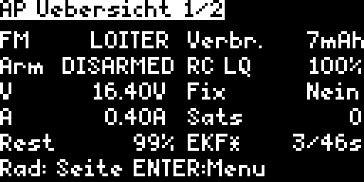
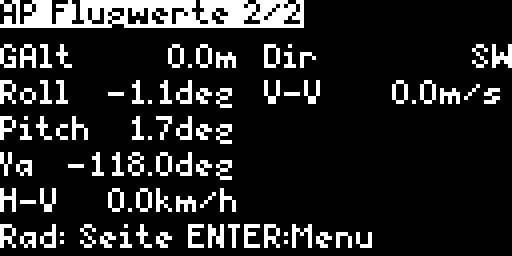
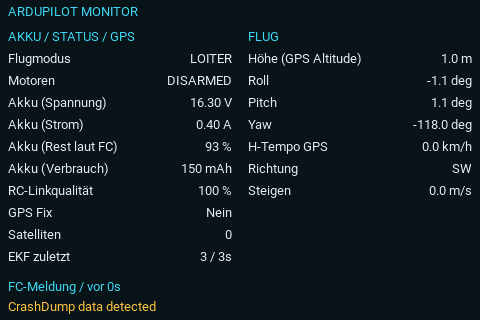

# APMon — EdgeTX Monitor for ArduPilot

[English](README.md) | **Deutsch**

[](LICENSE)

**Telemetrie für ArduPilot auf RadioMaster-Fernsteuerungen mit EdgeTX.**
APMon zeigt Akkudaten, Fluglage, GPS-Status und Meldungen des Flugcontrollers
auf der Fernsteuerung an. Die Anwendung besteht aus Lua-Skripten auf der
SD-Karte und benötigt zur Laufzeit weder einen Laptop noch ein zusätzliches
Skript im Flugcontroller.

| Paket | Sender | Oberfläche |
| --- | --- | --- |
| [APMon-SW.zip](APMon-SW.zip) | RadioMaster GX12 und Boxer | Telemetrieskript, 128 × 64 Pixel, zwei Datenseiten |
| [APMon-COLOR.zip](APMon-COLOR.zip) | RadioMaster GX15 | Widget, 480 × 320 Pixel, eine Gesamtansicht |

Die GUI unterstützt **Englisch und Deutsch**. Englisch ist die Standardsprache.
Der aktuelle Projektstand ist **Version 0.1.0**; die Versionsnummer steht in
[VERSION](VERSION).

**Entwicklung mit KI-Unterstützung:** APMon wurde unter Mithilfe von
**OpenAI Codex CLI** entwickelt. Codex CLI wurde für die Erstellung und
Überarbeitung von Quellcode, Tests und Dokumentation eingesetzt. Diese
Unterstützung ersetzt keine Prüfung auf der jeweiligen Hardware; der aktuelle
Prüfstatus ist im Abschnitt zur Kompatibilität dokumentiert.

## Screenshots

Echte Aufnahmen der GX12-Schwarzweißoberfläche und des GX15-Farbwidgets.
Die Schwarzweißbilder sind zur besseren Lesbarkeit vergrößert.
Die Werte zeigen den Aufnahmezustand und sind keine Aussage zur Flugbereitschaft.

| Übersicht | Flugwerte |
| --- | --- |
|  |  |

**Farbübersicht — GX15**



**Sprache wechseln:** Auf SW-Displays **ENTER** (Drehgeber drücken) betätigen,
mit Drehgeber oder Plus/Minus **Deutsch** oder **English** auswählen und mit
ENTER bestätigen. Auf COLOR-Displays APMon lange antippen und
**Widget-Einstellungen → Language → English / Deutsch** öffnen.

## Inhalt

- [Screenshots](#screenshots)
- [Funktionen](#funktionen)
- [Kompatibilität und Voraussetzungen](#kompatibilität-und-voraussetzungen)
- [Installation](#installation)
- [Bedienung](#bedienung)
- [Sensoren konfigurieren](#sensoren-konfigurieren)
- [Bedeutung und Gültigkeit der Daten](#bedeutung-und-gültigkeit-der-daten)
- [Fehlersuche](#fehlersuche)
- [Entwicklung und Tests](#entwicklung-und-tests)
- [Mitwirken](#mitwirken)
- [Lizenz](#lizenz)

## Funktionen

- **Akku:** Spannung, Strom, vom FC gemeldete Restladung und verbrauchte mAh.
- **Flug:** ausgeschriebener Flugmodus, Armed/Disarmed, Höhe, Roll, Pitch, Yaw,
  horizontales GPS-Tempo, Steigen und Himmelsrichtung aus Yaw.
- **GPS:** Satellitenanzahl und echter Fixstatus einschließlich 2D, 3D, DGPS,
  RTK Float und RTK Fixed aus ELRS-Passthrough.
- **FC-Status:** letzte Textmeldung und zuletzt gemeldeter EKF-Quellensatz,
  jeweils mit Alter der Meldung.
- **RC-Linkqualität:** Anteil empfangener Steuerpakete in Prozent.
- **Sprachwahl:** direkt am Sender; weitere Sprachen können zentral ergänzt werden.

APMon sendet **keine Flugbefehle, Parameteränderungen oder Telemetrieanfragen**.
Es verändert keine Modell- oder FC-Einstellungen. Die SW-Version speichert
lediglich ihre Sprachwahl in einer eigenen Datei auf der SD-Karte.

**Grenzen:** LiDAR-Bodenabstand, Optical-Flow-Rohdaten, VTX-Frequenz, Band/Kanal
und PIT werden derzeit nicht angezeigt. Die vorhandenen Konfigurationseinträge
allein schaffen dafür keinen Transport vom FC zur Fernsteuerung.
APMon ist eine Telemetrieanzeige, keine Flugfreigabe und kein Ersatz für die
PreArm-Prüfungen des Flugcontrollers.

## Kompatibilität und Voraussetzungen

Zielplattform ist die **klassische EdgeTX-2.x-LCD-API**. Eine Oberfläche für
EdgeTX 3.x/LVGL ist nicht enthalten.

| Sender | Firmwarestand / Prüfstatus |
| --- | --- |
| GX15 | EdgeTX 2.12.5 und ELRS 4.1.0; Oberfläche und mehrere Live-Werte im praktischen Einsatz bestätigt |
| GX12 | EdgeTX 2.12.2; SW-Version automatisiert geprüft, vollständiger Hardwaretest nach den Korrekturen noch offen |
| Boxer | Gemeinsame SW-Version; Hardwaretest und konkrete Firmwareversion noch offen |

Für den vollständigen Funktionsumfang werden benötigt:

1. ArduPilot mit funktionierender ExpressLRS-Verbindung im **MAVLink-Modus**.
2. Im EdgeTX-Modell entdeckte Telemetriesensoren mit passenden Namen und Einheiten.
3. Die Lua-API `getSourceValue()` mit dem Gültigkeitsflag `isCurrent`.
4. Für GPS-Fix, Armed und FC-Meldungen: die von **ELRS 4.1.0** erzeugten
   ArduPilot-Passthrough-Pakete und `crossfireTelemetryPop()`.

Fehlt Passthrough, bleiben die normalen EdgeTX-Sensoranzeigen nutzbar.
Die zusätzlichen Statusanzeigen können dann unbekannt bleiben.

### Auswahl nach Displaytyp

Die Paketauswahl und das Deployment richten sich nach dem Display, nicht nach
dem Sendernamen: `--display sw` installiert das Telemetrieskript,
`--display color` das Farbwidget. Die früheren `--radio`-Aufrufe entfallen.
Andere RadioMaster-Sender mit passender EdgeTX-API können dieselbe Variante
verwenden, sind damit aber nicht automatisch hardwaregeprüft.

SW ist für 128 × 64 Pixel ausgelegt. COLOR benötigt eine Widget-Zone von
mindestens 440 × 252 Pixeln. Andere Auflösungen, Tastenbelegungen, Speicherbudgets
und EdgeTX-Versionen müssen separat geprüft werden. EdgeTX 3.x/LVGL ist nicht
unterstützt. Der Herstellername allein reicht nicht als Kompatibilitätsnachweis.

### Datenweg

```text
ArduPilot FC → ELRS-Empfänger → Funk → ELRS-Sendemodul
                                      ├─ CRSF-Sensoren → EdgeTX → APMon
                                      ├─ ArduPilot-Passthrough → APMon
                                      └─ MAVLink → Backpack → GCS/Laptop (separat)
```

Der vollständige MAVLink-Datenstrom am Backpack steht einem EdgeTX-Lua-Skript
nicht automatisch zur Verfügung. APMon wertet die EdgeTX-Sensoren und eine
begrenzte Auswahl der Passthrough-Pakete aus.

## Installation

### Paket auf die SD-Karte kopieren

1. Das zum Display passende Paket aus der Tabelle oben herunterladen.
2. Den Sender per USB im **SD-Karten-/Speichermodus** verbinden oder die
   SD-Karte in einen Kartenleser einsetzen.
3. Das ZIP **direkt im Stammverzeichnis der SD-Karte** entpacken. Bestehende
   Ordner zusammenführen und APMon-Dateien bei einem Update ersetzen.
4. Bei einem manuellen Update alte `.luac`-Dateien der aktualisierten
   APMon-Module entfernen. Das Deployment-Skript übernimmt diesen Schritt.
5. SD-Karte sauber auswerfen, USB trennen und den Sender neu starten.

Die Struktur auf der SD-Karte muss so aussehen:

```text
SCRIPTS/
├── APMON/
│   ├── config.lua
│   ├── core.lua
│   ├── i18n.lua
│   ├── pass.lua
│   └── LICENSE.txt
└── TELEMETRY/             # nur im SW-Paket
    ├── APMon.lua
    └── APDiag.lua
WIDGETS/                   # nur im COLOR-Paket
└── APMon/
    └── main.lua
```

**Keinen zusätzlichen Paketordner anlegen:**
`/SCRIPTS/TELEMETRY/APMon.lua` ist richtig,
`/APMon-SW/SCRIPTS/TELEMETRY/APMon.lua` ist falsch.

### Farbdisplay (COLOR): Widget hinzufügen

1. In der Hauptansicht das EdgeTX-Menü öffnen und **Screen settings /
   Bildschirmeinstellungen** auswählen.
2. Ein Layout mit einer großen Zone wählen; APMon benötigt mindestens
   **440 × 252 Pixel**.
3. **Setup widgets / Widgets einrichten** öffnen, die Zone auswählen und
   **APMon** hinzufügen.
4. Mit RTN zur Hauptansicht zurückkehren.

### Schwarzweißdisplay (SW): Telemetrieskript auswählen

1. Das gewünschte Modell öffnen.
2. Unter **Modell → Anzeige/Display** einen Telemetriebildschirm auf
   **Script → APMon** einstellen.
3. Die Telemetrieansicht öffnen.

APMon wird als Telemetrieskript verwendet, nicht als einmaliges Werkzeug
über den SD-Karten-Browser gestartet.

### Automatisches Deployment unter Linux

Python **3.9 oder neuer** sowie eine Lua-5.3-/5.4-Systembibliothek werden für
die lokalen Hilfsprogramme benötigt. Python läuft nur auf dem Computer.

Im Projektverzeichnis zuerst eine Vorschau anzeigen:

```bash
python3 deploy.py --display color
```

Anschließend genau den zum Display passenden Befehl ausführen:

```bash
python3 deploy.py --display color --apply
# oder
python3 deploy.py --display sw --apply
```

`--display` ist erforderlich; eine automatische Modellfreigabe findet nicht statt.
Das Skript erkennt eine eingebundene EdgeTX-SD-Karte anhand der Verzeichnisse
`MODELS`, `RADIO` und `SCRIPTS`. Bei mehreren Karten das Ziel angeben:

```bash
python3 deploy.py --display color --sd /run/media/USER/KARTE --apply
```

Mit `--apply` führt es die Tests aus, erzeugt beide ZIP-Pakete, kopiert die zum
Display passenden Lua-Dateien, prüft deren Inhalt und entfernt zugehörige alte
`.luac`-Dateien. **Es erstellt kein Backup.** Andere Anwendungen und
Modelldateien werden nicht verändert.

`config.lua` wird ebenfalls durch die Projektversion ersetzt. Eigene
Sensorzuordnungen deshalb vor einem Update in
[SD/SCRIPTS/APMON/config.lua](SD/SCRIPTS/APMON/config.lua) übernehmen.
Die gespeicherte SW-Sprachwahl in `mono.cfg` bleibt erhalten.
Die Lizenz liegt in beiden ZIP-Paketen; beim direkten Deployment werden nur
die Lua-Dateien kopiert.

## Bedienung

### Farbdisplay / COLOR

Eine Gesamtansicht zeigt links Flugmodus, Motoren, Akku, RC-Linkqualität,
GPS-Fix, Satelliten und die letzte EKF-Umschaltmeldung. Rechts stehen Höhe,
Fluglage, horizontales GPS-Tempo, Richtung und Steigen. Die letzte FC-Meldung
erscheint unten mit Altersangabe; langer Text wird auf die verfügbare Breite
gekürzt.

**Sprache wechseln:** APMon lange antippen → **Widget settings /
Widget-Einstellungen → Language → English oder Deutsch**.
Die Auswahl gilt pro Widget und wird von EdgeTX mit dem Modell gespeichert.

### Schwarzweißdisplay / SW

| Ansicht | Inhalt |
| --- | --- |
| Seite 1 | Werte der linken GX15-Spalte: Flugmodus, Armed, Akku, RC-Linkqualität, GPS-Fix, Satelliten und letzte EKF-Umschaltmeldung |
| Seite 2 | Werte der rechten GX15-Spalte: Höhe, Roll, Pitch, Yaw, horizontales GPS-Tempo, Richtung und Steigen |

- **Drehgeber, Plus/Minus oder NEXT/PREV:** Seite wechseln; kein automatisches Blättern.
- **ENTER / Drehgeber drücken:** Menü öffnen.
- Im Menü Sprache oder **FC messages / FC-Meldungen** wählen und mit ENTER bestätigen.
- **RTN:** Menüauswahl verwerfen bzw. Meldungsansicht verlassen.

Die Sprache wird als Sprachcode in `/SCRIPTS/APMON/mono.cfg` gespeichert und
gilt für alle Modelle dieser SD-Karte. Bei einem Schreibfehler erscheint ein
Hinweis; die Auswahl bleibt für die aktuelle Sitzung aktiv.

Für das kleine Display werden kurze Labels verwendet:

| Label | Bedeutung |
| --- | --- |
| FM / Arm | Flugmodus / Motorenstatus |
| V / A | Akkuspannung / Akkustrom |
| Rest / Left | Restladung laut FC |
| Verbr. / Used | verbrauchte mAh |
| RC LQ | RC-Linkqualität |
| GAlt | Höhe aus dem gleichnamigen Sensor |
| H-V / V-V | horizontales GPS-Tempo / Steigen |
| Dir | Himmelsrichtung aus Yaw |
| EKF* | letzte EKF-Umschaltmeldung, z. B. `2/30s` = Set 2 vor 30 Sekunden gemeldet |

## Sensoren konfigurieren

Die Zuordnung liegt in [config.lua](SD/SCRIPTS/APMON/config.lua).
Sie gilt gemeinsam für alle Modelle derselben SD-Karte. Vor Benutzung die
Werte und Einheiten mit der FC-Anzeige vergleichen.

| Anzeige | Standardquelle | Erwartete Einheit / Bedeutung |
| --- | --- | --- |
| Akku (Spannung) | `RxBt` | V; muss die Flugakkuspannung sein, nicht BEC-/Empfängerspannung |
| Akku (Strom) | `Curr` | A |
| Akku (Rest laut FC) | `Bat%` | Prozent; keine eigene Spannungsschätzung |
| Akku (Verbrauch) | `Capa` | verbrauchte mAh |
| Höhe | `Alt`, ersatzweise `GAlt` | m; Höhenbezug der Quelle beachten |
| Steigen | `VSpd` | m/s |
| Horizontales GPS-Tempo | `GSpd` | km/h |
| Roll / Pitch / Yaw | `Roll` / `Ptch` / `Yaw` | CRSF-Standard: Radiant, von APMon in Grad umgerechnet |
| Satelliten | `Sats` | Anzahl; kein alleiniger Fixnachweis |
| GPS-Kurs | `Hdg` | Grad; Bewegungsrichtung, nicht zwingend Ausrichtung der Fahrzeugnase |
| Flugmodus | `FM` | FC-Modustext |
| RC-Linkqualität | `RQly` | Prozent empfangener Steuerpakete |
| GPS-Position | `GPS` | Tabelle mit `lat` und `lon` |

Die GPS-Position und der GPS-Kurs werden im Adapter ausgewertet, sind aber in
den aktuellen kompakten Hauptansichten nicht als eigene Felder enthalten.

Beispiel für eine umbenannte Spannungsquelle:

```lua
voltage = { names = { 'Flugakku' }, unit = 'V', decimals = 2, min = 0.1 },
```

`names` kann mehrere, der Reihe nach geprüfte Aliasnamen enthalten. Bei anderen
Einheiten `scale` anpassen: z. B. `3.6` für m/s → km/h oder `1`, wenn ein
Winkelsensor bereits Grad liefert. Die unveränderten CRSF-Winkelsensoren
verwenden `180 / math.pi` zur Umrechnung in Grad.

Nur echte Rückmeldesensoren zuordnen. Kanal- oder Schalterstellungen bestätigen
weder Armed noch einen aktiven EKF-Quellensatz oder eine VTX-Einstellung.

## Bedeutung und Gültigkeit der Daten

### Fehlende und veraltete Werte

`--` bedeutet: nicht empfangen, nicht zugeordnet, ungültiger Datentyp oder
veraltete Daten. Gültige Nullwerte bleiben erhalten.

| Datenquelle | Gültigkeit |
| --- | --- |
| EdgeTX-Sensoren | `isCurrent` von EdgeTX; in der Zielversion können letzte Werte bei Ausfall noch ungefähr 20 Sekunden sichtbar bleiben |
| Passthrough: GPS-Fix und Armed | etwa 3 Sekunden nach dem letzten entsprechenden Paket |
| FC-Text und letzte EKF-Umschaltmeldung | historische Meldung mit angezeigtem Alter; keine kontinuierliche Zustandsbestätigung |

`isFresh` wird nicht als Anzeigevoraussetzung verwendet: Sein kurzes Zeitfenster
würde langsam eintreffende, noch aktuelle Sensoren ausblenden. APMon bietet
keine unabhängige MAVLink-Heartbeat-Überwachung. Eine gute RC-Linkqualität
bestätigt weder vollständige FC-Telemetrie noch Flugbereitschaft.

### GPS, Höhe und Richtung

- GPS-Fix wird aus Passthrough gelesen, nicht aus Satellitenzahl oder Koordinaten geschätzt.
- „Ja“ bedeutet mindestens 2D-Fix; DGPS ist ein eigener unterstützter Fix-Typ.
- **GAlt** steht für *GPS Altitude*. Im normalen ELRS-4.1.0-MAVLink-Build wird
  dieser Sensor jedoch mit `GLOBAL_POSITION_INT.relative_alt` befüllt, also
  Höhe relativ Home. Ein Build mit `USE_MAVLINK_GPS_ALTITUDE` verwendet
  stattdessen die GPS-Höhe über Meeresspiegel. Die GUI benennt die Sensorquelle;
  daraus darf kein Bodenabstand abgeleitet werden.
- Die Himmelsrichtung stammt aus Yaw. GPS-Kurs und Fahrzeugausrichtung sind
  unterschiedliche Größen, besonders im Stillstand.

### Flugmodus und EKF

`STAB`, `LOIT` und `GUID` werden als `STABILIZE`, `LOITER` und `GUIDED`
ausgeschrieben. Ein abschließendes Sternchen wird aus dem Modustext entfernt;
Armed/Disarmed wird separat aus der Rückmeldung gelesen.

„EKF zuletzt“ wertet ausschließlich die FC-Textmeldung
`Using EKF Source Set 1/2/3` aus. Eine alte Meldung beweist nicht, dass der
Quellensatz noch aktiv ist, insbesondere nach einem FC-Neustart.

## Fehlersuche

| Problem | Prüfung |
| --- | --- |
| APMon fehlt in der Auswahl | Paketstruktur prüfen und Sender neu starten. SW: `/SCRIPTS/TELEMETRY/APMon.lua`; COLOR: `/WIDGETS/APMon/main.lua`. |
| Fehler beim Laden eines Moduls | Gesamtes passendes Paket installieren, nicht nur die Hauptdatei. Alte APMon-`.luac`-Dateien entfernen. |
| Nur Modus und RC-Linkqualität kommen an | Zuerst Werte in EdgeTX → Telemetrie prüfen. Fehlen sie dort ebenfalls, liegt das Problem vor APMon. |
| GPS-Fix / Armed bleiben unbekannt | ELRS-Version, MAVLink-Modus und Passthrough-Empfang prüfen. |
| Spracheinstellung fehlt im COLOR-Widget | Nach Update neu starten; nötigenfalls Widget entfernen und erneut hinzufügen. |
| SW meldet „Language not saved“ | Schreibzugriff und freien Platz auf der SD-Karte prüfen. |
| Meldung „waiting for home“ oder GPS-/AHRS-Abweichung | FC-/EKF-Problem; vollständige PreArm-Meldung mit einer GCS prüfen. APMon zeigt die Meldung nur an. |

### Telemetrie fehlt nach FC-Neustart

APMon fordert keine Nachrichtenraten an. Eine zuvor verbundene GCS kann
Nachrichtenintervalle für eine Sitzung angefragt haben; nach einem Neustart
muss der FC die benötigten Daten selbstständig senden.

Für den zugehörigen MAVLink-Kanal empfiehlt die
[ExpressLRS-Anleitung](https://www.expresslrs.org/software/mavlink/#flight-controller-setup)
SR-/MAV-Nachrichtengruppen mit 1 Hz, ausgenommen `ADSB`, `PARAMS` und
`RAW_CTRL` mit 0. Die Zuordnung des SR-Index zum Empfängeranschluss prüfen;
sie darf nicht pauschal mit der SERIAL-Nummer gleichgesetzt werden.
Nach der Konfiguration ohne angeschlossene GCS neu starten und prüfen.

### Andere Lua-Telemetrieprogramme

APMon liest über `crossfireTelemetryPop()` die CRSF-Lua-Warteschlange.
Andere Rohdatenleser, beispielsweise Yaapu oder das ELRS-Konfigurationstool,
können mit dieser Nutzung konkurrieren. Während der Nutzung und Fehlersuche
keine anderen Rohdatenleser parallel betreiben.

### APDiag

Das SW-Paket enthält das unabhängige Diagnoseskript **APDiag**. Es kann auf
einem freien Telemetriebildschirm ausgewählt werden und zeigt für ausgewählte
Sensoren den Rückgabewert von `getSourceValue()`, dessen Gültigkeitsflags sowie
`getValue()`. Plus/Minus bzw. NEXT/PREV wechseln den Sensor. APDiag sendet
keine Anfragen und ersetzt keine MAVLink-Diagnose.

## Entwicklung und Tests

### Projektstruktur

```text
SD/SCRIPTS/APMON/        Gemeinsamer Adapter, Passthrough, Konfiguration, Sprachen
SD/SCRIPTS/TELEMETRY/    Schwarzweiß-Anwendung und APDiag
SD/WIDGETS/APMon/        Farbwidget
tests/                  Simulierte EdgeTX-APIs und Lua-Testläufe
deploy.py               Vorschau und Deployment auf eine eingebundene SD-Karte
package_sd.py           Erzeugung und Prüfung beider Installationspakete
LICENSE                 Apache License 2.0
```

### Quellcode-Header und Versionierung

Alle Lua- und Python-Dateien enthalten einen einheitlichen Kommentarheader mit
Dateipfad, Zweck, Projektversion, Aktualisierungsdatum, Autorenangabe,
Codex-CLI-Unterstützung, Copyright und SPDX-Lizenzkennung `Apache-2.0`.
„APMon contributors“ bezeichnet die Projektmitwirkenden; Codex CLI wird separat
als Entwicklungsunterstützung aufgeführt. Das Datum beschreibt den dokumentierten
Änderungsstand, nicht ein nachträglich angenommenes Erstellungsdatum.

[VERSION](VERSION) ist die zentrale Projektversionsnummer. Bei einer neuen
Projektversion die Versionsangaben in allen Quellcode-Headern und in dieser
beiden READMEs gemeinsam aktualisieren. Bei Dateiänderungen das jeweilige Headerdatum
anpassen. Vor der Veröffentlichung beide Pakete mit `python3 package_sd.py`
neu bauen, damit sie die aktuellen Header enthalten.

### Tests ausführen

Vom Projektverzeichnis aus:

```bash
python3 tests/run.py
python3 -m unittest discover -s tests -p 'test_*.py'
```

Der Runner nutzt eine installierte Lua-5.3-/5.4-Systembibliothek über `ctypes`.
Alternativ mit einem Lua-Interpreter:

```bash
lua tests/check.lua
```

Geprüft werden unter anderem fehlende Sensoren, gültige Nullwerte,
veraltete Daten, Anzeigegrenzen, beide Skript-Lebenszyklen, Navigation,
Sprachwahl, SW-Speicherung, Passthrough-Paketformate, GPS-Fix einschließlich
DGPS, Armed, FC-/EKF-Meldungen und deren Zeitablauf. Die Tests berücksichtigen
auch eine eingeschränkte Lua-Umgebung ohne String-Methoden und ohne
`table`-Bibliothek für die SW-Anwendung.

Die Python-Tests prüfen die Dateiauswahl nach Displaytyp, die Vorschau und den
Erhalt fremder Dateien sowie der gespeicherten Sprache beim Deployment.

Das sind **Simulationstests**, keine vollständige Hardwarequalifikation.
Schriften, Tastenereignisse, Speicher- und Laufzeitbudget sowie Funkintegration
müssen auf dem jeweiligen Sender geprüft werden.

### Pakete bauen

```bash
python3 package_sd.py
```

Nach erfolgreichen Tests werden ausschließlich `APMon-SW.zip` und
`APMon-COLOR.zip` erzeugt. Beide enthalten den vollständigen Lizenztext.
Ein Gesamtpaket wird nicht mehr gebaut.

### Weitere Sprachen ergänzen

Das Register `languages` in [i18n.lua](SD/SCRIPTS/APMON/i18n.lua) enthält
Sprachcode, Anzeigename, Übersetzungen und Himmelsrichtungen. Einen Eintrag
am Ende ergänzen, beispielsweise:

```lua
{ code = 'fr', name = 'Français',
  texts = {
    ['Flugmodus'] = 'Mode de vol',
    ['Satelliten'] = 'Satellites',
    ['FC-Meldung / vor %ds'] = 'Message FC / il y a %ds',
    -- Weitere Schlüssel aus english übersetzen.
  },
  directions = { 'N', 'NE', 'E', 'SE', 'S', 'SO', 'O', 'NO' },
},
```

Die Auswahlmenüs entstehen automatisch aus dem Register. Fehlende Texte und
Himmelsrichtungen verwenden Englisch. Platzhalter wie `%ds` erhalten und
lange Texte auf beiden Displaytypen prüfen. Bestehende Einträge nicht
umsortieren: EdgeTX speichert die COLOR-Auswahl als Index; SW speichert den
Sprachcode. Empfangene FC-Meldungen bleiben in ihrer Originalsprache.

## Mitwirken

Fehlerberichte sollten Sender, EdgeTX-/ELRS-/ArduPilot-Version, Paketvariante,
Sensornamen und Einheiten sowie die genaue Meldung oder einen Screenshot
enthalten. Bei fehlenden Werten bitte angeben, ob sie bereits unter
EdgeTX → Telemetrie fehlen.

Beiträge als Pull Request einreichen und die Tests vorab ausführen.
Neue Telemetriequellen müssen Einheit, Bedeutung und Datenalter nachvollziehbar
behandeln. Ein fehlender Wert darf nicht durch einen erfundenen Zustand ersetzt
werden. Beiträge werden unter der Projektlizenz Apache-2.0 bereitgestellt.

### Referenzen

- [EdgeTX Lua-Dokumentation](https://luadoc.edgetx.org/)
- [EdgeTX 2.12.5: Lua-API](https://github.com/EdgeTX/edgetx/blob/v2.12.5/radio/src/lua/api_general.cpp)
- [EdgeTX 2.12.5: CRSF-Sensoren](https://github.com/EdgeTX/edgetx/blob/v2.12.5/radio/src/telemetry/crossfire.cpp)
- [ExpressLRS: MAVLink](https://www.expresslrs.org/software/mavlink/)
- [ELRS 4.1.0: MAVLink-Konverter](https://github.com/ExpressLRS/ExpressLRS/blob/4.1.0/src/lib/MAVLink/MAVLink.cpp)
- [ELRS 4.1.0: Passthrough-Feldkodierung](https://github.com/ExpressLRS/ExpressLRS/blob/4.1.0/src/lib/MAVLink/ardupilot_custom_telemetry.cpp)
- [MAVLink-Nachrichten und GPS-Fix-Typen](https://mavlink.io/en/messages/common.html)

## Lizenz

APMon wird unter der **Apache License, Version 2.0** veröffentlicht.
Der vollständige Lizenztext steht in [LICENSE](LICENSE).

EdgeTX, ExpressLRS und ArduPilot sind eigenständige Projekte mit eigenen
Lizenzen. Verlinkte Dokumentation und Protokollreferenzen werden dadurch
nicht unter die APMon-Lizenz gestellt.
