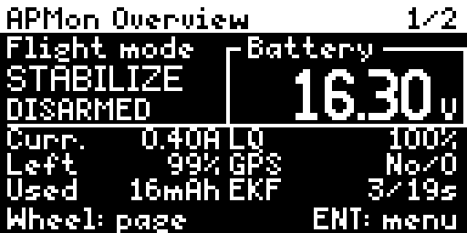
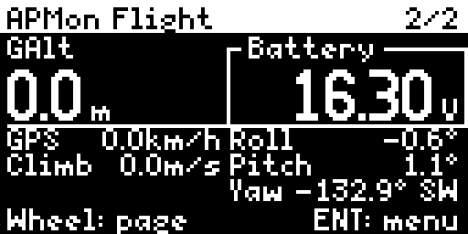
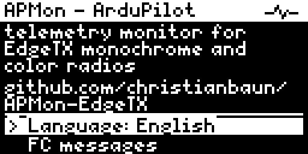
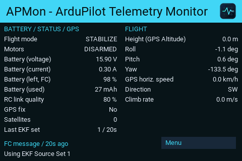
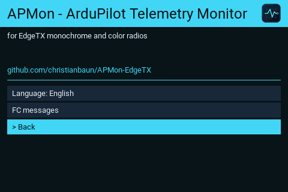
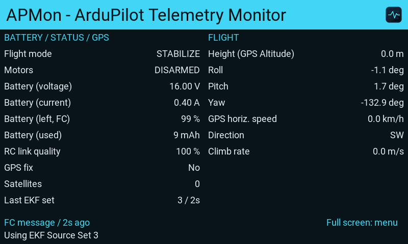
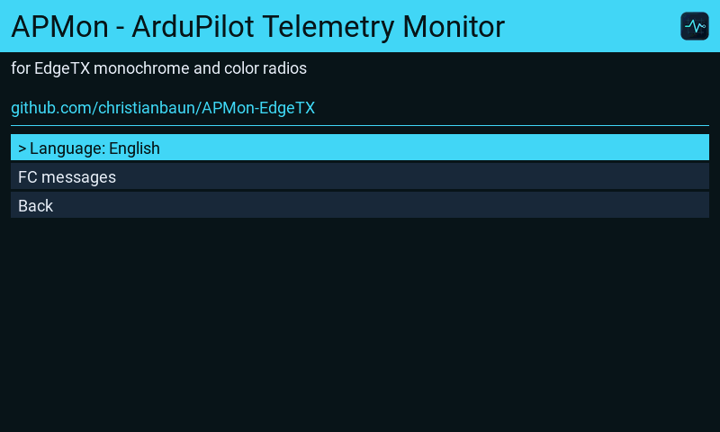

# APMon — EdgeTX Monitor for ArduPilot

**English** | [Deutsch](README.de.md)

[](LICENSE)

**ArduPilot telemetry on RadioMaster transmitters running EdgeTX.** APMon
displays battery readings, flight attitude, GPS status and flight-controller
messages. It runs as Lua scripts on the radio's SD card: no laptop or
additional flight-controller script is required during use.

Current project version: **0.2.1**, recorded in [VERSION](VERSION).
See the [v0.2.1 release notes](releases/v0.2.1.md).

The GUI supports **English and German**, with English as the default.

**AI-assisted development:** OpenAI Codex CLI helped write and revise the
source, tests and documentation. This does not replace hardware testing;
see the compatibility section for the current validation status.

## Contents

- [Choose your display](#choose-your-display)
- [Screenshots](#screenshots)
- [Features](#features)
- [Compatibility and requirements](#compatibility-and-requirements)
- [Installation](#installation)
- [Operation](#operation)
- [Sensor configuration](#sensor-configuration)
- [Data meaning and validity](#data-meaning-and-validity)
- [Troubleshooting](#troubleshooting)
- [Development and tests](#development-and-tests)
- [Contributing](#contributing)
- [License](#license)

## Choose your display

| Package | Display / interface | Reference radios |
| --- | --- | --- |
| [APMon-SW.zip](APMon-SW.zip) | Monochrome, 128 × 64; telemetry script with two data pages | RadioMaster GX12, Boxer |
| [APMon-COLOR.zip](APMon-COLOR.zip) | Color LCD; dashboard widget, minimum zone 440 × 252 | RadioMaster GX15 and TX15 (480 × 320), TX16S MK3 (800 × 480) |

**SW** means *Schwarzweiß* (German for monochrome). Choose the package and
deployment option by **display type**, not radio model: `--display sw` installs
the telemetry script, `--display color` the color widget. Other RadioMaster
radios may work if they meet the requirements below; a matching display alone
does not mean the hardware has been tested.

## Screenshots

Actual captures from the GX12, GX15 and TX16S MK3, including the project menu
on each radio. The GX12 images are enlarged 4×. The readings show the captured
state and are not an indication of flight readiness.

| Overview | Flight data |
| --- | --- |
|  |  |

**Monochrome project menu — GX12**



**Color dashboard and project menu — GX15 (480 × 320)**

| Dashboard in full screen | Project menu |
| --- | --- |
|  |  |

**Color dashboard and project menu — TX16S MK3 (800 × 480)**

| Dashboard | Project menu |
| --- | --- |
|  |  |

**Change language:** On SW, press **ENTER** and select **Language / Sprache**.
On COLOR, open APMon in full screen and select **Menu → Language**. For a
persistent COLOR setting, use **Widget settings → Language**.

## Features

- **Battery:** voltage, current, remaining percentage reported by the FC, consumed mAh.
- **Flight:** expanded flight-mode names, Armed/Disarmed, altitude, roll, pitch,
  yaw, horizontal GPS speed, climb rate and compass direction derived from yaw.
- **GPS:** satellite count and actual fix status, including 2D, 3D, DGPS,
  RTK Float and RTK Fixed, decoded from ELRS passthrough.
- **FC status:** latest text message and last reported EKF source-set change,
  both with their age.
- **RC link quality:** percentage of received control packets.
- **Language selection:** on the radio, with a central, extensible language registry.

APMon sends **no flight commands, parameter changes or telemetry requests**.
It does not modify model or FC settings. The SW variant only writes its own
language preference to the SD card.

**Limitations:** LiDAR ground distance, raw optical-flow readings, VTX frequency,
band/channel and PIT are not currently displayed. Reserved sensor configuration
entries do not provide a transport for these values. APMon is a telemetry
monitor, not a flight-readiness check or a replacement for FC pre-arm checks.

## Compatibility and requirements

APMon targets the **classic EdgeTX 2.x LCD API**, not EdgeTX 3.x/LVGL.
SW is designed for 128 × 64 pixels; COLOR needs a widget zone of at least
440 × 252 pixels. Other resolutions, key mappings, memory budgets and firmware
versions require separate testing.

| Reference radio | Firmware / validation status |
| --- | --- |
| GX15 | EdgeTX 2.12.5, ExpressLRS 4.1.0; UI and several live readings confirmed in practical use |
| TX15 | EdgeTX 2.12.4, ExpressLRS 4.1.0; color dashboard and full-screen project menu tested at 480 × 320 in English and German with the current source build. Full functional validation not recorded. |
| TX16S MK3 | EdgeTX 2.12.2, ExpressLRS 4.1.0; color dashboard and full-screen project menu tested at 800 × 480 in English and German with the current source build. Full functional validation not recorded. |
| GX12 | EdgeTX 2.12.2, ExpressLRS 4.1.0; automated SW tests pass; complete hardware validation after recent fixes is pending |
| Boxer | Shared SW variant; hardware validation and exact firmware version are pending |
| Other radios | Potentially compatible when display and API requirements match; not hardware-qualified |

For the complete feature set, you need:

1. ArduPilot with a working ExpressLRS connection in **MAVLink mode**.
2. Discovered EdgeTX telemetry sensors with matching names and units.
3. The Lua `getSourceValue()` API and its `isCurrent` validity flag.
4. For GPS fix, Armed and FC messages: the ArduPilot passthrough frames
   produced by **ELRS 4.1.0**, accessible through `crossfireTelemetryPop()`.

Without passthrough, ordinary EdgeTX sensor readings remain available, but
additional status fields may remain unknown.

### Data path

```text
ArduPilot FC → ELRS receiver → radio link → ELRS TX module
                                           ├─ CRSF sensors → EdgeTX → APMon
                                           ├─ ArduPilot passthrough → APMon
                                           └─ MAVLink → Backpack → GCS/laptop (separate)
```

The full MAVLink stream available through the Backpack is not automatically
available to EdgeTX Lua. APMon reads EdgeTX sensors and selected passthrough
frames rather than a full MAVLink stream.

## Installation

### Copy a package to the SD card

1. Download the package for your display from the table above.
2. Connect the powered radio in **USB storage / SD-card mode**, or use a card reader.
3. Extract the ZIP **directly into the SD-card root**. Merge directories and
   replace existing APMon files when updating.
4. For manual updates, remove old `.luac` files corresponding to updated APMon
   modules. The deployment script does this automatically.
5. Safely eject the card, disconnect USB and restart the radio.

Expected SD-card layout:

```text
SCRIPTS/
├── APMON/
│   ├── config.lua
│   ├── core.lua
│   ├── i18n.lua
│   ├── pass.lua
│   ├── project.lua
│   └── LICENSE.txt
└── TELEMETRY/             # SW package only
    ├── APMon.lua
    └── APDiag.lua
WIDGETS/                   # COLOR package only
└── APMon/
    ├── main.lua
    └── logo.png
```

Do not add an enclosing package directory:
`/SCRIPTS/TELEMETRY/APMon.lua` is correct;
`/APMon-SW/SCRIPTS/TELEMETRY/APMon.lua` is not.

### Color display: add the widget

1. Open the EdgeTX menu from the main view and select **Screen settings**.
2. Choose a layout with a large widget zone, at least **440 × 252 pixels**.
3. Open **Setup widgets**, select the zone and choose **APMon**.
4. Return to the main view with RTN.

### Monochrome display: select the telemetry script

1. Open the intended model.
2. Under **Model → Display**, set a telemetry screen to **Script → APMon**.
3. Open the telemetry view.

Run APMon as a telemetry screen, not as a one-time tool from the SD-card browser.

### Automated deployment on Linux

Local utilities require Python **3.9 or newer** and a Lua 5.3/5.4 shared library.
Python is only needed on the computer, not on the radio.

Connect and mount the SD card. From the project directory, preview the operation:

```bash
python3 deploy.py --display sw
# or
python3 deploy.py --display color
```

Apply the selected variant:

```bash
# Monochrome displays, e.g. GX12 / Boxer
python3 deploy.py --display sw --apply

# Color LCD widgets, e.g. GX15
python3 deploy.py --display color --apply
```

`--display` is required. The previous `--radio` option has been removed.
The script does not detect or certify a radio model: it installs the selected
variant onto the specified or automatically detected card.

A card is recognized by its `MODELS`, `RADIO` and `SCRIPTS` directories. If
multiple cards are mounted, specify the target explicitly:

```bash
python3 deploy.py --display color --sd /run/media/USER/CARD --apply
```

With `--apply`, the script runs the Lua tests, builds both ZIP packages, copies
only the selected variant, verifies file contents and removes matching old
APMon `.luac` files. **No backup is created.** Other scripts and model settings
are left untouched. `config.lua` is replaced: keep custom sensor mappings in
`SD/SCRIPTS/APMON/config.lua` before deploying. The saved SW language file,
`mono.cfg`, is preserved.

The ZIP packages include the license; direct deployment does not copy it.
Safely eject the card and restart the radio after deployment.

### Import screenshots

Take a screenshot with the EdgeTX **Screenshot** special function, then
connect the radio in USB storage mode. `import_screenshots.py` uses the same
card detection as `deploy.py`; use `--sd PATH` if more than one card is mounted.
Preview and import need Pillow 9.1+ (`python3-pil` on Debian); listing does not.

```bash
python3 import_screenshots.py --list
python3 import_screenshots.py --display sw --radio gx12 --view overview --lang de --scale 4
python3 import_screenshots.py --display sw --radio gx12 --view overview --lang de --scale 4 --apply
```

By default the importer picks up **all new captures** in `SCREENSHOTS` and
skips existing imports with the same capture time and pixels, even if their
labels or scale differ. The supplied view and language apply to the whole
batch. If those differ between captures, select the originals with
`--file NAME` (repeat for several captures with the same metadata).
For example, GX15 menu captures use
`--display color --radio gx15 --view menu --lang en`. Use `--version` if
the APMon version on the radio differs from [VERSION](VERSION).
The other view names include `flight`, `language`, `messages` and `diagnostics`.

The importer reads BMP and PNG files and writes PNGs such as
`images/screenshots/apmon-sw-gx12-overview-de-v0.2.1-2026-11-20-090305-4x.png`.
It uses the EdgeTX filename timestamp, or local file modification time for
renamed captures. Images keep their native size unless `--scale` is given.
Identical imports are skipped; different captures with the same name get
a numeric suffix. The SD card and existing README screenshots are untouched.

## Operation

### COLOR

The single view groups flight mode, motors, battery, RC link quality, GPS fix,
satellites and the last EKF source-set message on the left. Flight attitude,
altitude, horizontal GPS speed, direction and climb rate are on the right.
The latest FC message appears at the bottom with its age; long text is clipped.

- **Open the project menu:** double-tap APMon, or choose **Full screen** from
  the widget's context menu. In full screen, tap **Menu** or press **ENTER**.
- The menu shows the full project title and GitHub address. Open **Language**
  or **FC messages** by tapping an item or using the wheel and **ENTER**.
  **RTN** goes back; hold **RTN** to leave full screen.
- The menu language change applies to this widget for the current session.
  To save it in the model, long-press APMon in the main view and choose
  **Widget settings → Language → English / Deutsch**. If the old English
  checkbox remains after an update, restart and re-add the widget if needed.

### SW

- **Overview:** flight mode and arming state on the left, with battery current,
  remaining charge, consumed mAh, link quality, GPS fix/satellites and the last
  EKF source set below.
- **Flight:** large altitude on the left, with horizontal GPS speed, climb rate,
  roll, pitch and yaw with compass direction below.
- **Battery voltage is in the upper right on both pages**. Without a valid
  reading it shows `--`.
- **Rotary wheel, Plus/Minus or NEXT/PREV:** change pages manually; no automatic rotation.
- **ENTER / press the wheel:** open the menu with the full project title and
  GitHub address.
- Select **Language** to choose **English / Deutsch**, or **FC messages** to
  see the latest message. **RTN** returns one level without changing the selection.

The latest FC message is wrapped over several lines. Language is saved as a
code in `/SCRIPTS/APMON/mono.cfg`, shared by all models on that SD card. If
saving fails, a warning is displayed and the language remains active for the
current session.

Short labels keep readings on the same line on the small display:

| Label | Meaning |
| --- | --- |
| Battery / Curr. | Battery voltage (V) / current (A) |
| Rest / Left | Remaining percentage reported by the FC |
| Verbr. / Used | Consumed mAh |
| LQ | RC link quality |
| GAlt | Altitude from the GAlt sensor |
| GPS | Fix/satellite count on Overview (e.g. `3D/12`); horizontal GPS speed on Flight |
| Climb / Vario | Climb rate |
| Dir | Compass direction derived from yaw, when it does not fit next to the angle |
| EKF | Last source-set message; `2/30s` means set 2 was reported 30 seconds ago |

## Sensor configuration

Edit [config.lua](SD/SCRIPTS/APMON/config.lua). Mappings are shared across all
models on the card. Compare values and units with the flight-controller display
before relying on them.

| Reading | Default source | Expected unit / meaning |
| --- | --- | --- |
| Battery voltage | `RxBt` | V; verify this is flight-battery voltage, not receiver/BEC voltage |
| Battery current | `Curr` | A |
| Battery remaining | `Bat%` | Percentage reported by the FC; no voltage-based estimate |
| Battery used | `Capa` | Consumed mAh |
| Altitude | `Alt`, falling back to `GAlt` | m; verify the altitude reference |
| Climb rate | `VSpd` | m/s |
| Horizontal GPS speed | `GSpd` | km/h |
| Roll / pitch / yaw | `Roll` / `Ptch` / `Yaw` | Standard CRSF radians, converted to degrees |
| Satellites | `Sats` | Count, not proof of a fix |
| GPS course | `Hdg` | Degrees; course over ground, not necessarily nose direction |
| Flight mode | `FM` | FC mode text |
| RC link quality | `RQly` | Percentage of received control packets |
| GPS position | `GPS` | Table containing `lat` and `lon` |

The adapter reads GPS coordinates and course, but these are not separate fields
in the current compact main views.

Example for a renamed voltage sensor:

```lua
voltage = { names = { 'FlightBat' }, unit = 'V', decimals = 2, min = 0.1 },
```

`names` can contain ordered aliases. Adjust `scale` when source units differ:
for example, `3.6` converts m/s to km/h; use `1` for an angle sensor already in
degrees. Standard CRSF attitude sources use `180 / math.pi`.

Use real downlink telemetry sources. Channel and switch positions do not confirm
Armed, the active EKF source set or VTX settings.

## Data meaning and validity

### Missing and stale readings

`--` means missing, unmapped, invalid or stale data. Valid zero readings are kept.

| Source | Validity |
| --- | --- |
| EdgeTX sensors | EdgeTX `isCurrent`; last readings can remain visible for about 20 seconds after a loss in the target firmware |
| Passthrough GPS fix / Armed | About 3 seconds since the last corresponding frame |
| FC text / last EKF source-set message | Historical message with age, not a continuously confirmed state |

APMon does not require `isFresh`: its short window would hide slower sensors
that are still current. APMon has no independent MAVLink heartbeat monitor.
RC link quality is not signal strength, proof of complete FC telemetry, or
confirmation that the aircraft is ready to fly.

### GPS, altitude and heading

- Fix status comes from passthrough, not an estimate based on satellite count.
- “Yes” means at least a 2D fix. DGPS, RTK Float and RTK Fixed have separate labels.
- **GAlt** means *GPS Altitude*. However, normal ELRS 4.1.0 MAVLink builds populate
  it from `GLOBAL_POSITION_INT.relative_alt`, i.e. altitude relative to Home.
  A build with `USE_MAVLINK_GPS_ALTITUDE` uses GPS altitude above mean sea level
  instead. The displayed name identifies the sensor, not a ground-distance measurement.
- Compass direction is derived from yaw. GPS course and vehicle heading are
  different quantities, especially while stationary.

### Flight mode and EKF

`STAB`, `LOIT` and `GUID` are expanded to `STABILIZE`, `LOITER` and `GUIDED`.
A trailing asterisk is removed from mode text; Armed/Disarmed is read separately
from feedback.

The EKF field only recognizes the FC text `Using EKF Source Set 1/2/3`. An old
message is not proof that the source set is still active, particularly after an
FC restart.

## Troubleshooting

| Problem | What to check |
| --- | --- |
| APMon is missing from the selection | Verify SD layout and restart. SW: `/SCRIPTS/TELEMETRY/APMon.lua`; COLOR: `/WIDGETS/APMon/main.lua`. |
| Module load error | Install the complete matching package, not just its main file; remove old APMon `.luac` files. |
| Only mode and RC link quality work | Check EdgeTX's Telemetry screen first. If readings are absent there too, investigate the upstream telemetry path. |
| GPS fix / Armed remain unknown | Check ELRS version, MAVLink mode and passthrough reception. |
| Language option missing on COLOR | Restart; remove and re-add APMon if needed. |
| SW reports “Language not saved” | Check SD write access and free space. |
| “Waiting for home” or GPS/AHRS discrepancy | Inspect FC/EKF status. These originate from the FC, not APMon. |

### Missing telemetry after an FC restart

The FC must send the necessary messages even without a connected ground station
requesting streams. APMon does not change stream-rate parameters or request
message intervals.

For the MAVLink channel associated with the ELRS receiver, ExpressLRS recommends
SR/MAV stream groups at 1 Hz, except `ADSB`, `PARAMS` and `RAW_CTRL` at 0.
Check the correct channel mapping; do not assume an SR index always equals a
SERIAL port number. After configuration, restart without a GCS and check the
readings. See the [ELRS MAVLink setup guide](https://www.expresslrs.org/software/mavlink/).

### Other Lua telemetry programs

APMon consumes the CRSF Lua queue through `crossfireTelemetryPop()`. Do not run
other raw-telemetry readers, such as Yaapu or the ELRS configuration script,
concurrently when they may share that queue.

### APDiag

The SW package includes the independent `APDiag` telemetry script. It shows raw
EdgeTX API values and validity flags. It does not decode a full MAVLink stream.

## Development and tests

### Repository layout

```text
SD/SCRIPTS/APMON/        Shared adapter, passthrough, sensor configuration, languages
SD/SCRIPTS/TELEMETRY/    Monochrome application and APDiag
SD/WIDGETS/APMon/        Color LCD widget
tests/                  Lua regression tests and deployment tests
deploy.py               SD-card deployment preview and installation
package_sd.py           Build and verify both distribution archives
VERSION                 Project version
LICENSE                 Apache License 2.0
README.de.md            German documentation
```

### Source headers and versioning

All Lua and Python source files have headers recording purpose, project version,
update date, authorship and the `Apache-2.0` SPDX identifier. Christian Baun is
listed under `Authors`; Codex CLI is credited separately for development
assistance. Dates describe the recorded change state, not an assumed original
creation date.

[VERSION](VERSION) is the central project version. When releasing a new version,
update source-header versions and both READMEs together. Update each changed
file's header date and rebuild the archives before publishing.

### Run tests

From the repository root:

```bash
python3 tests/run.py
python3 -m unittest discover -s tests -p 'test_*.py'
```

The Lua runner uses a local Lua 5.3/5.4 shared library through `ctypes`. A Lua
interpreter can run the Lua suite directly instead:

```bash
lua tests/check.lua
```

Tests cover sensor validation, valid zeroes, stale data, screen bounds, script
lifecycles, navigation, language changes and persistence, passthrough formats,
DGPS and other fix types, Armed, FC/EKF messages and timeouts. The monochrome
suite also runs without string methods and without the `table` library.
Deployment tests check display-based selection, preview behavior and preservation
of unrelated files and saved preferences.

These are **simulation tests**, not complete hardware qualification. Fonts,
physical keys, runtime/memory limits and radio integration still need testing on
each target radio.

### Build packages

```bash
python3 package_sd.py
```

After the Lua tests pass, this builds and verifies only `APMon-SW.zip` and
`APMon-COLOR.zip`. Both include the complete license text.

### Add a language

Append an entry to `languages` in [i18n.lua](SD/SCRIPTS/APMON/i18n.lua):

```lua
{ code = 'fr', name = 'Français',
  texts = {
    ['Flugmodus'] = 'Mode de vol',
    ['Satelliten'] = 'Satellites',
    ['FC-Meldung / vor %ds'] = 'Message FC / il y a %ds',
    -- Translate additional keys from english.
  },
  directions = { 'N', 'NE', 'E', 'SE', 'S', 'SO', 'O', 'NO' },
},
```

Selection menus are generated from the registry. Missing translations or
compass directions fall back to English. Preserve format placeholders such as
`%ds` and check long labels on both displays. Do not reorder existing entries:
EdgeTX saves COLOR choices by index; SW saves a language code. Original FC
messages are not translated.

## Contributing

Bug reports should include radio model, display variant, EdgeTX/ELRS/ArduPilot
versions, sensor names and units, exact messages and screenshots where helpful.
For missing readings, state whether they are also absent in EdgeTX's Telemetry
screen.

Submit changes as pull requests and run the tests first. New telemetry fields
must document units, meaning and data age. Never replace missing data with an
invented state. Contributions are provided under the project's Apache-2.0 license.

### References

- [EdgeTX Lua documentation](https://luadoc.edgetx.org/)
- [EdgeTX 2.12.5 Lua API](https://github.com/EdgeTX/edgetx/blob/v2.12.5/radio/src/lua/api_general.cpp)
- [EdgeTX 2.12.5 CRSF sensors](https://github.com/EdgeTX/edgetx/blob/v2.12.5/radio/src/telemetry/crossfire.cpp)
- [ExpressLRS MAVLink](https://www.expresslrs.org/software/mavlink/)
- [ELRS 4.1.0 MAVLink conversion](https://github.com/ExpressLRS/ExpressLRS/blob/4.1.0/src/lib/MAVLink/MAVLink.cpp)
- [ELRS 4.1.0 passthrough field encoding](https://github.com/ExpressLRS/ExpressLRS/blob/4.1.0/src/lib/MAVLink/ardupilot_custom_telemetry.cpp)
- [MAVLink messages and GPS fix types](https://mavlink.io/en/messages/common.html)

## License

APMon is released under the **Apache License, Version 2.0**. See [LICENSE](LICENSE)
for the complete text.

EdgeTX, ExpressLRS and ArduPilot are independent projects with their own licenses.
Linked documentation and protocol references are not relicensed as APMon code.
