# APMon — ArduPilot Telemetry Monitor for EdgeTX radios

**English** | [Deutsch](README.de.md)

[](LICENSE)

**ArduPilot telemetry on RadioMaster transmitters running EdgeTX.** APMon is
designed for **ExpressLRS in MAVLink mode**. It displays battery readings,
flight attitude, GPS status and flight-controller messages by reading EdgeTX
sensors and selected ArduPilot passthrough data, not the full MAVLink stream.
It runs as Lua scripts on the radio's SD card: no laptop or
additional flight-controller script is required during use.

Current project version: **1.0.0**, recorded in [VERSION](VERSION).
See the [v1.0.0 release notes](releases/v1.0.0.md).

The GUI supports **English and German**, with English as the default.

**AI-assisted development:** OpenAI Codex CLI helped write and revise the
source, tests and documentation. This does not replace hardware testing.
See the compatibility section for the current validation status.

## Contents

- [Choose your display](#choose-your-display)
- [Screenshots](#screenshots)
- [Features](#features)
- [Compatibility and requirements](#compatibility-and-requirements)
- [Installation](#installation)
- [Operation](#operation)
- [Sensor configuration](#sensor-configuration)
- [Data meaning and validity](#data-meaning-and-validity)
- [Troubleshooting](#troubleshooting)
- [Development and tests](#development-and-tests)
- [Contributing](#contributing)
- [License](#license)

## Choose your display

| Package | Display / interface | Reference radios |
| --- | --- | --- |
| [APMon-SW.zip](APMon-SW.zip) | Telemetry script with Overview, Flight and HUD pages for 128 × 64 monochrome displays | RadioMaster GX12, Boxer |
| [APMon-COLOR.zip](APMon-COLOR.zip) | Dashboard widget for color displays (minimum zone 440 × 252) | RadioMaster GX15 and TX15 (480 × 320), TX16S MK3 (800 × 480) |

**SW** means *Schwarzweiß* (German for monochrome). Choose the package and
deployment option by **display type**, not radio model: `--display sw` installs
the telemetry script, `--display color` the color widget. Other RadioMaster
radios may work if they meet the requirements below. A matching display alone
does not mean the hardware has been tested.

## Screenshots

Actual captures from the GX12, GX15 and TX16S MK3. The readings show the
captured state and are not an indication of flight readiness.

**Monochrome — GX12 (128 × 64, APMon v1.0.0)**

The images are enlarged for readability. The radio clock is visible in both captures.

| Overview (1/3) | Flight data (2/3) |
| --- | --- |
| 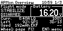 | 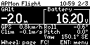 |

**Compact project menu:**

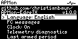

More GX12 captures: [HUD](#hud), [FC message filter](#radio-clock-and-fc-message-history),
[GPS details](#gps-details),
[Telemetry diagnostics](#telemetry-diagnostics),
[Setup check](#telemetry-setup-check),
[Diagnostic report](#diagnostic-report), and
[Post-disarm summary](#post-disarm-summary).

**Color display — GX15 (480 × 320, APMon v1.0.0)**

| Dashboard (1/2) with radio clock | Project menu |
| --- | --- |
| 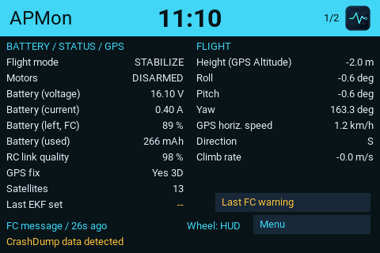 | 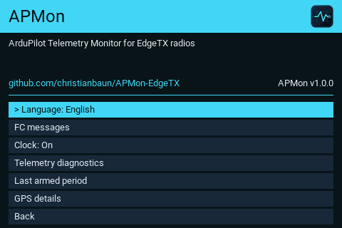 |

More GX15 captures: [HUD](#hud), [FC message filter](#radio-clock-and-fc-message-history),
[GPS details](#gps-details),
[Telemetry diagnostics](#telemetry-diagnostics),
[Setup check](#telemetry-setup-check),
[Diagnostic report](#diagnostic-report), and
[Post-disarm summary](#post-disarm-summary).

**Color display — TX16S MK3 (800 × 480, APMon v1.0.0)**

| Dashboard (1/2) with radio clock | Project menu |
| --- | --- |
| 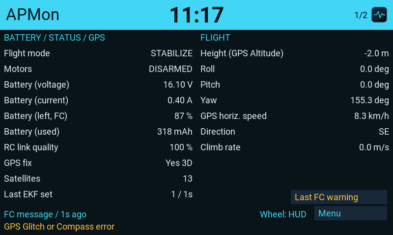 | 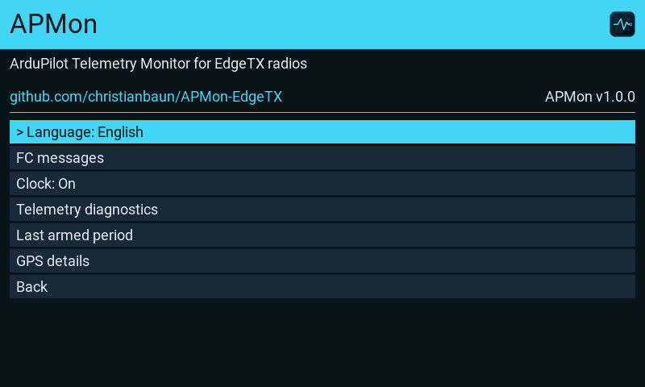 |

[Dashboard with no EKF source set displayed](images/screenshots/apmon-color-tx16s-mk3-overview-en-v1.0.0-2026-11-23-111701.png).

More TX16S MK3 captures: [HUD](#hud), [Armed summary](#post-disarm-summary),
[GPS details](#gps-details), [FC messages](#radio-clock-and-fc-message-history),
[Telemetry diagnostics](#telemetry-diagnostics),
[Setup check](#telemetry-setup-check), and [Diagnostic report](#diagnostic-report).

**Change language:** On SW, press **ENTER** and select **Language / Sprache**.
On COLOR, open APMon in full screen and select **Menu → Language**. For a
persistent COLOR setting, use **Widget settings → Language**.

## Features

- **Battery:** voltage, current, remaining percentage reported by the FC, consumed mAh.
- **Flight:** expanded flight-mode names, Armed/Disarmed, altitude, roll, pitch,
  yaw, horizontal GPS speed, climb rate and compass direction derived from yaw.
- **[GPS details](#gps-details):** coordinates, confirmed fix type, satellite
  count and GPS course. The last verified position stays visible after a loss.
- **FC status:** latest text message and last reported EKF source-set change,
  both with their age.
- **RC link quality:** percentage of received control packets.
- **Telemetry diagnostics:** check the RC link, EdgeTX sensors and FC status
  separately, open the [setup check](#telemetry-setup-check) or
  [save a diagnostic report](#diagnostic-report).
- **Last armed period:** review elapsed time and recorded extremes after
  disarming from the project menu.
- **Language selection:** on the radio, with a central, extensible language registry.

APMon sends **no flight commands, parameter changes or telemetry requests**.
It does not modify model or FC settings. SW stores its language and clock
preferences on the SD card. Both variants write a report only on request.

**Limitations:** LiDAR ground distance, raw optical-flow readings, VTX frequency,
band/channel and PIT are not currently displayed. Reserved sensor configuration
entries do not provide a transport for these values. APMon is a telemetry
monitor, not a flight-readiness check or a replacement for FC pre-arm checks.

## Alternatives and scope

APMon is a **read-only monitor on the radio**, not a Ground Control Station
(GCS). It uses EdgeTX sensors and selected ArduPilot passthrough data from
ExpressLRS MAVLink mode, not the full MAVLink stream. It does not plan or
upload missions, configure the flight controller, flash firmware or analyze
flight logs. Use a GCS alongside APMon when you need those functions.

| Solution | Platform and typical setup | Main purpose |
| --- | --- | --- |
| **APMon** | EdgeTX 2.x with the Lua LCD API on monochrome or color radios, ArduPilot with ExpressLRS in MAVLink mode | On-radio telemetry, FC messages, armed summaries and a local diagnostic report |
| [FM2M ToolBox](https://fm2m.online/) | EdgeTX or ETHOS color radios, primarily Betaflight and INAV, with compatible CRSF or FrSky S.Port telemetry | On-radio status, telemetry, diagnostics and, depending on the edition and setup, device and VTX configuration |
| [Yaapu Telemetry Script](https://github.com/yaapu/frskytelemetryscript) | OpenTX, EdgeTX or ETHOS, ArduPilot passthrough over FrSky S.Port, TBS Crossfire or ExpressLRS, depending on setup | On-radio ArduPilot telemetry script and widget for a wider range of radios and telemetry links |
| [INAV Lua Telemetry](https://github.com/iNavFlight/OpenTX-Telemetry-Widget) | OpenTX or EdgeTX with INAV and compatible telemetry | On-radio status, battery, GPS and flight data for INAV rather than ArduPilot |
| [ArduDeck](https://ardudeck.com/) | Cross-platform GCS for ArduPilot and PX4, with an optional EdgeTX HUD | Map-based monitoring, mission and survey planning, parameter management and log analysis |
| [Mission Planner](https://ardupilot.org/planner/docs/mission-planner-overview.html) by Michael Oborne | Windows GCS for ArduPilot | Vehicle setup and tuning, firmware installation, mission planning and log analysis |
| [MicoPilot](https://micoair.com/en/tools/micopilot) by MicoAir | GCS for ArduPilot and PX4, Android beta with other platforms in testing | Live telemetry, FC configuration, sensor calibration and mission planning |
| [QGroundControl](https://qgroundcontrol.com/) | Desktop and mobile MAVLink GCS for PX4 and ArduPilot | Vehicle setup, map-based flight monitoring and control, and mission planning |
| [MAVProxy](https://ardupilot.org/mavproxy/) | Command-line MAVLink ground station | Scriptable vehicle interaction and telemetry forwarding to other ground stations |
| [UgCS](https://ugcs.com/supported_drones_autopilots) | Commercial desktop mission planner for supported aircraft, including compatible ArduPilot and PX4 setups | Survey route planning for photogrammetry, LiDAR and corridor mapping |
| [ArduPilot UAV Log Viewer](https://plot.ardupilot.org/) | Browser tool for existing ArduPilot DataFlash (`.bin`) and MAVLink (`.tlog`) logs | Post-flight plots, maps and flight replay rather than live monitoring on the radio |
| [AirData UAV](https://airdata.com/supported-apps) | Cloud service that accepts supported ArduPilot `.bin` and `.tlog` flight logs | Post-flight analysis, battery health, maintenance and fleet management |
| [DroneLogbook](https://www.dronelogbook.com/hp/1/features.html) | Cloud service for flight records with supported log imports | Flight records, equipment, inspections, maintenance and compliance documentation |

Check the linked project's documentation for your radio, firmware and telemetry
link. A listed alternative is not necessarily compatible with an APMon setup
without changes.

Cloud services process data outside the radio. Their flight-log imports are
separate from APMon's local diagnostic report. APMon neither uploads to
these services nor exports a flight log.

## Compatibility and requirements

APMon targets **EdgeTX 2.x with the Lua LCD API**, not EdgeTX 3.x/LVGL.
SW is designed for 128 × 64 pixels. COLOR needs a widget zone of at least
440 × 252 pixels. Other resolutions, key mappings, memory budgets and firmware
versions require separate testing.

| Radio | Versions |
| --- | --- |
| GX15 | EdgeTX 2.12.5, ExpressLRS 4.1.0, APMon 1.0.0 |
| TX15 | EdgeTX 2.12.5, ExpressLRS 4.1.0, APMon 0.4.0 |
| TX16S MK3 | EdgeTX 2.12.5, ExpressLRS 4.1.0, APMon 1.0.0 |
| GX12 | EdgeTX 2.12.5, ExpressLRS 4.1.0, APMon 1.0.0 |
| Boxer | Hardware testing pending |
| Other radios | Hardware testing pending |

For the complete feature set, you need:

1. ArduPilot with a working ExpressLRS connection in **MAVLink mode**.
2. Discovered EdgeTX telemetry sensors with matching names and units.
3. The Lua `getSourceValue()` API and its `isCurrent` validity flag.
4. For GPS fix, Armed and FC messages: the ArduPilot passthrough frames
   produced by **ELRS 4.1.0**, accessible through `crossfireTelemetryPop()`.

Without passthrough, ordinary EdgeTX sensor readings remain available, but
additional status fields may remain unknown.

### Data path

```text
ArduPilot FC → ELRS receiver → radio link → ELRS TX module
                                           ├─ CRSF sensors → EdgeTX → APMon
                                           ├─ ArduPilot passthrough → APMon
                                           └─ MAVLink → Backpack → GCS/laptop (separate)
```

The full MAVLink stream available through the Backpack is not automatically
available to EdgeTX Lua. APMon reads EdgeTX sensors and selected passthrough
frames rather than a full MAVLink stream.

## Installation

### Copy a package to the SD card

1. Download the package for your display from the table above.
2. Connect the powered radio in **USB storage / SD-card mode**, or use a card reader.
3. Extract the ZIP **directly into the SD-card root**. Merge directories and
   replace existing APMon files when updating.
4. For manual updates, remove old `.luac` files corresponding to updated APMon
   modules. The deployment script does this automatically.
5. Safely eject the card, disconnect USB and restart the radio.

Expected SD-card layout:

```text
SCRIPTS/
├── APMON/
│   ├── armed_summary.lua
│   ├── config.lua
│   ├── core.lua
│   ├── diagnostics.lua
│   ├── i18n.lua
│   ├── mono_tools.lua      # SW package only
│   ├── pass.lua
│   ├── project.lua
│   ├── VERSION
│   └── LICENSE.txt
└── TELEMETRY/             # SW package only
    ├── APMon.lua
    └── APDiag.lua
WIDGETS/                   # COLOR package only
└── APMon/
    ├── main.lua
    └── logo.png
```

Do not add an enclosing package directory:
`/SCRIPTS/TELEMETRY/APMon.lua` is correct.
`/APMon-SW/SCRIPTS/TELEMETRY/APMon.lua` is not.

### Color display: add the widget

1. Open the EdgeTX menu from the main view and select **Screen settings**.
2. Choose a layout with a large widget zone, at least **440 × 252 pixels**.
3. Open **Setup widgets**, select the zone and choose **APMon**.
4. Return to the main view with RTN.

### Monochrome display: select the telemetry script

1. Open the intended model.
2. Under **Model → Display**, set a telemetry screen to **Script → APMon**.
3. Open the telemetry view.

### Start APMon from SYS → Tools

Both the SW and COLOR packages add **APMon** to the EdgeTX **SYS → Tools**
menu. Open the intended model first, then select **APMon** under **Tools**.
No telemetry screen or widget needs to be configured for this launch.
Use **RTN** to go back and press it on the dashboard to close the tool.
On COLOR, the tool opens directly at full size without entering widget full screen.

Use this entry for bench checks, not during flight. EdgeTX suspends other
Lua scripts while the tool is open, including Lua mixer scripts. The tool
starts with its own message history and armed summary. For monitoring in
the background, use the model's telemetry screen on SW or widget on COLOR.
On SW, EdgeTX reloads the model's Lua scripts after the tool closes, so
the telemetry screen's previous in-memory history and armed summary are lost.
On COLOR, language and clock changes in the tool apply only until it closes
and do not change the widget settings.

### Automated deployment on Linux

Local utilities require Python **3.9 or newer** and a Lua 5.3/5.4 shared library.
Python is only needed on the computer, not on the radio.

Connect and mount the SD card. From the project directory, preview the operation:

```bash
python3 deploy.py --display sw
# or
python3 deploy.py --display color
```

Apply the selected variant:

```bash
# Monochrome displays, e.g. GX12 / Boxer
python3 deploy.py --display sw --apply

# Color LCD widgets, e.g. GX15
python3 deploy.py --display color --apply
```

`--display` is required. The previous `--radio` option has been removed.
The script does not detect or certify a radio model: it installs the selected
variant onto the specified or automatically detected card.

A card is recognized by its `MODELS`, `RADIO` and `SCRIPTS` directories. If
multiple cards are mounted, specify the target explicitly:

```bash
python3 deploy.py --display color --sd /run/media/USER/CARD --apply
```

With `--apply`, the script runs the Lua tests, builds both ZIP packages, copies
only the selected variant, verifies file contents and removes matching old
APMon `.luac` files. **No backup is created.** Other scripts and model settings
are left untouched. `config.lua` is replaced: keep custom sensor mappings in
`SD/SCRIPTS/APMON/config.lua` before deploying. The saved SW preferences file,
`mono.cfg`, is preserved.

The ZIP packages include the license. Direct deployment does not copy it.
Safely eject the card and restart the radio after deployment.

### Import screenshots

Take a screenshot with the EdgeTX **Screenshot** special function, then
connect the radio in USB storage mode. `import_screenshots.py` uses the same
card detection as `deploy.py`. Use `--sd PATH` if more than one card is mounted.
Preview and import need Pillow 9.1+ (`python3-pil` on Debian). Listing does not.

```bash
python3 import_screenshots.py --list
python3 import_screenshots.py --display sw --radio gx12 --view overview --lang de --scale 4
python3 import_screenshots.py --display sw --radio gx12 --view overview --lang de --scale 4 --apply
```

By default the importer picks up **all new captures** in `SCREENSHOTS` and
skips existing imports with the same capture time and pixels, even if their
labels or scale differ. The supplied view and language apply to the whole
batch. If those differ between captures, select the originals with
`--file NAME` (repeat for several captures with the same metadata).
For example, GX15 menu captures use
`--display color --radio gx15 --view menu --lang en`. Use `--version` if
the APMon version on the radio differs from [VERSION](VERSION).
The other view names include `flight`, `language`, `messages` and `diagnostics`.

The importer reads BMP and PNG files and writes PNGs such as
`images/screenshots/apmon-sw-gx12-overview-de-v0.2.1-2026-11-20-090305-4x.png`.
It uses the EdgeTX filename timestamp, or local file modification time for
renamed captures. Images keep their native size unless `--scale` is given.
Identical imports are skipped. Different captures with the same name get
a numeric suffix. The SD card and existing README screenshots are untouched.

## Operation

### COLOR

The single view groups flight mode, motors, battery, RC link quality, GPS fix,
satellites and the last EKF source-set message on the left. Flight attitude,
altitude, horizontal GPS speed, direction and climb rate are on the right.
The latest FC message appears at the bottom with its age. Long text is clipped.

- **Open full screen:** In EdgeTX 2.12.5, select the **App mode** layout for
  the screen and assign APMon to its single widget slot. Then hold **ENTER**
  on that screen to open APMon directly in full screen. With a regular
  layout, choose **Full screen** from the widget's context menu. EdgeTX
  controls this mode and does not let a Lua widget enter it automatically.
  In full screen, tap **Menu** or press **ENTER** to open the project menu.
- Below **APMon**, the menu shows **ArduPilot Telemetry Monitor for EdgeTX radios**,
  followed by the GitHub address and installed version. Open **Language** or
  **FC messages** by tapping an item or using
  the wheel and **ENTER**.
  **RTN** goes back. Hold **RTN** to leave full screen.
- The menu language change applies to this widget for the current session.
  To save it in the model, open **Widget settings → Language** through
  **Set up widgets** in EdgeTX's screen settings. If the old English checkbox
  remains after an update, restart and re-add the widget if needed.
- **Menu → Clock** toggles the larger radio clock centered in the dashboard
  header for the current session. Use **Widget settings → Clock** to save
  the default per widget.

### SW

- **Overview:** flight mode and arming state on the left, with battery current,
  remaining charge, consumed mAh, link quality, GPS fix/satellites and the last
  EKF source set below.
- **Flight:** large altitude on the left, with horizontal GPS speed, climb rate,
  roll, pitch and yaw with compass direction below.
- **[HUD](#hud):** artificial horizon with roll and pitch, on page 3.
- **Battery voltage is in the upper right on Overview and Flight**. Without a valid
  reading it shows `--`.
- **Rotary wheel, Plus/Minus or NEXT/PREV:** change pages manually.
- **ENTER / press the wheel:** open the menu with the project title, GitHub
  address and installed APMon version.
- Select **Language** to choose **English / Deutsch**, or **FC messages** to
  open the history. Select **Clock: Off/On** directly below and press **ENTER**
  to toggle the clock. The time appears next to the page
  number on all three telemetry pages. **RTN** goes back one level.

Language and clock preferences are saved in `/SCRIPTS/APMON/mono.cfg`, shared by
all models on that SD card. If a write fails, APMon shows a warning and keeps the
change for the current session.

Short labels keep readings on the same line on the small display:

| Label | Meaning |
| --- | --- |
| Battery / Curr. | Battery voltage (V) / current (A) |
| Rest / Left | Remaining percentage reported by the FC |
| Verbr. / Used | Consumed mAh |
| LQ | RC link quality |
| GAlt | Altitude from the GAlt sensor |
| GPS | Fix and satellite count on Overview (e.g. `3D/12`), horizontal GPS speed on Flight |
| Climb / Vario | Climb rate |
| Dir | Compass direction derived from yaw, when it does not fit next to the angle |
| EKF | Last source-set message. `2/30s` means set 2 was reported 30 seconds ago. |

### HUD

On SW, rotate right from **Overview** through **Flight** to **HUD**.
On COLOR, open the widget in full screen and rotate right from the dashboard
(**1/2**) to the HUD (**2/2**).
Rotate left to go back. On either display, **ENTER** still opens the project
menu.

The HUD shows a fixed aircraft symbol, a moving horizon and pitch marks,
alongside battery voltage, current, RC link quality, the last EKF source set,
GPS fix type and satellite count. The header shows the clock only if it is
enabled on the main page.
It uses roll and pitch from the configured EdgeTX sensors (`Roll` and `Ptch`
by default). The two readings do not need to arrive together. The HUD
bridges gaps of up to one second per axis while EdgeTX still considers
the source current. If either reading expires, becomes invalid or is lost,
**HOLD** marks the last complete attitude as frozen. If no complete attitude
has been received, there is no horizon to show. The other sensor readings
continue to update. On SW they are grouped in two rows below the horizon.
On COLOR the values next to the horizon use a larger font when space permits.
The HUD is not a primary flight instrument.

| GX12 with v1.0.0: Level attitude | Bank and pitch |
| --- | --- |
| 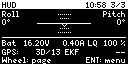 | 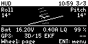 |

| GX15 with v1.0.0: HUD at a bank angle | HUD in HOLD |
| --- | --- |
| 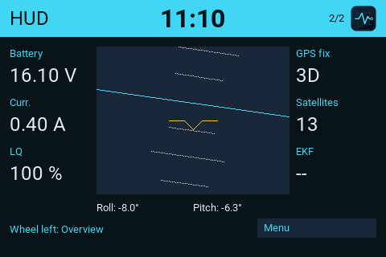 | 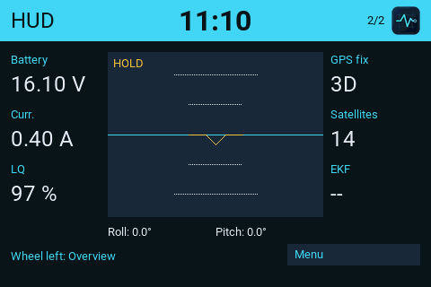 |

[GX15 HUD with the model nearly level](images/screenshots/apmon-color-gx15-hud-level-en-v1.0.0-2026-11-23-111005.png).

| TX16S MK3 with v1.0.0: Level attitude | Tilted horizon |
| --- | --- |
| 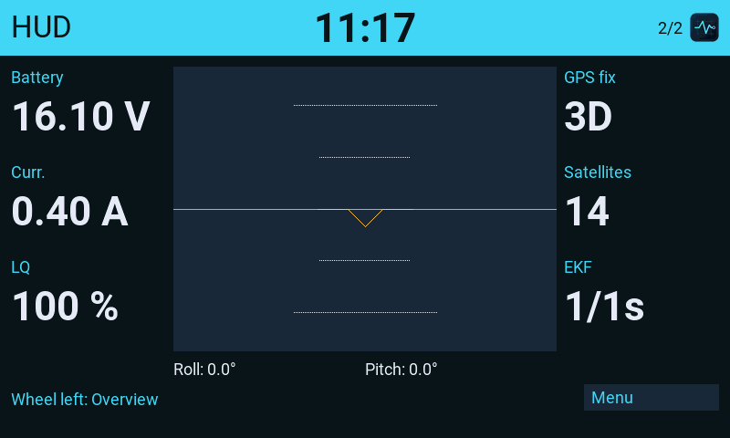 | 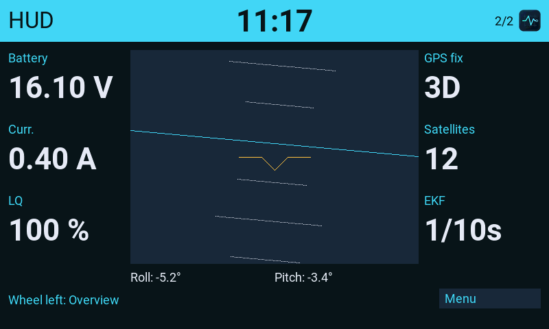 |

### Radio clock and FC message history

The clock is off by default. It shows the EdgeTX radio's time in 24-hour `HH:MM`
format, even without a connection to the model and regardless of the calendar
date. If EdgeTX cannot supply a valid hour or minute, it shows `--:--`.

**FC messages** shows a list, newest first. Use the wheel or **NEXT/PREV** to
browse, or tap **Older/Newer** on COLOR. Press **ENTER** or tap a row on
COLOR to open the full message with its severity, age since it was last
received and any consecutive repeat count (`x3`). **RTN** returns to the list.
`S4` means MAVLink severity 4.

On COLOR, tap **Last FC warning** at the lower right of the full-screen
dashboard to open the latest retained warning or error (S0–S4). The button
only appears when a warning or error is available. **Back** or **RTN**
returns directly to the dashboard without changing the history filter.

| Last FC warning on the GX15 | Last FC warning on the TX16S MK3 |
| --- | --- |
| 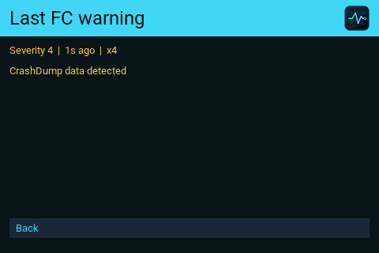 | 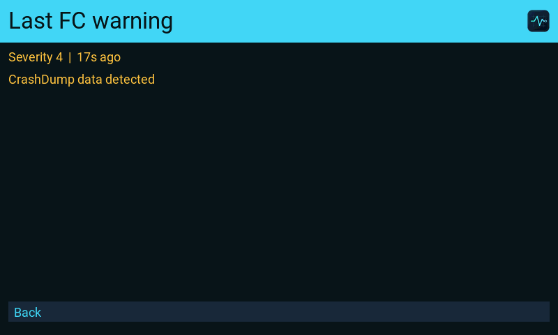 |

[The same warning in the telemetry diagnostics overview](images/screenshots/apmon-color-gx15-diagnostics-en-v0.9.0-2026-11-23-091154.png).

Use **Filter: All** to switch between all messages and **Warnings & errors**.
Use the wheel or **PREV** from the newest row to reach the filter, then press
**ENTER**. On COLOR, you can also tap the filter directly. The warnings view
shows severities **S0 through S4** and hides all other messages without
deleting them.

| GX12 with v0.5.0: All messages | GX12 with v0.5.0: Warnings |
| --- | --- |
| 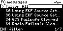 | 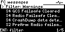 |

| GX15 with v0.6.0: All messages | GX15 with v0.6.0: Warnings & errors |
| --- | --- |
| 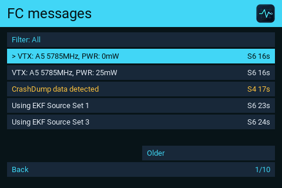 | 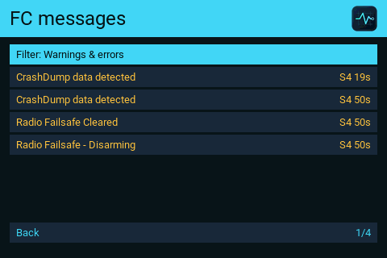 |

Confirmed transitions in the FC status appear as **`[ARMED]`** and
**`[DISARMED]`**. Markers remain visible with the warnings filter. No marker is
created for the first reported state, including after an FC status gap. APMon
does not infer transitions from switch positions. The history holds **12 messages
and 4 markers on SW** or **32 messages and 8 markers on COLOR**. Markers do not
displace messages. Reloading APMon clears the history.

| TX16S MK3 with v0.6.0: All messages | TX16S MK3 with v0.6.0: Warnings & errors |
| --- | --- |
| 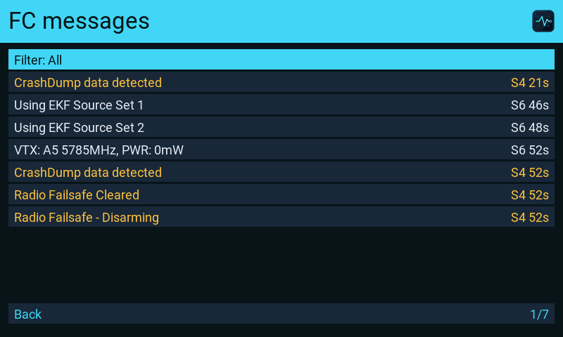 | 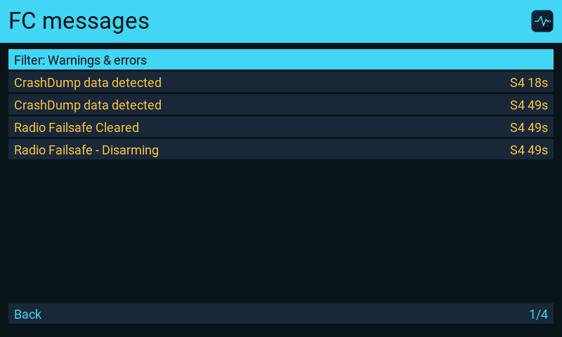 |

[Armed markers with the warnings filter active (German, v0.5.0)](images/screenshots/apmon-color-tx16s-mk3-messages-de-v0.5.0-2026-11-22-113025.png)

### GPS details

Open **GPS details** from the project menu. On SW, five entries fit on screen
at once. Scroll past **Last armed period** for **GPS details**, then press
**ENTER**. On COLOR, you can also tap the entry when it is visible.

| GX12 (SW) | GX15 (COLOR) |
| --- | --- |
| 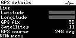 | 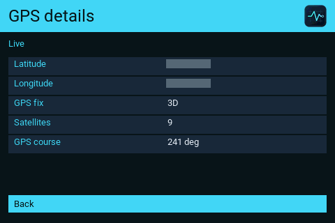 |

**TX16S MK3 (COLOR, 800 × 480, APMon v0.7.0):**

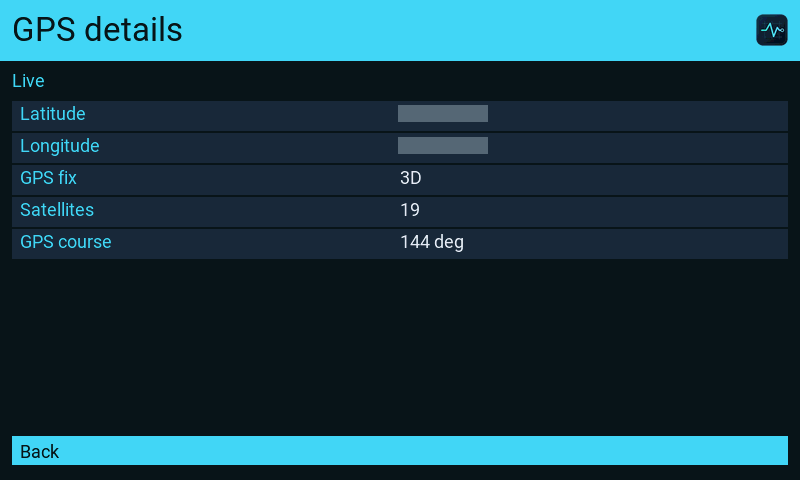

*GX12 and GX15 captures are from APMon 0.6.0. Coordinates are masked in all three screenshots.*

Coordinates are shown in decimal degrees. APMon needs a fresh, valid `GPS`
reading and a confirmed position fix to show **Live**. To avoid flicker
between updates, **Live** can persist for up to 1.5 seconds after the last
fresh reading while the GPS reading remains valid and the fix confirmed.
ArduPilot passthrough reports the fix type (2D, 3D, DGPS, RTK float or
RTK fix). A configured, verified `gpsfix` sensor can confirm a fix without
specifying its type. APMon never infers a fix from coordinates or satellite
count. While the position is live, `Sats` and `Hdg` each hold their last fresh
value for up to 1.5 seconds. Invalid, unavailable or expired readings show `--`.
`Hdg` is GPS course over ground, not the aircraft's yaw.

After position data or fix confirmation is lost, **Not live** marks the last
verified coordinates and shows the time since APMon last saw them live.
Until the first verified position, coordinates are blank (`--`).
The position is kept only in memory and disappears when APMon reloads.
No position is written to the SD card and no Home arrow is shown.

### Telemetry diagnostics

Open **Telemetry diagnostics** in the project menu. On SW, it is visible
below **Clock**. On COLOR, you can also tap the entry. The overview
separates RC link quality, EdgeTX sensors, FC status packets and FC text
messages. Only an ArduPilot status packet resets the FC status age. GPS and
text updates do not count as status packets.

**Sensors** shows each source's name, status and last value accepted by APMon.
Browse with the wheel or **NEXT/PREV**, or use the touch controls on COLOR.
After a sensor drops out, its cached value remains visible only as the last
value, not as live telemetry. Unconfigured sensors are not counted. Valid
readings are not flight clearance.

| GX15 with v0.9.0: Telemetry diagnostics | Sensor list |
| --- | --- |
| 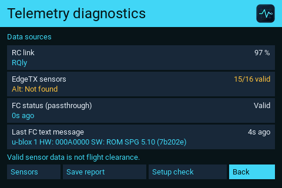 | 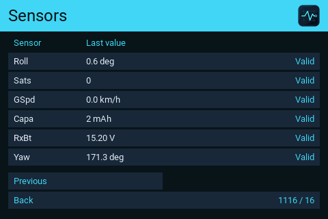 |

| GX12 with v0.9.0: Telemetry diagnostics | Sensor details |
| --- | --- |
| 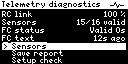 | 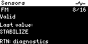 |

| TX16S MK3 with v0.9.0: Telemetry diagnostics | Sensor list |
| --- | --- |
| 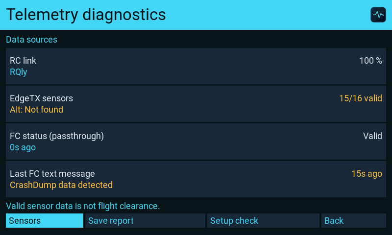 | 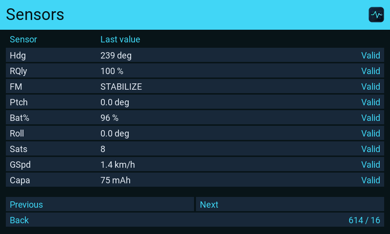 |

[TX16S MK3 diagnostics with a valid FC status and a separate GPS or compass warning](images/screenshots/apmon-color-tx16s-mk3-diagnostics-en-v0.9.0-2026-11-23-092316.png).

### Telemetry setup check

Open **Project menu → Telemetry diagnostics → Setup check**. Use the wheel
or **NEXT/PREV** to browse on SW, or tap **Previous/Next** on COLOR. It checks
RC link quality, FC status, GPS coordinates, GPS fix type, battery voltage,
current and the mAh counter. The check shows the source and its status and,
where appropriate, suggests a next step. For example, valid GPS coordinates
can coexist with a fix type that was never received. The fix-type check uses
ArduPilot passthrough, not satellite count or coordinates. The check never
changes radio or FC settings and is not a flight-readiness check.

In v1.0.0, the check also shows the names
configured in `config.lua` in lookup order and distinguishes a detected
source from one that supplies an accepted value. On SW, long lists of
aliases may be shortened. **Relative altitude** checks the explicit mapping
used by the armed summary. Set `relativeAltitudeSensor` only after verifying
that the source reports height above Home. APMon does not pick a GPS altitude
source for the summary automatically.

| GX12: 3D fix | GX15: Waiting for a fix |
| --- | --- |
| 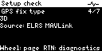 | 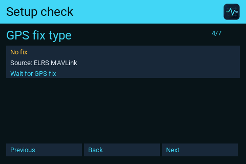 |

[GX12 telemetry diagnostics with Setup check selected](images/screenshots/apmon-sw-gx12-diagnostics-en-v0.9.0-2026-11-23-091731.png).
On the TX16S MK3: [valid FC status from ELRS MAVLink](images/screenshots/apmon-color-tx16s-mk3-setup-check-fc-status-en-v0.9.0-2026-11-23-092313.png).

### Diagnostic report

Open **Project menu → Telemetry diagnostics → Save report**. Use the wheel
and **ENTER** on SW, or tap the buttons on COLOR. Confirm **Without FC text**
to write `/APMon-report.txt` to the SD card. A new report replaces the old one.
APMon displays the path on success or a write error on failure.

| GX15 with v0.9.0: Export confirmation | Report saved |
| --- | --- |
| 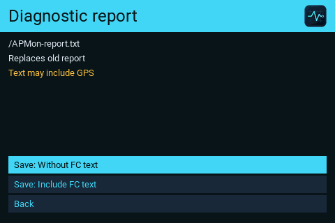 | 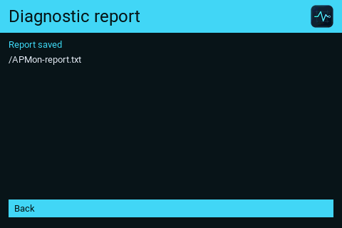 |

| GX12 with v0.9.0: Export confirmation | Report saved |
| --- | --- |
| 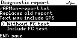 | 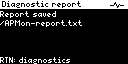 |

On the TX16S MK3: [export confirmation without FC text](images/screenshots/apmon-color-tx16s-mk3-report-confirm-en-v0.9.0-2026-11-23-092259.png)
and [save result](images/screenshots/apmon-color-tx16s-mk3-report-saved-en-v0.9.0-2026-11-23-092301.png).

The report contains the APMon and EdgeTX versions, configured sensor names and
detected sources with their validity, FC status and its age, and the severity,
age and repeat count of up to eight recent FC messages. **Radio time** is the
local date and time at confirmation (`YYYY-MM-DD HH:MM:SS`). If the radio does
not provide a valid calendar date and time in 2020–2099, the report says
**Unavailable**. A plausible time is not proof that the clock is synchronized.
The report contains no sensor
values or GPS coordinates from sensors. **Include FC text** is a separate
choice for each export. FC text can itself contain location data. Review the
report before sharing it. There is no background logging or automatic upload.

[Confirmation with the optional FC text selected](images/screenshots/apmon-color-gx15-report-confirm-fc-text-en-v0.9.0-2026-11-23-091246.png).

### Post-disarm summary

Open **Project menu → Last armed period** to review the last completed summary.
On SW, scroll past **Telemetry diagnostics** to find it. On COLOR, select or
tap the entry. The page never opens automatically on disarm. The summary stays
in memory until APMon reloads.

- **Time armed:** elapsed time between confirmed arming and disarming,
  including time on the ground. If the start was not observed or FC status
  dropped out, APMon shows `--` rather than guessing.
- **Min. RC LQ:** lowest fresh, valid `RQly` sample while the FC confirmed
  armed status. No valid sample shows `--`. A reported `0 %` remains `0 %`.
  The minimum is separate from FC data gaps and is not proof of RC link loss.
- **Measurements:** minimum battery voltage and peak current from fresh
  readings while armed. Charge used is the difference between mAh counter
  samples within three seconds of the start and end. If those samples are
  missing, the source changes, or the counter goes backwards, the result is
  unknown.
- **Max. relative altitude:** `--` by default. Set `relativeAltitudeSensor` in
  [`config.lua`](SD/SCRIPTS/APMON/config.lua) to the exact sensor name (e.g.
  `GAlt`) only after confirming that it reports height **relative to Home**
  in your setup. The summary does not fall back to another altitude source
  or estimate ground clearance.

If the summary is **Incomplete**, open **Details** to see why. For example,
**FC status missing 2x** means two separate gaps in FC status.
**Current missing 1x** means the current sensor was unavailable during one
observed interval. Consecutive missing samples of the same source count
as one gap. APMon counts FC status, voltage, current, the mAh counter and
relative altitude separately. Relative altitude is checked only if configured.
APMon does not attribute a gap to individual sensors while the armed status
cannot be confirmed. On SW, use the wheel or **NEXT/PREV** if a second
details page is indicated.

Observed readings remain visible. A data gap is **not proof of RC link loss**.
Loss of telemetry is never treated as disarming.

| GX12 with v0.7.0: Complete summary | Details for the same period |
| --- | --- |
| 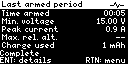 | 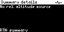 |

While the first armed period is still being recorded: [GX12](images/screenshots/apmon-sw-gx12-summary-en-v0.7.0-2026-11-22-192608.png)
and [GX15](images/screenshots/apmon-color-gx15-summary-en-v0.7.0-2026-11-22-193114.png).

| GX15 with v0.7.0: Complete summary | Details for the same period |
| --- | --- |
| 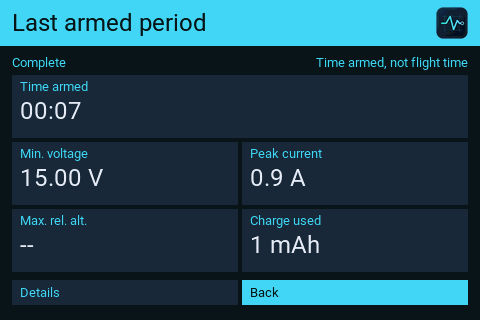 | 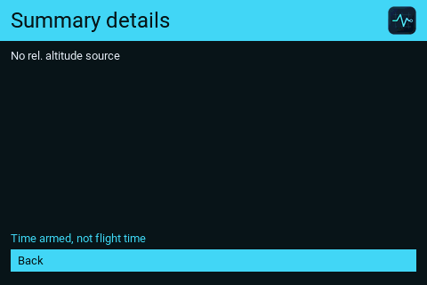 |

| TX16S MK3 with v0.7.0: Complete summary | Details for the same period |
| --- | --- |
| 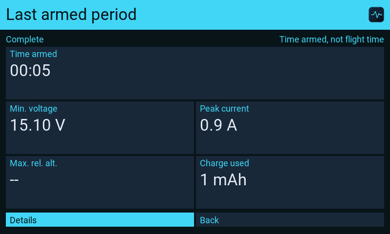 | 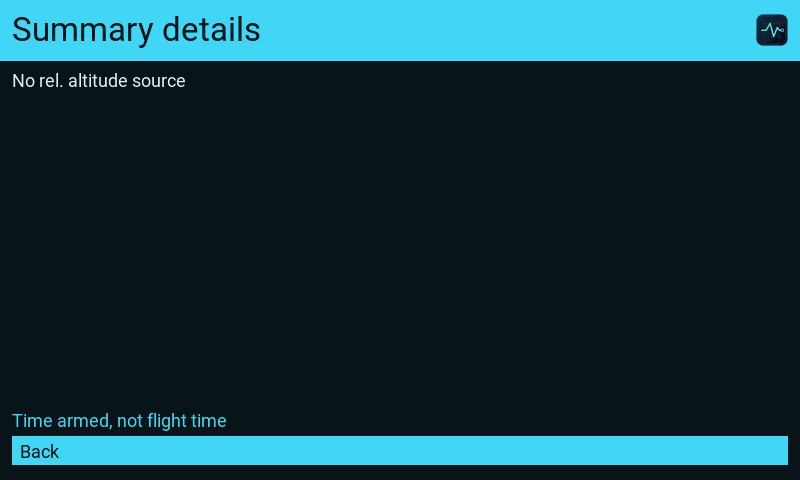 |

## Sensor configuration

Edit [config.lua](SD/SCRIPTS/APMON/config.lua). Mappings are shared across all
models on the card. Compare values and units with the flight-controller display
before relying on them.

| Reading | Default source | Expected unit / meaning |
| --- | --- | --- |
| Battery voltage | `RxBt` | Voltage in V. Verify that the sensor measures the flight battery, not the receiver or BEC. |
| Battery current | `Curr` | A |
| Battery remaining | `Bat%` | Percentage reported by the FC, not estimated from voltage |
| Battery used | `Capa` | Consumed mAh |
| Altitude | `Alt`, falling back to `GAlt` | Meters. Verify the altitude reference. |
| Climb rate | `VSpd` | m/s |
| Horizontal GPS speed | `GSpd` | km/h |
| Roll / pitch / yaw | `Roll` / `Ptch` / `Yaw` | Standard CRSF radians, converted to degrees |
| Satellites | `Sats` | Count, not proof of a fix |
| GPS course | `Hdg` | Course over ground in degrees, not necessarily nose direction |
| Flight mode | `FM` | FC mode text |
| RC link quality | `RQly` | Percentage of received control packets |
| GPS position | `GPS` | Table containing `lat` and `lon` |

The adapter reads GPS coordinates and course, but these are not separate fields
in the current compact main views.

Example for a renamed voltage sensor:

```lua
voltage = { names = { 'FlightBat' }, unit = 'V', decimals = 2, min = 0.1 },
```

`names` can contain ordered aliases. Adjust `scale` when source units differ:
for example, `3.6` converts m/s to km/h. Use `1` for an angle sensor already in
degrees. Standard CRSF attitude sources use `180 / math.pi`.

Use real downlink telemetry sources. Channel and switch positions do not confirm
Armed, the active EKF source set or VTX settings.

## Data meaning and validity

### Missing and stale readings

`--` means missing, unmapped, invalid or stale data. Valid zero readings are kept.

| Source | Validity |
| --- | --- |
| EdgeTX sensors | EdgeTX `isCurrent`. In the target firmware, last readings can remain visible for about 20 seconds after a loss. |
| Passthrough GPS fix / Armed | About 3 seconds since the last corresponding frame |
| FC text / last EKF source-set message | Historical message with age, not a continuously confirmed state |

APMon does not require `isFresh`: its short window would hide slower sensors
that are still current. APMon has no independent MAVLink heartbeat monitor.
RC link quality is not signal strength, proof of complete FC telemetry, or
confirmation that the aircraft is ready to fly.

### GPS, altitude and heading

- Fix status comes from passthrough, not an estimate based on satellite count.
- “Yes” means at least a 2D fix. DGPS, RTK Float and RTK Fixed have separate labels.
- **GAlt** means *GPS Altitude*. However, normal ELRS 4.1.0 MAVLink builds populate
  it from `GLOBAL_POSITION_INT.relative_alt`, i.e. altitude relative to Home.
  A build with `USE_MAVLINK_GPS_ALTITUDE` uses GPS altitude above mean sea level
  instead. The displayed name identifies the sensor, not a ground-distance measurement.
- Compass direction is derived from yaw. GPS course and vehicle heading are
  different quantities, especially while stationary.

### Flight mode and EKF

`STAB`, `LOIT` and `GUID` are expanded to `STABILIZE`, `LOITER` and `GUIDED`.
A trailing asterisk is removed from mode text. Armed/Disarmed is read separately
from feedback.

The EKF field only recognizes the FC text `Using EKF Source Set 1/2/3`. An old
message is not proof that the source set is still active, particularly after an
FC restart.

## Troubleshooting

| Problem | What to check |
| --- | --- |
| APMon is missing from the selection | Verify SD layout and restart. Tools: `/SCRIPTS/TOOLS/APMon.lua`. SW telemetry screen: `/SCRIPTS/TELEMETRY/APMon.lua`. COLOR widget: `/WIDGETS/APMon/main.lua`. |
| Module load error | Install the complete matching package, not just its main file. Remove old APMon `.luac` files. |
| SW reports `not enough memory` | Install the complete latest SW package, remove old APMon `.luac` files and restart the radio. If it still happens, temporarily disable other Lua scripts in the model and retest. |
| Only mode and RC link quality work | Check EdgeTX's Telemetry screen first. If readings are absent there too, investigate the upstream telemetry path. |
| GPS fix / Armed remain unknown | Check ELRS version, MAVLink mode and passthrough reception. |
| Language option missing on COLOR | Restart. Remove and re-add APMon if needed. |
| SW reports “Language not saved” | Check SD write access and free space. |
| “Waiting for home” or GPS/AHRS discrepancy | Inspect FC/EKF status. These originate from the FC, not APMon. |

### Missing telemetry after an FC restart

The FC must send the necessary messages even without a connected ground station
requesting streams. APMon does not change stream-rate parameters or request
message intervals.

For the MAVLink channel associated with the ELRS receiver, ExpressLRS recommends
SR/MAV stream groups at 1 Hz, except `ADSB`, `PARAMS` and `RAW_CTRL` at 0.
Check the correct channel mapping. Do not assume an SR index always equals a
SERIAL port number. After configuration, restart without a GCS and check the
readings. See the [ELRS MAVLink setup guide](https://www.expresslrs.org/software/mavlink/).

### Other Lua telemetry programs

APMon consumes the CRSF Lua queue through `crossfireTelemetryPop()`. Do not run
other raw-telemetry readers, such as Yaapu or the ELRS configuration script,
concurrently when they may share that queue.

### APDiag

The SW package includes the independent `APDiag` telemetry script. It shows raw
EdgeTX API values and validity flags. It does not decode a full MAVLink stream.

## Development and tests

### Repository layout

```text
SD/SCRIPTS/APMON/        Shared adapter, passthrough, sensor configuration, languages
SD/SCRIPTS/TELEMETRY/    Monochrome application and APDiag
SD/SCRIPTS/TOOLS/        SYS → Tools launcher for both display types
SD/WIDGETS/APMon/        Color LCD widget
tests/                  Lua regression tests and deployment tests
deploy.py               SD-card deployment preview and installation
package_sd.py           Build and verify both distribution archives
VERSION                 Project version
LICENSE                 Apache License 2.0
README.de.md            German documentation
```

### Source headers and versioning

All Lua and Python source files have headers recording purpose, project version,
update date, authorship and the `Apache-2.0` SPDX identifier. Christian Baun is
listed under `Authors`. Codex CLI is credited separately for development
assistance. Dates describe the recorded change state, not an assumed original
creation date.

[VERSION](VERSION) is the central project version. Both SD packages and
`deploy.py` copy it to `SCRIPTS/APMON/VERSION` for the menu. When releasing a
new version,
update source-header versions and both READMEs together. Update each changed
file's header date and rebuild the archives before publishing.

### Run tests

From the repository root:

```bash
python3 tests/run.py
python3 -m unittest discover -s tests -p 'test_*.py'
```

The Lua runner uses a local Lua 5.3/5.4 shared library through `ctypes`. A Lua
interpreter can run the Lua suite directly instead:

```bash
lua tests/check.lua
```

Tests cover sensor validation, valid zeroes, stale data, screen bounds, script
lifecycles, navigation, language changes and persistence, passthrough formats,
DGPS and other fix types, Armed, FC/EKF messages and timeouts. The monochrome
suite also runs without string methods and without the `table` library.
Deployment tests check display-based selection, preview behavior and preservation
of unrelated files and saved preferences.

These are **simulation tests**, not complete hardware qualification. Fonts,
physical keys, runtime/memory limits and radio integration still need testing on
each target radio.

### APMon host simulator and GIF demos

The simulator in [`simulate.py`](simulate.py) runs the actual APMon Lua scripts
with synthetic sensors, passthrough packets and scripted wheel, key and touch
input. It checks the message filter, GPS position after data loss, the armed
summary, and a diagnostic report without coordinates or FC text. The simulated
SD card is kept in memory.

```bash
python3 simulate.py --check
python3 simulate.py
python3 simulate.py --profile sw-128x64 --profile color-480x320 --lang de
```

By default it checks both languages on SW 128 × 64 and experimental 212 × 64,
and COLOR 440 × 252, 480 × 320 and 800 × 480. The first command checks only.
GIF generation additionally needs Pillow and a Unicode TrueType font such as
DejaVu Sans (`--font` can select a font explicitly). GIFs go to
`simulator-output/` by default, which Git ignores. Use `--output-dir` to choose
another location. Action captions and touch markers explain the controls.

This is an approximation of the Lua LCD API, not the official EdgeTX
simulator. The GIFs are not hardware screenshots or evidence that a new
radio or resolution is supported.

### Build packages

```bash
python3 package_sd.py
```

After the Lua tests pass, this builds and verifies only `APMon-SW.zip` and
`APMon-COLOR.zip`. Both include the complete license text.

### Add a language

Append an entry to `languages` in [i18n.lua](SD/SCRIPTS/APMON/i18n.lua):

```lua
{ code = 'fr', name = 'Français',
  texts = {
    ['Flugmodus'] = 'Mode de vol',
    ['Satelliten'] = 'Satellites',
    ['FC-Meldung / vor %ds'] = 'Message FC / il y a %ds',
    -- Translate additional keys from the catalogue.
  },
  directions = { 'N', 'NE', 'E', 'SE', 'S', 'SO', 'O', 'NO' },
},
```

Selection menus are generated from the registry. Missing translations or
compass directions fall back to English. Preserve format placeholders such as
`%ds` and check long labels on both displays. Do not reorder existing entries:
EdgeTX saves COLOR choices by index, while SW saves a language code. Original FC
messages are not translated.

## Contributing

Bug reports should include radio model, display variant, EdgeTX/ELRS/ArduPilot
versions, sensor names and units, exact messages and screenshots where helpful.
For missing readings, state whether they are also absent in EdgeTX's Telemetry
screen.

Submit changes as pull requests and run the tests first. New telemetry fields
must document units, meaning and data age. Never replace missing data with an
invented state. Contributions are provided under the project's Apache-2.0 license.

### References

- [EdgeTX Lua documentation](https://luadoc.edgetx.org/)
- [EdgeTX 2.12.5 Lua API](https://github.com/EdgeTX/edgetx/blob/v2.12.5/radio/src/lua/api_general.cpp)
- [EdgeTX 2.12.5 CRSF sensors](https://github.com/EdgeTX/edgetx/blob/v2.12.5/radio/src/telemetry/crossfire.cpp)
- [ExpressLRS MAVLink](https://www.expresslrs.org/software/mavlink/)
- [ELRS 4.1.0 MAVLink conversion](https://github.com/ExpressLRS/ExpressLRS/blob/4.1.0/src/lib/MAVLink/MAVLink.cpp)
- [ELRS 4.1.0 passthrough field encoding](https://github.com/ExpressLRS/ExpressLRS/blob/4.1.0/src/lib/MAVLink/ardupilot_custom_telemetry.cpp)
- [MAVLink messages and GPS fix types](https://mavlink.io/en/messages/common.html)

## License

APMon is released under the **Apache License, Version 2.0**. See [LICENSE](LICENSE)
for the complete text.

EdgeTX, ExpressLRS and ArduPilot are independent projects with their own licenses.
Linked documentation and protocol references are not relicensed as APMon code.
